# Claudion Checkin

**Employee attendance and HR self-service for Frappe and ERPNext on iOS and Android.**

Employees use Claudion Checkin to record check-ins, check-outs and breaks, review their attendance history, submit HR requests, read company notifications and view the employee records their company makes available. The app connects each employee to their company's backend. Company and employee settings determine which workflows, attendance rules and documents are available.

[Product walkthrough](#product-walkthrough) · [PowerPoint guide](#powerpoint-guide) · [Screenshot index](#screenshot-index) · [Development and rollout](#development-and-rollout)

| Home menu and employee records | Attendance in progress | Automatic attendance |
| --- | --- | --- |
| <a href="docs/screenshots/home-menu-and-records.png">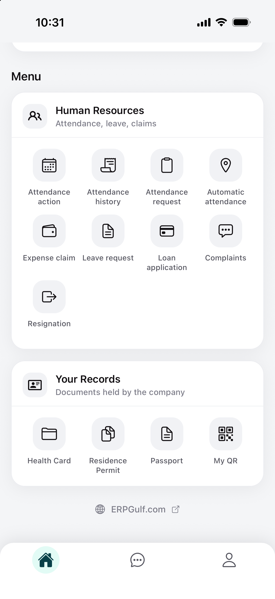</a> | <a href="docs/screenshots/attendance-checked-in.png">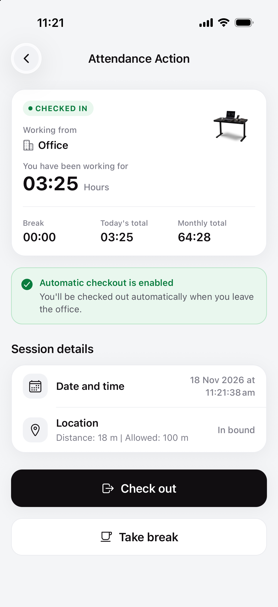</a> | <a href="docs/screenshots/automatic-attendance.png">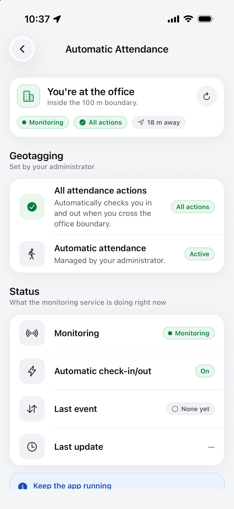</a> |

## Product walkthrough

### Company setup and sign-in

| Sign-in path | Employee experience | Deployment dependency |
| --- | --- | --- |
| **Scan QR code** | Scan the company-provided QR code with the camera or select it from Photos. After provisioning the workspace, enter the account password on the sign-in screen. A previously provisioned device can return directly to password sign-in. | A company-issued provisioning QR and valid account credentials. |
| **Sign in with mobile number** | Enter a company code and the mobile number registered with the employer. The app resolves the company's workspace and presents the next authentication step for that account. | Company-code lookup configured for the deployment and a compatible backend. |
| **Sign in with mobile number using Server address** | Choose **Server address**, enter the company's HTTPS address and continue with the registered mobile number. The app remembers the company after it starts a valid authentication flow. **Change company** lets the employee select a different workspace. | The company's HTTPS address and a compatible backend. This path connects directly to the company server. |

Depending on company policy and the employee's account, mobile sign-in asks for a password, a one-time code (OTP), or password followed by OTP. Mobile account setup starts with an OTP and can require or offer password creation. Password creation and recovery use an OTP when the account's flow offers those actions. The supported native build and the live integration checks are documented in [Mobile sign-in](docs/mobile-sign-in.md) and [Authentication architecture](docs/architecture/authentication.md).

| Welcome | Company code | Server address | QR scanner |
| --- | --- | --- | --- |
| <a href="docs/screenshots/welcome.png">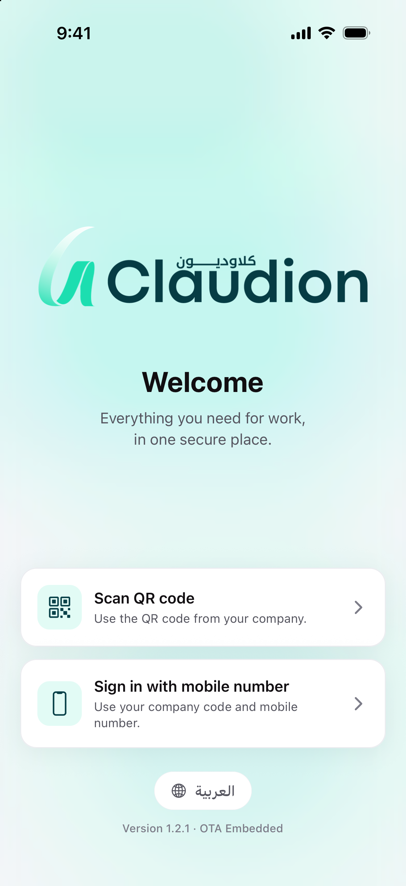</a> | <a href="docs/screenshots/mobile-company-code.png">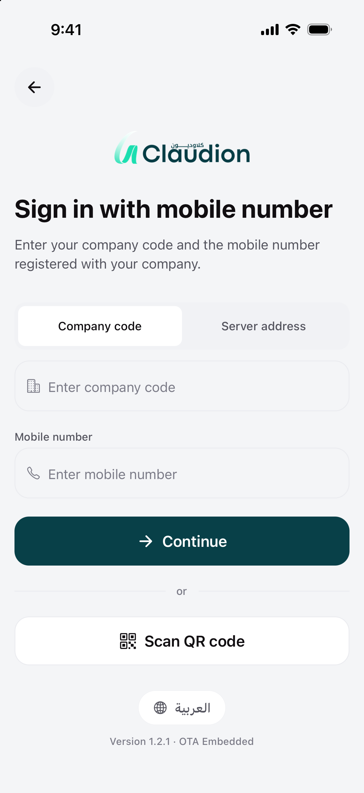</a> | <a href="docs/screenshots/mobile-server-address.png">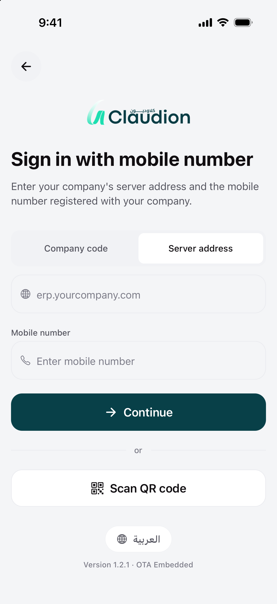</a> | <a href="docs/screenshots/qr-scanner.png">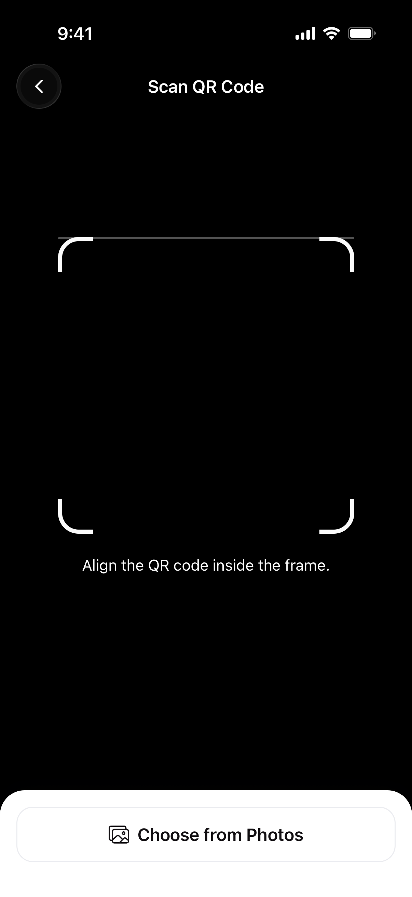</a> |

### Home and Quick Access

- **Home** greets the signed-in employee and provides an unread notification badge. The **Human Resources** menu groups Attendance action, Attendance history, Attendance request, Automatic attendance, Expense claim, Leave request, Loan application, Complaints and Resignation. The app applies company settings to the available tiles.
- **Quick Access** lets the employee pin and unpin frequently used actions. The chosen shortcuts appear at the top of Home, so employees can reach their daily tasks without opening the full menu.
- **Your Records** opens the documents the company provides. **My QR** opens the employee's personal QR code. The Home, Chat and Profile tabs are available from the bottom navigation. Chat and the Vacation list shortcut currently display **Coming soon**. [Home menu](components/Home/YourLavas.jsx) · [Quick Access options](utils/quickAccess.js) · [Chat](screens/Chat.jsx)

[View the Quick Access picker](docs/screenshots/quick-access.png)

### Attendance

| Workflow | What the employee can see or do |
| --- | --- |
| **Attendance Action** | Check in to start a work session and check out to close it. See the current session state, elapsed working time, available daily and monthly totals, and the session date and time. When location applies, the screen can show distance from the workplace, the allowed radius and whether the device is within range. |
| **Manual location and photo rules** | The employee and company policies determine location restrictions, whether checkout can occur outside the check-in boundary, and whether the app opens the camera for photo attendance. Manual check-ins and check-outs require a connection to the company server. |
| **Breaks** | When enabled, start a break during an active session and optionally add a reason. The screen shows an elapsed break timer and the applicable limit. The employee can end the break or complete checkout. |
| **Attendance History** | Review date-grouped check-in and check-out times, automatic markers where recorded, and device or terminal labels when supplied by the server. Saved automatic punches can appear in the same timeline with sync status before the server confirms them. |
| **Attendance Request** | Enter a date and time range, choose **Work From Home** or **On Duty**, and optionally attach a supporting document. The **Your requests** list shows previous submissions and their current statuses. |
| **Automatic Attendance** | For eligible employees, entering or leaving the configured workplace boundary can create a check-in or check-out. The monitoring screen shows workplace presence when it can verify a position, policy, monitoring status, last transition and last update. |

[Attendance architecture](docs/architecture/attendance.md) · [Attendance Action](screens/AttendanceAction.jsx) · [Attendance History](screens/AttendanceHistory.jsx) · [Attendance Request](screens/AttendanceRequest.jsx)

| First sign-in explanation | Break in progress | Attendance request |
| --- | --- | --- |
| <a href="docs/screenshots/automatic-attendance-onboarding.png">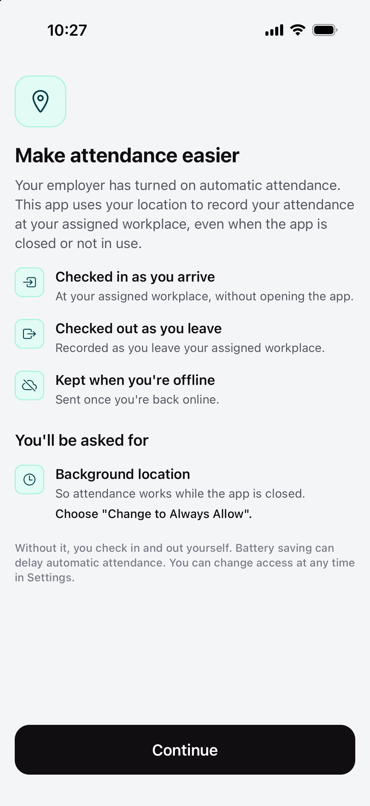</a> | <a href="docs/screenshots/attendance-break-in-progress.png">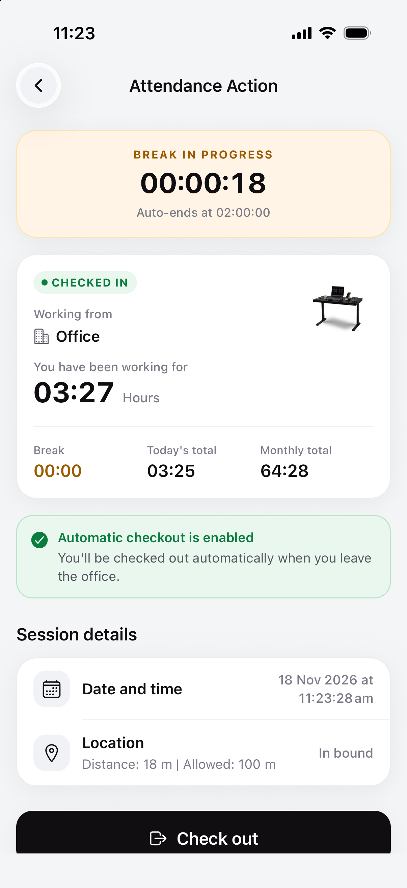</a> | <a href="docs/screenshots/attendance-request.png">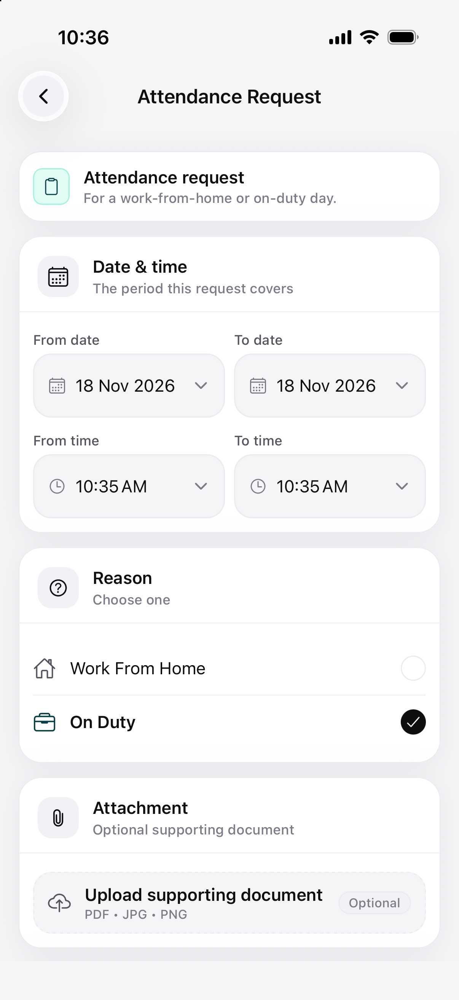</a> |

#### Automatic attendance and offline sync

1. **Employer enables monitoring.** The company must enable geotagging, and the employee must be assigned the mode that records automatic check-in and check-out. Eligible employees can see a first-sign-in explanation and grant the location access needed by their device. The Automatic Attendance page displays the administrator's configuration and the device's current monitoring status.
2. **The phone reports a workplace boundary crossing.** The app can register eligible arrivals and departures from a company-defined location. Manual and automatic attendance share the same session, so an eligible departure can close a session that the employee opened with a manual check-in.
3. **Eligible punches can be saved locally.** When the server cannot be reached, the app can queue automatic punches under the company's offline attendance configuration, cached employee policy and tenant support. Attendance History distinguishes saved punches awaiting sync from server-confirmed records. Profile includes **Sync pending attendance** with status, review and sync controls where applicable.
4. **The device gets an opportunity to upload.** Android can schedule background sync when the connection returns. iOS can process online crossings during a short background wake. An offline punch on iOS can wait for another qualifying location event, background push or app launch. Permissions, power management and OS scheduling affect timing. Force-stopping on Android or force-quitting on iOS can suppress background delivery until the employee reopens the app. [Background attendance](docs/android-background-attendance.md) · [Offline attendance](docs/architecture/offline-attendance.md)

The app treats a confirmed loss of required location access separately from weak or unavailable GPS. For eligible automatic sessions on supported builds, a confirmed loss can close the matched automatic session. Recovery requires restored access and a reliable location check. [Location-access checkout and recovery](docs/location-access-checkout.md)

### HR self-service

| Workflow | What the employee submits | What the employee sees after submission |
| --- | --- | --- |
| **Leave Application** | A leave type supplied by the company, a start and end date, an optional reason and an optional supporting document. The form shows the selected type and requested duration before submission. The **Remote** leave type requires acknowledgement of the remote-work policy. | A success confirmation and a **Your leave** list with request dates and backend status. The screen explains that the manager reviews the request. |
| **Expense Claims** | Expense date, a company-provided expense type and a positive amount, with an optional description and receipt or supporting document. | A confirmation and searchable **History** with expense type, date, amount, status and an attachment link when available. Search covers type, amount, date, status and receipt name. |
| **Loan Application** | A company-provided loan product, requested amount, monthly repayment amount, repayment method, reason and the first supporting attachment. A second attachment is optional. A summary shows the requested amount, monthly repayment and attachment count. | A submission confirmation and a **Your applications** list with the amount, available repayment details and backend status. The company's approval workflow determines the outcome. |
| **Complaints** | A written issue or feedback for the relevant department, with an optional supporting attachment. | A submission confirmation. The screen explains that the relevant department will review the complaint. |
| **Resignation** | A resignation date, a reason and up to two optional attachments. The employee reviews a confirmation prompt before sending. The prompt explains that withdrawal is unavailable from the app. | A confirmation and a reference when returned by the backend. The screen directs the employee to wait for HR review and next steps. |

The attachment picker offers **Take Photo**, **Choose Image** and **Browse Files**, with PDF, JPG and PNG shown in the interface. The forms indicate which attachments are optional or required. A success confirmation acknowledges a submission. The history status, where provided, shows the company's review outcome. [Attachment picker](components/common/AttachmentSheet.jsx) · [Feature availability reference](docs/capability-enforcement/01-FEATURE_MATRIX.md)

| Leave application | Expense claims | Loan application | Supporting documents |
| --- | --- | --- | --- |
| <a href="docs/screenshots/leave-request.png">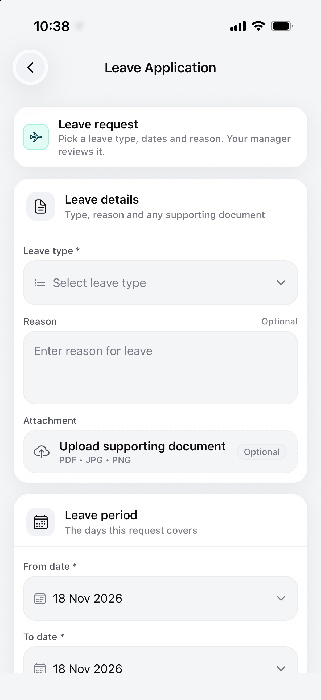</a> | <a href="docs/screenshots/expense-claim.png">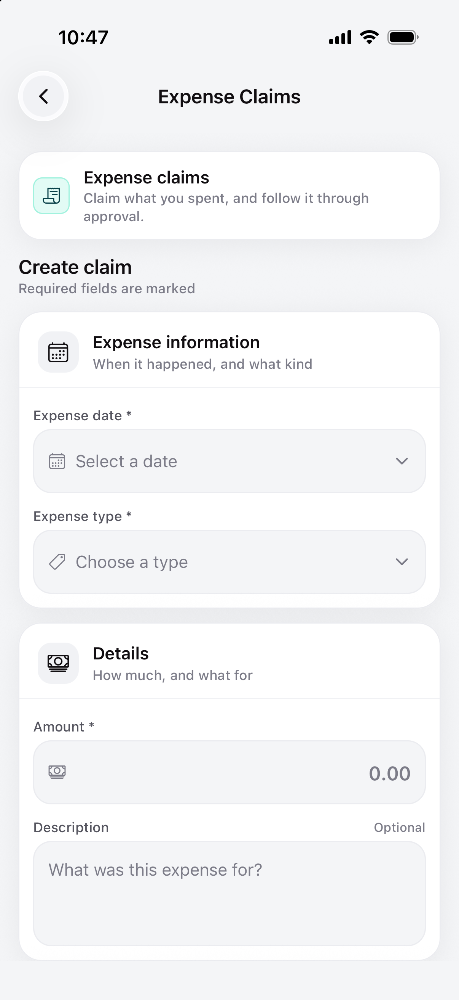</a> | <a href="docs/screenshots/loan-application.png">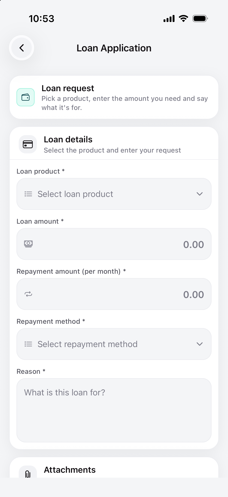</a> | <a href="docs/screenshots/loan-attachment-options.png">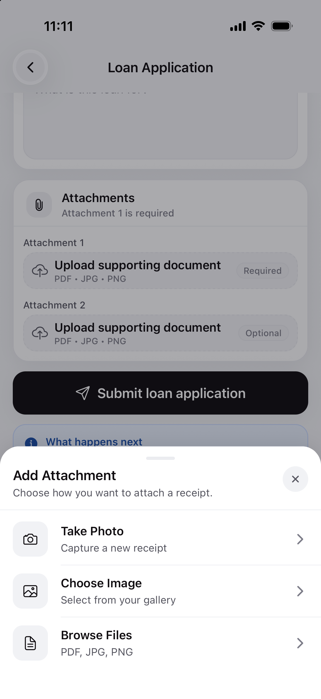</a> |

[View the complaints form](docs/screenshots/complaint-form.png) · [View the resignation form](docs/screenshots/resignation-form.png)

### Notifications, employee records and My QR

| Area | What the employee sees |
| --- | --- |
| **Notifications** | Open the bell on Home to see the inbox, unread count and entries grouped by date. Search titles and message text. Tap an item to read its full message and mark it as read. Push delivery also depends on backend configuration and device notification permissions. |
| **Employee records** | Open company-provided records from **Your Records**. The supplied captures show **Health Card**, **Residence Permit** and **Passport**. The details view displays the fields the backend provides, including status, validity date and remaining days when present. An upcoming renewal can be highlighted in the validity card. Record titles, fields and values vary by deployment. |
| **My QR Code** | Display the employee QR image returned by the company server. The screen identifies it as a personal code for attendance or identity verification where the company uses it. This is a signed-in employee screen. The QR scanner on Welcome is the company provisioning flow. |

[Notifications](screens/Notifications.jsx) · [Record detail view](components/ShortcutDetails/ShortcutDetailsModern.jsx) · [My QR Code](screens/MyQrCode.jsx) · [Push configuration](docs/development-and-release.md#firebase-cloud-messaging-fcm)

### Profile, language and appearance

- **Profile** shows the signed-in account, app version, device and OS information, update status and sign-out. It also contains attendance sync status and the offline sync alert preference.
- **Language** can be changed between English and Arabic in Profile and on supported sign-in screens. App navigation and app-owned forms adapt to Arabic right-to-left layout. Tenant-provided names, descriptions and messages can stay in the language supplied by the backend.
- **Appearance** offers System, Light and Dark with the redesigned Home experience. The setting applies across the themed screens. The legacy presentation uses the light palette. [Localization](docs/localization.md) · [Profile](screens/Profile.jsx) · [Appearance](hooks/useAppTheme.js)

| Profile preferences | Dark attendance | Arabic attendance | Arabic leave form |
| --- | --- | --- | --- |
| <a href="docs/screenshots/profile-preferences.png">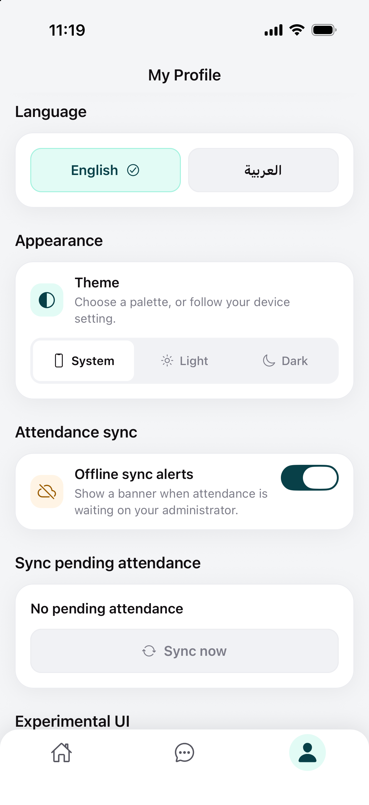</a> | <a href="docs/screenshots/dark-attendance-action.png">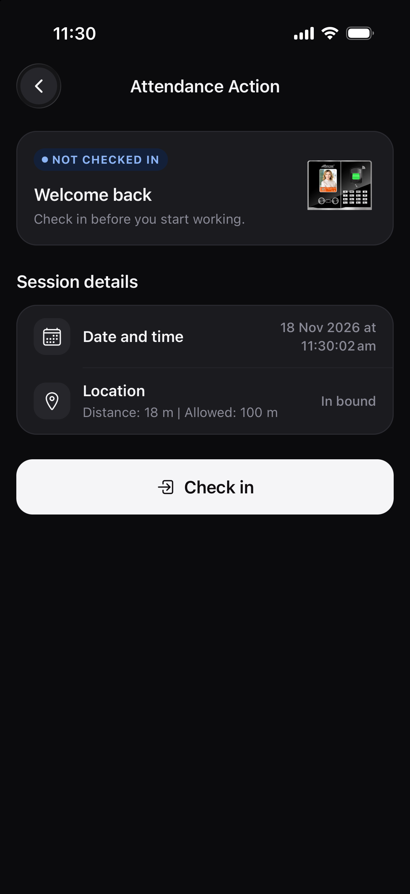</a> | <a href="docs/screenshots/arabic-attendance-action.png">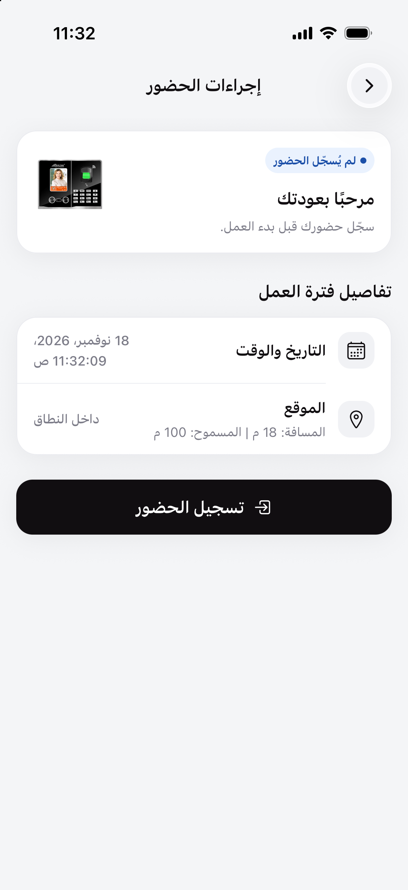</a> | <a href="docs/screenshots/arabic-leave-request.png">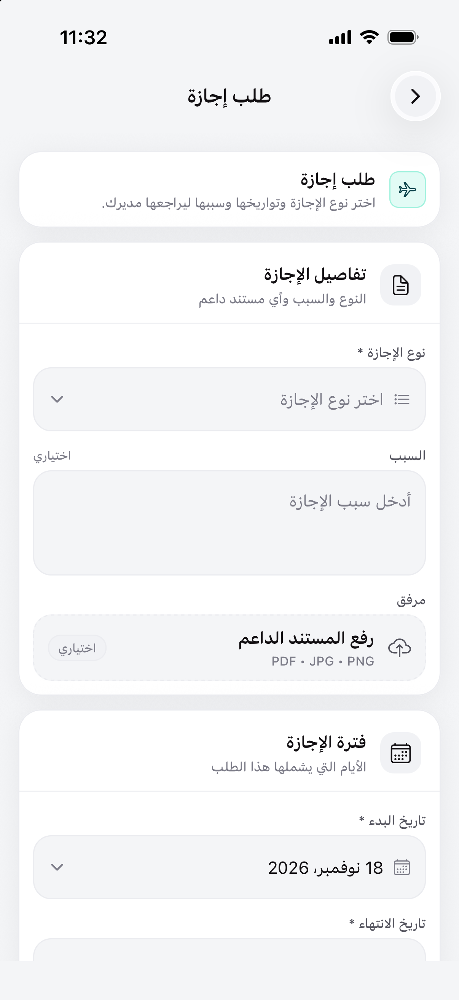</a> |

## PowerPoint guide

Use the slide titles and messages below as presentation copy. Open a linked screenshot to download the full-resolution PNG for PowerPoint. The capture IDs identify the exact files in **Claudion App Screenshots**, including those available only in the original folder. [Screenshot index](#screenshot-index)

| Slide title | Suggested on-slide copy | Screenshot IDs and presenter cues |
| --- | --- | --- |
| **Attendance and HR self-service on mobile** | Claudion Checkin gives employees one mobile place to record attendance, send HR requests and view company records. | **01-01, 02-02.** Start with the Welcome screen and Home menu so the audience can see the scope in two views. |
| **Connect employees to their company workspace** | Employees can use a company-issued QR and password, or sign in with their registered mobile number under company policy. | **01-01 to 01-05.** Show the two entry points, then the Company code and Server address choices. Explain that the account flow determines the next credentials. |
| **Put everyday actions within reach** | Employees can pin the attendance and HR actions they use most to Quick Access. | **02-01 to 02-03.** Move from the Home menu to the shortcut picker and point out selected shortcuts. |
| **See the work session as it happens** | Check in, record a break, check out and review the attendance timeline. | **03-08, 03-01, 03-07, 03-02.** Walk through ready, active, on break and recorded history states. |
| **Record arrivals and departures at eligible workplaces** | Employer-enabled automatic attendance can record arrivals and departures at a configured workplace boundary. Eligible automatic punches can sync later. | **01-06, 03-05, 11-03.** Show the permission explanation and monitoring state. Describe offline sync as pending until the server confirms the record. |
| **Request attendance adjustments and leave** | Employees can send attendance and leave requests with the relevant dates and supporting evidence, then follow the request status. | **03-03, 03-04, 04-02, 04-04, 04-06.** Connect the form to the submitted record. Describe approval as a company workflow. |
| **Submit expenses and loan applications** | Employees enter claim details or loan terms, attach documents, and see the status returned by their company. | **05-01, 05-05, 06-01, 06-06, 06-07.** Show a form and the history it feeds. Highlight the required first attachment on a loan. |
| **Send employee submissions to HR** | Employees can file complaints and submit resignations with supporting documents. | **07-01, 08-01, 08-03, 08-05.** Show the resignation confirmation and, on a cleared capture, the submitted reference. |
| **Read updates and find company records** | The inbox surfaces company messages. Your Records shows available document details and validity information. | **09-01, 09-02, 10-01 to 10-04.** Show the inbox-to-detail flow and explain what the validity card displays. Use organization-approved captures for populated records and QR screens. |
| **Offer English, Arabic and dark mode** | Employees can choose English or Arabic and adapt the appearance to their device or preference. | **11-03, 12-03, 13-03, 13-04.** Show the same attendance action in dark mode and Arabic, then show the mirrored leave form. |

### Live demo readiness

| Area | Confirm before the presentation |
| --- | --- |
| **Account and sign-in** | Use an approved demonstration workspace and account. Confirm the QR and mobile sign-in paths you plan to show, including the specific OTP or password flow on the installed build. |
| **Attendance and location** | Confirm the demonstration employee's location, photo and break policy. For automatic attendance, verify workplace coordinates and radius, employee eligibility, precise and background location access and active monitoring on that device. |
| **Offline attendance** | Confirm the tenant supports offline uploads. Use saved and synced states that you can verify, and account for the different Android and iOS background opportunities if you demonstrate reconnection. |
| **Requests and employee records** | Confirm which modules, request types, loan products, documents and review statuses the workspace provides. Use source captures approved for the audience whenever a screen displays names, record numbers, financial details, documents, notifications or scannable QR codes. |

## Screenshot index

The source folder **Claudion App Screenshots** contains **63 PNGs in 13 folders** and shows the redesigned iOS interface. Each ID combines the folder number and the original filename number. Linked filenames open full-resolution copies in this repository. The selected images omit captures with visible employee names, employee document numbers, financial submissions or scannable QR codes.

### Sign-in and first-use onboarding

Source folder **01 Sign in**.

| ID | Original filename | What it shows |
| --- | --- | --- |
| 01-01 | [01 Welcome.png](docs/screenshots/welcome.png) | Choose company QR setup or mobile sign-in from Welcome. |
| 01-02 | [02 Sign in with mobile number - company code.png](docs/screenshots/mobile-company-code.png) | Enter the company code and registered mobile number. |
| 01-03 | [03 Sign in with mobile number - server address.png](docs/screenshots/mobile-server-address.png) | Switch to an HTTPS server address and registered mobile number. |
| 01-04 | [04 Scan QR code.png](docs/screenshots/qr-scanner.png) | Use the camera scanning frame or choose a QR from Photos. |
| 01-05 | 05 Sign in with password.png | Enter a password after QR provisioning. Alternate sign-in options remain visible. |
| 01-06 | [06 First sign-in - automatic attendance explained.png](docs/screenshots/automatic-attendance-onboarding.png) | Read why background location is required and how automatic attendance works. |

### Home

Source folder **02 Home**.

| ID | Original filename | What it shows |
| --- | --- | --- |
| 02-01 | 01 Home.png | See the employee greeting, unread badge and pinned shortcuts. |
| 02-02 | [02 Home - menu and your records.png](docs/screenshots/home-menu-and-records.png) | See the Human Resources menu, company record shortcuts and My QR. |
| 02-03 | [03 Quick access - choose shortcuts.png](docs/screenshots/quick-access.png) | Pin or unpin shortcuts and see which ones are selected. |

### Attendance

Source folder **03 Attendance**.

| ID | Original filename | What it shows |
| --- | --- | --- |
| 03-01 | [01 Attendance action - checked in.png](docs/screenshots/attendance-checked-in.png) | See an active session, elapsed time, location and check-out or break controls. |
| 03-02 | 02 Attendance history.png | Review date-grouped check-ins and check-outs with automatic markers or terminal labels where present. |
| 03-03 | [03 Attendance request - new request.png](docs/screenshots/attendance-request.png) | Set the date and time range, choose a reason, and optionally attach a document. |
| 03-04 | 04 Attendance request - your requests.png | See previous attendance requests and their current statuses. |
| 03-05 | [05 Automatic attendance.png](docs/screenshots/automatic-attendance.png) | Inspect workplace presence, geotagging policy and monitoring status. |
| 03-06 | 06 Attendance action - take a break.png | Open the break sheet and enter an optional reason before starting. |
| 03-07 | [07 Attendance action - break in progress.png](docs/screenshots/attendance-break-in-progress.png) | See the elapsed break timer and the automatic end limit while checked in. |
| 03-08 | [08 Attendance action - ready to check in.png](docs/screenshots/attendance-ready.png) | See the ready state, session details and Check in action. |

### Leave

Source folder **04 Leave**.

| ID | Original filename | What it shows |
| --- | --- | --- |
| 04-01 | [01 Leave request.png](docs/screenshots/leave-request.png) | Open a new Leave Application with leave details, attachment and date fields. |
| 04-02 | 02 Leave request - leave types.png | Choose a leave type from the list returned for the workspace. |
| 04-03 | 03 Leave request - completed form.png | See how a selected type, written reason and requested dates appear. |
| 04-04 | 04 Leave request - summary.png | Review the selected type and calculated duration before sending. |
| 04-05 | 05 Leave request - submitted.png | See the submission confirmation after creating the leave request. |
| 04-06 | 06 Leave request - your leave.png | Review the Your leave list with dates, days, reasons and statuses where available. |

### Expense claims

Source folder **05 Expense claims**.

| ID | Original filename | What it shows |
| --- | --- | --- |
| 05-01 | [01 Expense claim.png](docs/screenshots/expense-claim.png) | Start a claim and enter expense date, type, amount and optional description. |
| 05-02 | 02 Expense claim - expense types.png | Choose an expense category from the company-provided list. |
| 05-03 | 03 Expense claim - completed form.png | Review the completed claim, optional receipt field and Submit claim action. |
| 05-04 | 04 Expense claim - submitted.png | See the confirmation after the claim is submitted. |
| 05-05 | 05 Expense claim - history.png | Search previous claims and see amounts, status and available receipt links. |

### Loans

Source folder **06 Loans**.

| ID | Original filename | What it shows |
| --- | --- | --- |
| 06-01 | [01 Loan application.png](docs/screenshots/loan-application.png) | Open the form with product, amount, monthly repayment, method and reason fields. |
| 06-02 | 02 Loan application - loan products.png | Choose a loan product from the workspace catalogue. |
| 06-03 | 03 Loan application - completed form.png | Review the selected product and entered loan and repayment details. |
| 06-04 | 04 Loan application - attachment and summary.png | See the attached file and summary of amount, monthly repayment and document count. |
| 06-05 | 05 Loan application - submitted.png | See the confirmation after the application is submitted. |
| 06-06 | [06 Loan application - add attachment.png](docs/screenshots/loan-attachment-options.png) | Choose a photo, an image or a document from the device. |
| 06-07 | 07 Loan application - your applications.png | Review previous applications and the terms and statuses returned by the company. |

### Complaints

Source folder **07 Complaints**.

| ID | Original filename | What it shows |
| --- | --- | --- |
| 07-01 | [01 Complaints.png](docs/screenshots/complaint-form.png) | Open the message field, supporting-document upload and submission action. |
| 07-02 | 02 Complaints - completed form.png | See a completed message and the optional attachment control. |
| 07-03 | 03 Complaints - submitted.png | See confirmation that the complaint was submitted for review. |

### Resignation

Source folder **08 Resignation**.

| ID | Original filename | What it shows |
| --- | --- | --- |
| 08-01 | [01 Resignation.png](docs/screenshots/resignation-form.png) | Open the fields for resignation date, reason and two optional documents. |
| 08-02 | 02 Resignation - completed form.png | Review the entered date and reason before submitting. |
| 08-03 | 03 Resignation - confirm.png | Review the date and withdrawal message in the final confirmation prompt. |
| 08-04 | 04 Resignation - submitted.png | See the confirmation following submission. |
| 08-05 | 05 Resignation - submitted status.png | See the submitted reference and the message about review. |

### Notifications

Source folder **09 Notifications**.

| ID | Original filename | What it shows |
| --- | --- | --- |
| 09-01 | 01 Notifications.png | See unread indicators, date groups and search in the inbox. |
| 09-02 | 02 Notification detail.png | Open a message detail sheet over the inbox. |

### Employee records and QR code

Source folder **10 Records and QR code**.

| ID | Original filename | What it shows |
| --- | --- | --- |
| 10-01 | 01 Health card.png | See health card status, validity, renewal indicator and fields supplied by the company. |
| 10-02 | 02 Residence permit.png | See residence permit status, remaining validity and company-provided fields. |
| 10-03 | 03 Passport.png | See passport status, remaining validity and company-provided fields. |
| 10-04 | 04 My QR code.png | See the employee QR image and the screen explanation of its use. |

### Chat and Profile

Source folder **11 Chat and Profile**.

| ID | Original filename | What it shows |
| --- | --- | --- |
| 11-01 | 01 Chat (coming soon).png | See the Chat tab’s Coming soon state. |
| 11-02 | 02 Profile.png | See the account header, device information and update status. |
| 11-03 | [03 Profile - language, appearance and sync.png](docs/screenshots/profile-preferences.png) | Change language, choose appearance and view pending attendance controls. |

### Dark mode

Source folder **12 Dark mode**.

| ID | Original filename | What it shows |
| --- | --- | --- |
| 12-01 | 01 Profile - dark appearance selected.png | Select Dark in the Profile appearance settings. |
| 12-02 | 02 Home.png | See the Home dashboard and shortcuts in dark mode. |
| 12-03 | [03 Attendance action.png](docs/screenshots/dark-attendance-action.png) | See attendance state, session details and check-in in dark mode. |
| 12-04 | 04 Leave request.png | See the leave form in dark mode. |
| 12-05 | 05 Notifications.png | See inbox search, date groups and unread indicators in dark mode. |
| 12-06 | 06 Health card.png | See the health card and its validity indicator in dark mode. |
| 12-07 | 07 Profile.png | See the account and device information in dark mode. |

### Arabic and right-to-left layout

Source folder **13 Arabic**.

| ID | Original filename | What it shows |
| --- | --- | --- |
| 13-01 | 01 Profile - Arabic language selected.png | See Arabic selected in Profile and the mirrored settings layout. |
| 13-02 | 02 Home.png | See Home, Quick Access, the menu and navigation in right-to-left layout. |
| 13-03 | [03 Attendance action.png](docs/screenshots/arabic-attendance-action.png) | See the Arabic attendance state, session details and check-in action. |
| 13-04 | [04 Leave request.png](docs/screenshots/arabic-leave-request.png) | See Arabic leave fields, date controls and right-to-left navigation. |

## Development and rollout

Claudion Checkin uses Expo SDK 57 and React Native, with a local Swift/Kotlin module for automatic attendance, SQLite for saved attendance and Firebase Cloud Messaging for push. Use Node 22.14.0 and the checked-in npm lockfile. Local Android and iOS runs require the matching native tooling and a development build. The iOS project is committed. The root Android project is generated, with the native module sources tracked separately. [Contributor guide](AGENTS.md) · [Application architecture](docs/architecture/app-infrastructure.md) · [Native migration](docs/expo-sdk57-migration.md)

```bash
npm ci
npm run ios
# Or run on Android
npm run android
```

| Task | Command |
| --- | --- |
| Start Metro for an installed development build | `npm start` |
| Run the Jest suite | `npm test -- --runInBand` |
| Run ESLint | `npm run lint` |
| Validate English and Arabic resources | `npm run validate:localization` |

For Firebase setup, Crashlytics verification and EAS build and OTA steps, see [Development and release operations](docs/development-and-release.md) and [Releases and versioning](docs/architecture/releases-and-versioning.md).

Screenshots document the visible experience. For deployment, verify mobile sign-in, employee mapping and token refresh against the target staging backend. Validate automatic attendance, location permission changes, background delivery and notifications on the intended physical devices and native builds. [Mobile sign-in acceptance checks](docs/mobile-sign-in.md#native-release-and-required-live-checks) · [Location-access device checks](docs/location-access-checkout.md#native-release-and-physical-device-checks) · [Android background validation](docs/android-background-attendance.md#validation-and-release-gate) · [Localization verification](docs/localization.md#verification-record)
