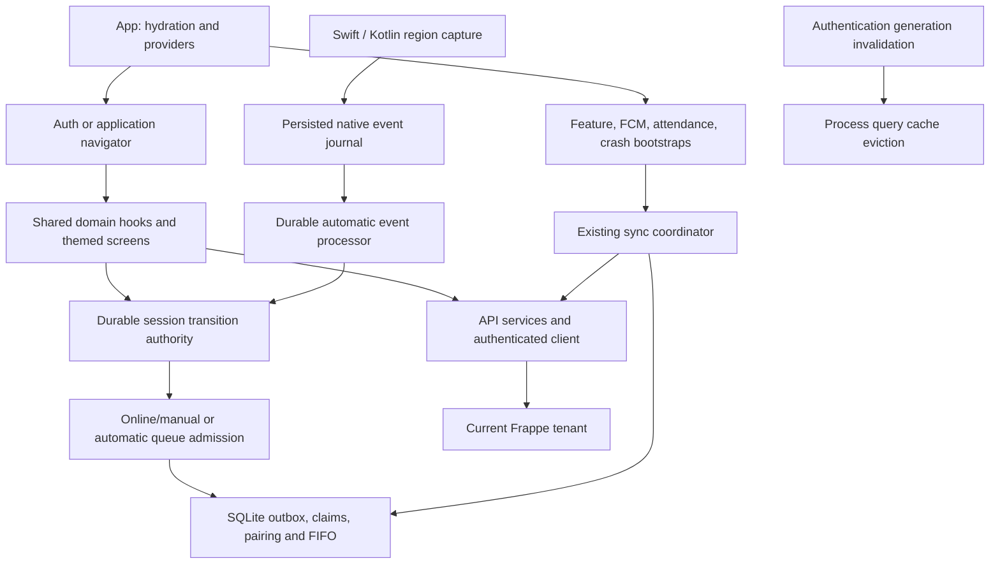

# Architecture and baseline audit

Date: 2026-10-28. Baseline commit: `9e163f4c0c785253b4360a9c2d50ca1405695816`; clean initial working tree. Existing attendance features, native data and production configuration were preserved.

## Stack and ownership

Installed manifest: Expo `~57.0.27`, React Native `0.86.3`, React `19.2.3`, React Navigation 7, Redux Toolkit/persist, TanStack Query 5, Axios, expo-sqlite and an optional local Expo geofence module. The application source is JavaScript/JSX; installed TypeScript alone does not establish a typed application. iOS is committed; generated root Android is ignored.

Relevant authorities: [App.js](../../App.js), [navigator](../../navigation/navigator.jsx), [session transitions](../../utils/attendanceSessionState.js), [queue provenance](../../services/offline/attendanceQueueProvenance.js), [event processor](../../services/offline/AutoAttendanceEventProcessor.js), [SQLite schema/migrations](../../services/offline/AttendanceDatabase.js), [sync service](../../services/offline/AttendanceSyncService.js), [query cache boundary](../../services/queryClient.js).

Architecture/feature references read before implementation: `AGENTS.md`, `DESIGN.md`, `CLAUDE.md` architecture and versioning sections, mobile sign-in documentation, automatic-attendance architecture/context, and instance-availability validation notes. Older historical architecture documents describe single-slot native storage and older schema versions; current journal/schema code and executable contracts take precedence.

## Expected critical workflows

| Workflow | Required behavior retained | Executable evidence |
| --- | --- | --- |
| QR/password and mobile authentication | Same routes/provisioning priority; SDK-controlled credentials and manual OTP resend | authProvisioning, authFlowMatrix, mobileLoginHook/UI, mobileAuthSession |
| Token rotation/outage | Single shared 401 refresh; persist rotated credentials before memory; transient refresh failure retains session; ordinary 403 passes through | apiClient, sessionResilience |
| Logout/tenant/employee switch | Invalidate stale work; keep accepted queue rows; reset scoped policy/session as appropriate | attendanceExpiryRecovery, attendanceAuthRecovery.integration, autoAttendanceQueueProvenance |
| Manual attendance/photo | Online-only, location-policy guards, session transition lock across submit | manualLocationTransport, manualEmployeePolicyRace, manualAttendanceScope, attendanceOfflineApi |
| Manual IN followed by automatic OUT | Same durable session authority; no duplicate transition | hybridAttendance.integration, attendanceSessionAuthority |
| Native automatic attendance | Persist crossing before emission, consume exact event, keep original identity/time | autoAttendanceDurableEvents, autoAttendanceEventProcessor, native store harness |
| Offline/recovery/firewall | Distinguish no transport from unreachable instance; preflight before dispatch marker; ordered single-row sync; ambiguous POST history-only verification | instanceAvailability, autoAttendanceAvailability.integration, autoAttendanceAmbiguousDispatch, queue/sync/migration suites |
| HR history | Current-session records only; real errors differ from valid empty results | queryClientSession, requestHistory, expensePagination, notificationReadState, shortcutData |
| Background/foreground | Keep native-event/launch/reconnect opportunities; suppress periodic foreground work while inactive | backgroundSyncLifecycle, autoAttendanceBootstrap.durable |

## Coverage and boundaries

The source inventory covered all tracked application directories, 45 screen files and 18 Swift/Kotlin files (including native fixtures/runtime copies); stale `.git-rewrite`, generated builds, assets and dependency source were excluded from app-source counts. Every tracked application JavaScript/JSX file was syntax-parsed with the installed Babel parser: zero parse errors. See the generated directory/screen inventory below.

Specialist source reviews covered motion/shared UI and all native module sources. Root review covered startup, authentication generation, API interceptors/services, diagnostic privacy, queue/session design, background manager, memory retention and tooling. This is a repository-wide static and automated audit, not proof that every possible path is defect-free. Device-only visual, memory, battery and geofence behavior remains explicitly unverified in this audit.

F01 fixes the confirmed process-wide HR cache lifetime flaw: `App.js` now consumes `services/queryClient.js`, whose synchronous generation listener clears queries, retryers and mutation-cache entries before logout/provisioning awaits. No provider remount or attendance-bootstrap restart was added. A completed POST cannot be undone by clearing a mutation cache; existing operation scope guards remain necessary.

F11 establishes an actual ESLint entry point in [.eslintrc.cjs:1](../../.eslintrc.cjs#L1). Baseline lint exited 2 for missing configuration; baseline `tsc --noEmit` exited 1 with help because no tsconfig exists. No superficial TypeScript config/migration was introduced. The lint configuration checks correctness and hooks, with documented legacy/style exceptions and visible dependency warnings.

No backend, SQLite migration, native registration protocol, route name, production build/OTA field or package lock was changed.

| Baseline directory | Tracked non-asset files inventoried |
| --- | --- |
| root | 24 |
| Toast | 3 |
| __tests__ | 131 |
| components | 125 |
| constants | 4 |
| docs | 40 |
| hooks | 28 |
| ios | 26 |
| modules | 22 |
| native-tests | 1 |
| native | 1 |
| navigation | 6 |
| plugins | 1 |
| redux | 10 |
| screens | 45 |
| services | 51 |
| settings | 3 |
| test-utils | 3 |
| utils | 34 |

Baseline screen inventory (all 45 files; variants and wrappers included):

`screens/AttendanceAction.jsx`, `screens/AttendanceActionLegacy.jsx`, `screens/AttendanceCamera.jsx`, `screens/AttendanceHistory.jsx`, `screens/AttendanceHistoryLegacy.jsx`, `screens/AttendanceRequest.jsx`, `screens/AttendanceRequestLegacy.jsx`, `screens/AutoAttendance.jsx`, `screens/AutoAttendanceLegacy.jsx`, `screens/Chat.jsx`, `screens/ComingSoon.jsx`, `screens/Complaints.jsx`, `screens/ComplaintsLegacy.jsx`, `screens/ExpenseClaim.jsx`, `screens/ExpenseClaimLegacy.jsx`, `screens/Home.jsx`, `screens/HomeLegacy.jsx`, `screens/LeaveRequest.jsx`, `screens/LeaveRequestLegacy.jsx`, `screens/LoanApplication.jsx`, `screens/LoanApplicationLegacy.jsx`, `screens/Login.jsx`, `screens/LoginLegacy.jsx`, `screens/LoginModern.jsx`, `screens/MobileLogin.jsx`, `screens/MyQrCode.jsx`, `screens/MyQrCodeLegacy.jsx`, `screens/Notifications.jsx`, `screens/NotificationsLegacy.jsx`, `screens/Profile.jsx`, `screens/QrScan.jsx`, `screens/QrScanLegacy.jsx`, `screens/QrScanModern.jsx`, `screens/Resignation.jsx`, `screens/ResignationLegacy.jsx`, `screens/SalaryAdvance.jsx`, `screens/SelectQuickAccess.jsx`, `screens/SelectQuickAccessLegacy.jsx`, `screens/Shortcut1.jsx`, `screens/Shortcut2.jsx`, `screens/Shortcut3.jsx`, `screens/WelcomeScreen.jsx`, `screens/WelcomeScreenLegacy.jsx`, `screens/WelcomeScreenModern.jsx`, `screens/index.js`.

