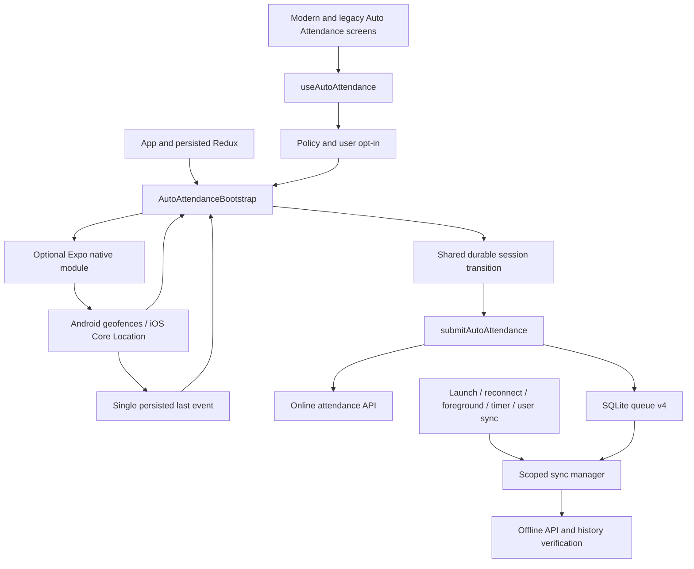

# Auto Attendance: current implementation

> Latest implementation report: [12-HYBRID-RELIABILITY-FIXES.md](12-HYBRID-RELIABILITY-FIXES.md), 2026-10-14. The baseline below remains historical.

> Historical baseline at `de722c9`. Read [11-RELIABILITY-FIXES.md](11-RELIABILITY-FIXES.md) for the current fixes, regression results, native-build limits and physical-device validation plan. Source line anchors below refer to the baseline.

Investigation date: 2026-10-13. Source baseline: `de722c954621bd0eeb980917f397677df9bdc69e`, plus the pre-existing untracked material identified in [01-FILE-INVENTORY.md](01-FILE-INVENTORY.md). This investigation changed only this documentation directory. Application tests, native builds, device experiments, and backend calls were not run.

## Evidence and scope

**CONFIRMED** means established by the current source, not demonstrated on a device. **POTENTIAL RISK** means the code permits a problematic outcome under the stated conditions; production occurrence is unverified. **UNKNOWN / UNVERIFIED** means the repository cannot establish the outcome. Source links show repository-relative paths and line anchors at this baseline; later edits can move those lines.

Discovery followed imports and calls through UI, Redux, the optional Expo module, Kotlin and Swift callbacks, shared session authority, API authentication, SQLite queueing, synchronization, recovery UI, native app configuration, and tests. It excluded `.git-rewrite/`, dependency implementation snapshots, build products, Pods implementation sources, and generated root Android files. Installed dependency versions and native linkage were inspected through manifests/lockfiles. See the inventory for the exact counting boundary.

## Architecture in one page

The normal registrar and punch processor is the app-level `AutoAttendanceBootstrap`, mounted after Redux persistence rehydrates. Opening the Auto Attendance screen is unnecessary. The modern and legacy screens share `useAutoAttendance` for opt-in, permission prompts, policy refresh, status display, and development controls. The screen hook normally asks Redux to enable processing; the bootstrap registers the fence. [App.js:182](../../App.js#L182), [AutoAttendanceBootstrap.jsx:86](../../components/AutoAttendanceBootstrap.jsx#L86), [useAutoAttendance.js:354](../../hooks/useAutoAttendance.js#L354).

Native code monitors one persisted circular office fence and writes one last ENTER/EXIT event. It emits events to an attached Expo JavaScript module listener. It does not submit authenticated attendance or write the SQLite attendance queue. Android has broadcast and boot/package-update receivers. iOS uses Core Location delegates and an app-owned runtime that attempts to create a React root during a wake without a scene. [Android receiver:23](../../modules/expo-auto-attendance/android/src/main/java/expo/modules/autoattendance/GeofenceBroadcastReceiver.kt#L23), [iOS manager:227](../../modules/expo-auto-attendance/ios/GeofenceManager.swift#L227), [AttendanceBackgroundRuntime.swift:46](../../ios/ClaudionCheckin/AttendanceBackgroundRuntime.swift#L46).

JavaScript turns ENTER into IN and EXIT into OUT through `performSessionTransition`. This shared authority serializes manual and automatic requests across a process-local lock, reads the durable device session, skips redundant transitions, executes submission while locked, and commits an allowed response. An allowed queued response changes the local session even though the server has not confirmed attendance. Redux mirrors that session for UI. [attendanceSessionState.js:259](../../utils/attendanceSessionState.js#L259), [bootstrap:243](../../components/AutoAttendanceBootstrap.jsx#L243).

Online automatic submission calls `autoCheckInOut` with `auto: true`. Automatic failures may fall back to the shared SQLite queue, subject to cached policy and queueing capability; manual punches are online-only. Scoped drains use a different API, one queued record per request. The current database schema is **version 4**, including tenant provenance and server-acceptance evidence. [attendance.service.js:438](../../services/api/attendance.service.js#L438), [AttendanceQueueService.js:405](../../services/offline/AttendanceQueueService.js#L405), [AttendanceDatabase.js:123](../../services/offline/AttendanceDatabase.js#L123), [AttendanceApi.js:194](../../services/offline/AttendanceApi.js#L194).

## Most important established behavior

| Concern | Current behavior | Evidence |
| --- | --- | --- |
| Runtime enablement | Logged in, employee present, native module available, policy allows monitoring, and user opt-in. Policy 1 monitors without punches; policy 2 submits punches. | [bootstrap:149](../../components/AutoAttendanceBootstrap.jsx#L149), [AutoAttendanceSlice.js:97](../../redux/Slices/AutoAttendanceSlice.js#L97) |
| Feature gate | `auto_attendance` hides/disables screen access; the bootstrap does not consult this flag. Offline flag controls new queueing, while existing rows can still drain. | [app-navigator.jsx:68](../../navigation/app-navigator.jsx#L68), [OfflineAttendanceBootstrap.jsx:59](../../components/OfflineAttendanceBootstrap.jsx#L59) |
| Locations | Resolve the nearest configured office from current GPS; register `office-main`, not one fence per office. Existing stored monitoring skips registration. | [getOfficeLocation:92](../../services/api/attendance.service.js#L92), [ensureMonitoring:442](../../components/AutoAttendanceBootstrap.jsx#L442) |
| Initial presence | Native initial-inside ENTER plus JavaScript inside-presence reconciliation. The latter may create IN after querying server history. No symmetric startup outside-presence OUT exists. | [Android manager:115](../../modules/expo-auto-attendance/android/src/main/java/expo/modules/autoattendance/GeofenceManager.kt#L115), [iOS manager:294](../../modules/expo-auto-attendance/ios/GeofenceManager.swift#L294), [bootstrap:525](../../components/AutoAttendanceBootstrap.jsx#L525) |
| Replay | Only the last native event, with a device-wide processed timestamp, 24-hour age limit, and 60-second future tolerance. Live events bypass those replay filters. | [geofenceEventLog.js:52](../../utils/geofenceEventLog.js#L52), [bootstrap:355](../../components/AutoAttendanceBootstrap.jsx#L355) |
| Queue identity | A drain requires authenticated tenant and employee scope. Historical native events carry no such identity; bootstrap gives older replay no source scope. | [bootstrap:237](../../components/AutoAttendanceBootstrap.jsx#L237), [attendanceQueueProvenance.js:65](../../services/offline/attendanceQueueProvenance.js#L65) |
| Duplicate outcome | A duplicate message prompts exact server-history verification. Inconclusive evidence becomes `needs_review`, with no automatic resend. | [AttendanceSyncService.js:119](../../services/offline/AttendanceSyncService.js#L119), [AttendanceVerification.js:32](../../services/offline/AttendanceVerification.js#L32) |
| Logout | Stops JS sync and requests native stop; resets user opt-in and clears policy/capability caches. Keeps queued attendance, native last event, durable session, and processed mark. | [Profile.jsx:322](../../screens/Profile.jsx#L322), [AttendanceQueueService.js:722](../../services/offline/AttendanceQueueService.js#L722), [AutoAttendanceSlice.js:75](../../redux/Slices/AutoAttendanceSlice.js#L75) |

## Main limitations and open validation

Confirmed structural limitations include a single overwritten native event rather than an event log; no Android receiver path that boots attendance JavaScript; keeping a stored fence when office/employee configuration changes; older replay queueing into NULL-tenant rows that scoped drains cannot claim; online OUT potentially overtaking an earlier queued IN; and offline payloads omitting the online `auto` field. These mechanisms and their conditions are detailed in [08-EDGE-CASES-AND-RISKS.md](08-EDGE-CASES-AND-RISKS.md). None was fixed during this investigation.

Actual OS wake delivery, user force-stop/force-quit behavior, permission downgrade recovery, background GPS availability, iOS startup within available execution time, Android OEM power behavior, and live tenant API/employee/token compatibility are **UNVERIFIED**. JavaScript test mocks and native configuration text checks do not establish those outcomes.

## Reading route

For a future implementation task: [10 handoff](10-AGENT-HANDOFF.md) → [02 architecture](02-ARCHITECTURE.md) → [03 runtime flows](03-RUNTIME-FLOWS.md) → [06 rules/APIs](06-API-AND-BUSINESS-RULES.md) → [07 queue/recovery](07-OFFLINE-SYNC-AND-RECOVERY.md) → relevant [04 Android](04-ANDROID-IMPLEMENTATION.md) or [05 iOS](05-IOS-IMPLEMENTATION.md) → [08 risks](08-EDGE-CASES-AND-RISKS.md) → [09 validation](09-TESTING-AND-VALIDATION.md). Use [01 inventory](01-FILE-INVENTORY.md) as the source index.
