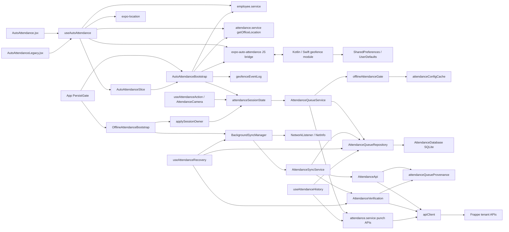

# Architecture and dependency map

> Historical baseline at `de722c9`. Read [11-RELIABILITY-FIXES.md](11-RELIABILITY-FIXES.md) for the current fixes, regression results, native-build limits and physical-device validation plan. Source line anchors below refer to the baseline.

Status vocabulary and source baseline: [00-OVERVIEW.md](00-OVERVIEW.md). All behavior below is source-established unless qualified.

## Ownership boundaries

| Layer | Entry points and responsibility | Contracts shared with other features |
| --- | --- | --- |
| Application lifecycle | `App` mounts bootstraps after `PersistGate`; `AutoAttendanceBootstrap` owns normal registration, native ENTER/EXIT listeners, replay, and presence recovery. | Logout/expiry cleanup, OTA startup, Firebase, persisted login, auth generation. [App.js:130](../../App.js#L130), [bootstrap:86](../../components/AutoAttendanceBootstrap.jsx#L86) |
| UI | `AutoAttendance` and `AutoAttendanceLegacy` both use `useAutoAttendance`. The hook owns permissions, opt-in, policy/status refresh, display-only presence, and development commands. | Themes, feature-gated routes, Home quick access. [hook:61](../../hooks/useAutoAttendance.js#L61), [app-navigator:68](../../navigation/app-navigator.jsx#L68) |
| Redux | `AutoAttendanceSlice` stores normalized policy, user opt-in, and sync request ID; `AttendanceSlice` mirrors punch/session display; `AuthSlice` and `UserSlice` expose login/employee/tenant. | All manual attendance consumers, persisted root state, logout `REVERT_ALL`. [AutoAttendanceSlice:60](../../redux/Slices/AutoAttendanceSlice.js#L60), [AttendanceSlice:21](../../redux/Slices/AttendanceSlice.js#L21), [Store.js:16](../../redux/Store.js#L16) |
| Native bridge | Optional `ExpoAutoAttendance` exposes monitoring/reliability queries, last-event read/clear, and three listener types. | Older binaries remain import-safe; unavailable mutating calls throw. [bridge:17](../../modules/expo-auto-attendance/index.js#L17) |
| Native monitor | Android Play Services geofences and iOS Core Location region monitoring. Native stores registration and a last transition. | Native module linkage, manifest/Info.plist permissions, app delegate wake handling. [Android manager:97](../../modules/expo-auto-attendance/android/src/main/java/expo/modules/autoattendance/GeofenceManager.kt#L97), [iOS manager:145](../../modules/expo-auto-attendance/ios/GeofenceManager.swift#L145) |
| Session authority | `performSessionTransition` locks, checks existing state, submits, commits durable state, and returns outcome. | Manual screens and camera punches must use the same authority. [session:259](../../utils/attendanceSessionState.js#L259), [manual hook:512](../../hooks/useAttendanceAction.js#L512), [camera:139](../../screens/AttendanceCamera.jsx#L139) |
| Submission | `submitAutoAttendance` wraps `submitAttendance`; `autoCheckInOut` handles the online API. Cached-policy fallback creates a queued local acceptance. | Manual path calls `submitManualAttendance` but deliberately stays online-only. [queue service:405](../../services/offline/AttendanceQueueService.js#L405), [attendance API service:438](../../services/api/attendance.service.js#L438) |
| Queue and drain | SQLite repository owns insertion, claims, ordering, pairing, retries, review, and recovery queries. `AttendanceSyncService` owns scoped single-record upload and evidence. | Retained old manual/photo records, migrations, recovery settings, history, offline banner. [repository:152](../../services/offline/AttendanceQueueRepository.js#L152), [sync:402](../../services/offline/AttendanceSyncService.js#L402) |
| Authenticated transport | `apiClient` resolves current context and refreshes 401s; queue scope guards pin tenant/employee/auth generation. | QR and mobile authentication, token rotation, session expiry. [apiClient:485](../../services/api/apiClient.js#L485), [provenance:65](../../services/offline/attendanceQueueProvenance.js#L65) |

## Actual dependency graph

The native receiver is not connected directly to `AttendanceDatabase` or `apiClient`. Comments reserving a future native API path do not implement one. The iOS background runtime creates the same React application; attendance work still traverses the normal bootstraps. [Android receiver:63](../../modules/expo-auto-attendance/android/src/main/java/expo/modules/autoattendance/GeofenceBroadcastReceiver.kt#L63), [iOS manager:237](../../modules/expo-auto-attendance/ios/GeofenceManager.swift#L237), [runtime:80](../../ios/ClaudionCheckin/AttendanceBackgroundRuntime.swift#L80).

## Native bridge contract

The module name is `ExpoAutoAttendance`; production identifier is `office-main`. Current exports are:

| JavaScript export | Behavior / return |
| --- | --- |
| `isAvailable()` | Whether the optional native module exists. |
| `startGeofence({latitude, longitude, radius, identifier})` / `stopGeofence()` | Native asynchronous registration/removal. |
| `isMonitoring()` / `getRegisteredGeofences()` | Synchronous stored flag and zero/one saved configurations. |
| `getLastEvent()` / `clearLastEvent()` | Synchronous single transition read/clear; clear does not clear the JS processed mark. |
| `hasFullAccuracy()` / `isLowPowerModeEnabled()` / `isIgnoringBatteryOptimizations()` | Native reliability queries where present; compatibility fallbacks true/false/true respectively. |
| `addGeofenceEnterListener(cb)` / `addGeofenceExitListener(cb)` | Subscribe to `onGeofenceEnter` / `onGeofenceExit`; return removable subscription. |
| `addErrorListener(cb)` | Subscribe to `onError` with code/message; return removable subscription. |

Source: [bridge:17](../../modules/expo-auto-attendance/index.js#L17), [bridge:51](../../modules/expo-auto-attendance/index.js#L51), [bridge:105](../../modules/expo-auto-attendance/index.js#L105), [bridge:118](../../modules/expo-auto-attendance/index.js#L118), [bridge:139](../../modules/expo-auto-attendance/index.js#L139).

Live transitions carry `{identifier, identifiers, transition, timestamp}`; stored last event carries `{identifier, transition, timestamp}`. Neither carries tenant/employee/event UUID. The bootstrap subscribes to ENTER/EXIT before start; the UI hook also subscribes to errors. Future journal/acknowledgment methods proposed in SDK planning documents are absent. [bootstrap:355](../../components/AutoAttendanceBootstrap.jsx#L355), [Android receiver:69](../../modules/expo-auto-attendance/android/src/main/java/expo/modules/autoattendance/GeofenceBroadcastReceiver.kt#L69), [iOS manager:243](../../modules/expo-auto-attendance/ios/GeofenceManager.swift#L243).

`App` also mounts the global `OfflineBanner`, which uses `useOfflineStatus` and opens `AttendanceSyncSheet`; Profile mounts recovery and sync-alert settings. These are visibility/recovery consumers of the same queue, not native registrars. [App.js:202](../../App.js#L202), [OfflineBanner.jsx:170](../../components/common/OfflineBanner.jsx#L170), [Profile.jsx:564](../../screens/Profile.jsx#L564).

## Execution and state domains

There are three distinct persistence domains, with no atomic transaction across them:

1. **Native registration/event:** Android SharedPreferences `expo_auto_attendance`; iOS UserDefaults registration flags/configuration/one last event. A stored monitoring flag describes application bookkeeping, not an authoritative query of OS registration. [Android store:16](../../modules/expo-auto-attendance/android/src/main/java/expo/modules/autoattendance/GeofenceStore.kt#L16), [iOS store:14](../../modules/expo-auto-attendance/ios/GeofenceStore.swift#L14).
2. **JavaScript device state:** persisted Redux; AsyncStorage tenant/employee/tokens; durable attendance session and employee owner; legacy session times; processed native-event timestamp; policy cache; endpoint capability; server-clock offset. These keys have different scoping and cleanup behavior. [session:37](../../utils/attendanceSessionState.js#L37), [event log:24](../../utils/geofenceEventLog.js#L24), [cache:34](../../services/offline/attendanceConfigCache.js#L34), [clock:24](../../utils/serverClock.js#L24).
3. **SQLite attendance:** version-4 rows with tenant/employee identity, wall-clock timestamp, action, status, retry/claim state, pair links, server result, and acceptance proof. Native events are not SQLite rows until JavaScript submission queues them. [database:125](../../services/offline/AttendanceDatabase.js#L125), [queue service:199](../../services/offline/AttendanceQueueService.js#L199).

The session lock is a JavaScript promise chain, not an interprocess/native/database lock. Redux is a display mirror, not the authority deciding whether to punch. `execute` runs inside the lock: calling `readSession()` from it would wait on itself. Queue pairing therefore queries SQLite rather than reading the session again. [session:174](../../utils/attendanceSessionState.js#L174), [queue service:259](../../services/offline/AttendanceQueueService.js#L259).

## Lifecycle and dependency subtleties

- Bootstrap policy refresh is a separate effect on login/employee. Monitoring depends on login, active opt-in, employee, and sync request ID; it does not depend on tenant URL or full-action policy. Full-action changes are read through a ref. A same-code tenant switch alone does not cause this effect to re-register. [bootstrap:111](../../components/AutoAttendanceBootstrap.jsx#L111), [bootstrap:647](../../components/AutoAttendanceBootstrap.jsx#L647).
- `ensureMonitoring` fetches an office before checking `isMonitoring`. It updates the JavaScript office ref but keeps the native fence if the stored flag is true. Existing registered geometry and new API location metadata can consequently differ. [bootstrap:442](../../components/AutoAttendanceBootstrap.jsx#L442).
- `OfflineAttendanceBootstrap` restarts the manager on tenant URL as well as employee/login/flag changes, and separately applies an **employee-only** session owner. Its comment claiming logout clears the queue is contradicted by `clearOfflineAttendance`; the implementation retains rows. [offline bootstrap:76](../../components/OfflineAttendanceBootstrap.jsx#L76), [offline bootstrap:112](../../components/OfflineAttendanceBootstrap.jsx#L112), [queue service:722](../../services/offline/AttendanceQueueService.js#L722).
- The manager's interval, network listener, AppState listener, and queue callbacks operate while JavaScript is running. They are not native scheduled background jobs. No application usage of Expo TaskManager, `startLocationUpdatesAsync`, a foreground attendance service, WorkManager attendance worker, or continuous Core Location tracking was found. [manager:213](../../services/offline/BackgroundSyncManager.js#L213), [module manifest:1](../../modules/expo-auto-attendance/android/src/main/AndroidManifest.xml#L1), [iOS manager:145](../../modules/expo-auto-attendance/ios/GeofenceManager.swift#L145).
- Native additions require matching binaries. `requireOptionalNativeModule` and optional reliability-method fallbacks protect older binaries, but neither OTA nor these fallbacks install native code. Startup also waits for fonts/preferences and can check/download/reload an OTA. [bridge:17](../../modules/expo-auto-attendance/index.js#L17), [App.js:130](../../App.js#L130), [app.json:118](../../app.json#L118).

## Future change impact

Changes to session transitions affect manual screens, timer restoration, camera punches, and server reconciliation. Queue schema/claim changes affect migrations, retained historical records, synchronization, diagnostics, history, and recovery settings. Auth-context changes affect both login methods and refresh; native startup changes also affect Expo Updates, Firebase background notification wakes, scene attachment, and plugin reapplication. Read the relevant focused documents and tests before changing these shared contracts.
