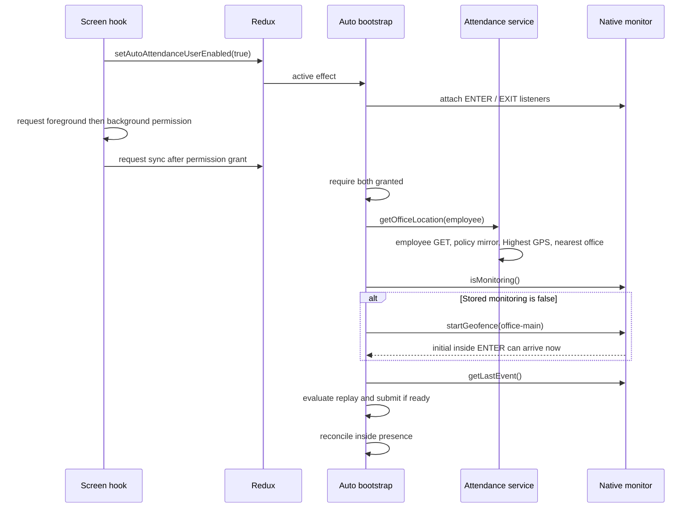

# Runtime flows: execution order

> Historical baseline at `de722c9`. Read [11-RELIABILITY-FIXES.md](11-RELIABILITY-FIXES.md) for the current fixes, regression results, native-build limits and physical-device validation plan. Source line anchors below refer to the baseline.

Source baseline and evidence labels: [00-OVERVIEW.md](00-OVERVIEW.md). Native callbacks are asynchronous; arrows below describe call relationships, not guaranteed wall-clock ordering between independent effects.

## 1. App launch and session restoration

1. `App.js` initializes crash reporting, guarded mobile crypto, and Firebase's background-message handler. Session-expiry cleanup registers FCM and offline-cache cleanup. These are not a launch-time mobile authentication exchange. [App.js:46](../../App.js#L46), [App.js:63](../../App.js#L63).
2. App readiness waits for fonts and preferences; production startup checks Expo Updates and may reload after download. It returns no UI until ready. [App.js:130](../../App.js#L130).
3. Redux `PersistGate` restores the persisted root. `AutoAttendanceBootstrap`, `OfflineAttendanceBootstrap`, FCM, feature settings, and crash-reporting bootstraps mount. Navigation uses persisted login state. [App.js:182](../../App.js#L182), [Store.js:16](../../redux/Store.js#L16), [navigator.jsx:15](../../navigation/navigator.jsx#L15).
4. `OfflineAttendanceBootstrap` independently calls `applySessionOwner(employeeCode)`, sets the administrative queueing flag, and starts the sync manager. These asynchronous effects do not await the auto bootstrap. The owner can clear a previous employee's device session; same employee code is retained. [offline bootstrap:76](../../components/OfflineAttendanceBootstrap.jsx#L76), [session owner:442](../../utils/attendanceSessionState.js#L442).
5. `readSession` lazily reads the durable session and can migrate legacy check-in/checkout keys. Manual UI status refresh reconciles server state with the same authority. Auth is refreshed on qualifying API failures, not preemptively authenticated through the SDK on launch. [session:144](../../utils/attendanceSessionState.js#L144), [manual hook:173](../../hooks/useAttendanceAction.js#L173), [apiClient:565](../../services/api/apiClient.js#L565).

## 2–5. Initialization, configuration, permissions, registration/update

`AutoAttendanceBootstrap` has a policy effect (`fetchEmployeeData` → `setAutoAttendanceGeotagging`, cached `geotagging` on failure) and a separate monitoring effect. Native unavailable is a no-op. Logged out or inactive requests `stopGeofence`; missing employee returns. An active effect captures authenticated queue scope, attaches ENTER/EXIT listeners, and serializes its startup promise against previous startups. [bootstrap:111](../../components/AutoAttendanceBootstrap.jsx#L111), [bootstrap:149](../../components/AutoAttendanceBootstrap.jsx#L149), [bootstrap:355](../../components/AutoAttendanceBootstrap.jsx#L355), [bootstrap:629](../../components/AutoAttendanceBootstrap.jsx#L629).

Startup calls `ensureMonitoring` → `replayPendingEvent` → `reconcilePresence`. `ensureMonitoring` reads foreground/background permission status, requires both granted, then calls `getOfficeLocation(employeeCode)`. This repeats employee-data retrieval, validates complete mobile policy, writes legacy policy keys, asks foreground permission, takes a Highest-accuracy GPS position, and selects the nearest office. There is no cached office fallback or timeout on that particular GPS call. A null office, denied permission, or caught office/registration error still allows the subsequent replay call; presence reconciliation needs a valid office. An operation that remains pending, such as the unbounded GPS call, delays replay. [bootstrap:442](../../components/AutoAttendanceBootstrap.jsx#L442), [getOfficeLocation:92](../../services/api/attendance.service.js#L92).

`officeRef` is updated. Only when `isMonitoring()` is false does the bootstrap call `startGeofence({identifier: "office-main", latitude, longitude, radius})`, using radius 100 if the chosen radius is not positive. It does not compare current registered geometry to new office configuration. This is registration on demand, not a reliable office-update mechanism. [bootstrap:461](../../components/AutoAttendanceBootstrap.jsx#L461).

The UI opt-in path is `toggleMonitoring`: dispatch opt-in → query permissions → request foreground then background as necessary → bump sync request after newly granted permissions → notification setup → validate office → wait up to 15 seconds for monitoring. Denied permission leaves opt-in saved. Turning off changes Redux; the bootstrap performs native stop. Development manual start/stop bypass the normal bootstrap registrar and use user-entered coordinates. [hook:317](../../hooks/useAutoAttendance.js#L317), [hook:354](../../hooks/useAutoAttendance.js#L354), [hook:443](../../hooks/useAutoAttendance.js#L443).



The registration-generated live event can precede replay and overwrite the native last-event slot. The startup order guarantees replay before JavaScript presence reconciliation, not before every native callback.

## 6. Initial presence

Android requests `INITIAL_TRIGGER_ENTER`. iOS calls `requestState(for:)` after registration succeeds and turns `.inside` into ENTER; `.unknown` retries after 2, 4, and 8 seconds. [Android manager:115](../../modules/expo-auto-attendance/android/src/main/java/expo/modules/autoattendance/GeofenceManager.kt#L115), [iOS manager:253](../../modules/expo-auto-attendance/ios/GeofenceManager.swift#L253), [iOS state decision:65](../../modules/expo-auto-attendance/ios/GeofenceManager.swift#L65).

JavaScript `reconcilePresence` applies only when the newly resolved office says `withinRadius` and the local session is closed. If this employee has rows counted by `mayAffectServerCount`, it asks `syncNow` to drain and returns if the count remains. It then fetches server status. A server-open session is reconciled if a valid start can be resolved; an open status without a valid start still prevents a new IN. Server-closed, or unavailable status with an empty relevant queue, causes IN at the current time with `markProcessed: false`. No outside-presence checkout is implemented. [bootstrap:525](../../components/AutoAttendanceBootstrap.jsx#L525), [bootstrap:561](../../components/AutoAttendanceBootstrap.jsx#L561), [bootstrap:606](../../components/AutoAttendanceBootstrap.jsx#L606).

This can reopen a session after manual OUT while the employee remains inside and monitoring restarts. It does not require a fresh boundary crossing. The screen hook's separate presence read merely displays location and does not submit punches. [hook:176](../../hooks/useAutoAttendance.js#L176).

## 7–11. ENTER/check-in, EXIT/check-out, request and response

Android receiver saves the last transition then emits through `GeofenceEventBus`. Swift delegates call `handleTransition`, save the event, post the app-wake notification, and invoke the bus listener. Timestamp is callback receipt time, not a measured physical-crossing time. [Android receiver:55](../../modules/expo-auto-attendance/android/src/main/java/expo/modules/autoattendance/GeofenceBroadcastReceiver.kt#L55), [Swift manager:227](../../modules/expo-auto-attendance/ios/GeofenceManager.swift#L227).

Bootstrap's `addGeofenceEnterListener` and `addGeofenceExitListener` callbacks invoke `performAttendanceAction("IN"/"OUT", timestamp)`. They do not validate fence identifier, age, future skew, or last processed mark. Warnings-only policy marks the event handled without submitting. Full-actions mode reads the current employee ref and supplies captured queue scope only for timestamps at/after the effect's scope-observation time; older events receive NULL scope. [bootstrap:211](../../components/AutoAttendanceBootstrap.jsx#L211), [bootstrap:355](../../components/AutoAttendanceBootstrap.jsx#L355).

Inside `performSessionTransition`, redundant IN/OUT is skipped. Otherwise `execute` checks undelivered queue count **for IN only**, calls `submitAutoAttendance`, and gives it the online callback `autoCheckInOut`. Transport availability permits an online attempt unless forced to queue. Online success requires `message.name`; the API service returns `{allowed: true, ...}` or `{allowed: false, error, message}`. Queue fallback returns allowed/queued. Session authority commits only allowed responses, then bootstrap marks completed/skipped native events handled and updates Redux. OUT schedules a local notification, with separate pending-sync copy for queued success. A failed submission leaves the session unchanged and does not advance the processed mark. [bootstrap:243](../../components/AutoAttendanceBootstrap.jsx#L243), [queue service:405](../../services/offline/AttendanceQueueService.js#L405), [attendance service:438](../../services/api/attendance.service.js#L438), [session:259](../../utils/attendanceSessionState.js#L259), [bootstrap:294](../../components/AutoAttendanceBootstrap.jsx#L294).

```mermaid
sequenceDiagram
  participant OS as OS location provider
  participant Native as Receiver / delegate
  participant Store as Native last-event slot
  participant Boot as Auto bootstrap
  participant Session as Session authority
  participant Submit as Queue service
  participant API as Online API
  participant DB as SQLite
  OS->>Native: ENTER or EXIT callback
  Native->>Store: overwrite transition and receipt timestamp
  Native-->>Boot: emit when listener attached
  Boot->>Session: performSessionTransition(IN or OUT, AUTO)
  Session->>Session: lock and inspect durable state
  alt Already in target state
    Session-->>Boot: skipped
  else Transition permitted
    Session->>Submit: submitAutoAttendance
    alt Transport and no forceQueue
      Submit->>API: autoCheckInOut with auto true
      API-->>Submit: allowed or classified failure
    end
    opt Queue fallback allowed
      Submit->>DB: enqueue tenant-scoped or NULL-tenant row
      DB-->>Submit: local acceptance
    end
    Submit-->>Session: allowed / queued / refused
    Session->>Session: commit only if allowed, then unlock
    Session-->>Boot: completed or failed
  end
  Boot->>Boot: mark completed/skipped event; mirror Redux; notify OUT
```

## 12–13. Offline persistence, synchronization, duplicates

`queueAttendance` formats the event using cached server-clock offset, validates any source scope, inserts a row with nullable tenant identity, and pairs eligible queued OUT with an earlier IN. Atomic drain claims select only scoped pending rows with no earlier unresolved dependency. The manager schedules drains at launch, reconnect, foreground, token update, queue kick, timer, or user request. `AttendanceApi` sends one record; strict response interpretation distinguishes confirmed inserted ID, duplicate hint, ambiguous review, recoverable block, and positive validation rejection. Duplicate hints require exact history verification before confirmation. Full schema/ordering/retry detail: [07-OFFLINE-SYNC-AND-RECOVERY.md](07-OFFLINE-SYNC-AND-RECOVERY.md). [queue service:199](../../services/offline/AttendanceQueueService.js#L199), [repository:324](../../services/offline/AttendanceQueueRepository.js#L324), [sync:149](../../services/offline/AttendanceSyncService.js#L149).

Replay uses a different deduplication mechanism: `getLastEvent` → `evaluatePendingEvent({lastEvent, lastProcessedAt})` rejects unknown/invalid events, timestamps at/below the global mark, >24-hour-old events, and events >60 seconds in the future. Expired events advance the mark. A replay EXIT older than the active session start is discarded and marked. Failed replay can be retried at a later startup while still eligible; there is no general periodic replay worker. [bootstrap:377](../../components/AutoAttendanceBootstrap.jsx#L377), [geofenceEventLog:52](../../utils/geofenceEventLog.js#L52).

## 14–16. Foreground/background, termination/restart, reboot

- While JS runs, the sync manager handles foreground (3-second debounce), transport reconnect, 60-second interval, token changes, and queued-row kicks. Auto bootstrap itself has no AppState-based registration refresh. The UI screen refreshes permission/policy/reliability/presence on focus. [manager:143](../../services/offline/BackgroundSyncManager.js#L143), [manager:213](../../services/offline/BackgroundSyncManager.js#L213), [hook:287](../../hooks/useAutoAttendance.js#L287).
- Without JS, Android's geofence receiver still has a code path to overwrite its last-event slot, but does not boot JS or submit attendance. Reopening executes the normal initialization before replay. Receiver delivery while force-stopped or under OEM restrictions is **UNVERIFIED**. [Android receiver:61](../../modules/expo-auto-attendance/android/src/main/java/expo/modules/autoattendance/GeofenceBroadcastReceiver.kt#L61).
- During an iOS OS wake, the Expo subscriber primes `CLLocationManager`; the app runtime observes the native transition and attempts JS startup only when background/no scene/no window. It obtains an Expo Updates launch asset and retains a React root; hydration and bootstrap/API prerequisites still apply. Actual killed-app wake and time-budget sufficiency are **UNVERIFIED**. [subscriber:13](../../modules/expo-auto-attendance/ios/AutoAttendanceAppDelegateSubscriber.swift#L13), [runtime:21](../../ios/ClaudionCheckin/AttendanceBackgroundRuntime.swift#L21).
- Android `BOOT_COMPLETED` and `MY_PACKAGE_REPLACED` call `restoreFromStore`, which re-registers persisted geometry if monitoring and required permissions remain. It does not read employee/auth/tenant policy or drain SQLite. iOS has no app-authored boot receiver; restoration relies on Core Location and app-launch delegate paths. [boot receiver:13](../../modules/expo-auto-attendance/android/src/main/java/expo/modules/autoattendance/GeofenceBootReceiver.kt#L13), [Android restore:157](../../modules/expo-auto-attendance/android/src/main/java/expo/modules/autoattendance/GeofenceManager.kt#L157).

## 17. Logout, employee, and tenant changes

Explicit logout invalidates auth generation, unregisters FCM, clears offline cache/capability, clears tokens, and resets Redux. Auto bootstrap asks native stop; offline bootstrap cancels active sync and removes timers/listeners. Durable queue/session/legacy checkout/processed mark/native last event remain. Refresh-terminal expiry uses the registered cleanup then resets state; transient refresh failure retains login. [Profile:322](../../screens/Profile.jsx#L322), [apiClient:335](../../services/api/apiClient.js#L335), [apiClient:353](../../services/api/apiClient.js#L353).

Employee-owner changes clear the device session and legacy start asynchronously, not inside the session lock, and do not clear native events or processed mark. Mobile handoff explicitly clears session/start when normalized tenant changes, even for the same employee code; QR provisioning writes identity without that explicit tenant-session clear. Monitoring cleanup removes listeners but does not stop the old fence on employee changes. Captured/in-flight work is not uniformly cancelled by effect cleanup. [session owner:442](../../utils/attendanceSessionState.js#L442), [mobile handoff:210](../../services/api/mobileAuth.service.js#L210), [QR hook:192](../../hooks/useQrScanner.js#L192), [bootstrap:643](../../components/AutoAttendanceBootstrap.jsx#L643).

## 18. Permission changes, GPS loss, network loss/restoration

Bootstrap initially requires both grants but does not observe native `onError`; screen listeners show selected power/precision warnings. iOS auth downgrade emits `-1`, reduced precision `-3`; no automatic stop/reset/re-register follows in that callback. Android registration checks fine/background permission and receiver errors only emit. Permission restoration with no screen/toggle or relevant effect change does not itself trigger auto re-registration. [hook:269](../../hooks/useAutoAttendance.js#L269), [iOS manager:340](../../modules/expo-auto-attendance/ios/GeofenceManager.swift#L340), [Android module:96](../../modules/expo-auto-attendance/android/src/main/java/expo/modules/autoattendance/ExpoAutoAttendanceModule.kt#L96).

GPS loss can stall/fail bootstrap office resolution. Offline automatic queue fallback can accept with no GPS fix under cached policy; manual restricted location rules remain stricter. Network loss chooses the queue only where automatic eligibility allows it; network restoration wakes a scoped drain, not a fresh bootstrap office fetch. `isInternetReachable` does not govern attendance request attempts. [offline gate:166](../../services/offline/offlineAttendanceGate.js#L166), [NetworkListener:57](../../services/offline/NetworkListener.js#L57), [manager:157](../../services/offline/BackgroundSyncManager.js#L157).
