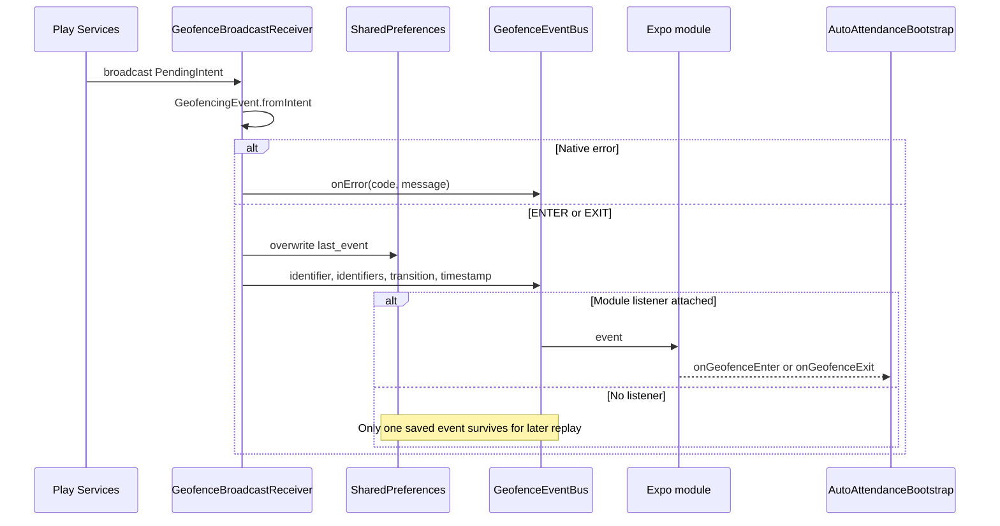

# Android implementation

> Historical baseline at `de722c9`. Read [11-RELIABILITY-FIXES.md](11-RELIABILITY-FIXES.md) for the current fixes, regression results, native-build limits and physical-device validation plan. Source line anchors below refer to the baseline.

Source baseline and evidence labels: [00-OVERVIEW.md](00-OVERVIEW.md). Native source exists; no Android build, merged-manifest inspection, emulator test, or device test was performed.

## Native entries and linkage

The local module is registered as `expo.modules.autoattendance.ExpoAutoAttendanceModule` by [expo-module.config.json:3](../../modules/expo-auto-attendance/expo-module.config.json#L3). [android/build.gradle:18](../../modules/expo-auto-attendance/android/build.gradle#L18) links Play Services Location 21.3.0. Kotlin files are under `modules/expo-auto-attendance/android/src/main/java/expo/modules/autoattendance/`:

| File / entry | Responsibility |
| --- | --- |
| [ExpoAutoAttendanceModule.kt:83](../../modules/expo-auto-attendance/android/src/main/java/expo/modules/autoattendance/ExpoAutoAttendanceModule.kt#L83), `OnCreate` / `OnDestroy` | Attach/detach the single event-bus listener; register/unregister a power-save-mode receiver; expose Expo functions/events. |
| [GeofenceManager.kt:97](../../modules/expo-auto-attendance/android/src/main/java/expo/modules/autoattendance/GeofenceManager.kt#L97), `startMonitoring` | Build a circular Play Services geofence and request registration. |
| [GeofenceBroadcastReceiver.kt:23](../../modules/expo-auto-attendance/android/src/main/java/expo/modules/autoattendance/GeofenceBroadcastReceiver.kt#L23), `onReceive` | Parse transition broadcast, persist one last event, emit to the bus. |
| [GeofenceBootReceiver.kt:13](../../modules/expo-auto-attendance/android/src/main/java/expo/modules/autoattendance/GeofenceBootReceiver.kt#L13), `onReceive` | Handle reboot/package replacement by requesting persisted-fence restoration. |
| [GeofenceEventBus.kt:17](../../modules/expo-auto-attendance/android/src/main/java/expo/modules/autoattendance/GeofenceEventBus.kt#L17) | One volatile listener; drops emission if no attached module listener. |
| [GeofenceStore.kt:16](../../modules/expo-auto-attendance/android/src/main/java/expo/modules/autoattendance/GeofenceStore.kt#L16) | SharedPreferences monitoring/config/last-event bookkeeping. |

Root `android/` is generated and ignored. Module-native sources are retained. The module manifest and `app.json` establish intended inputs; the actual merged manifest, target SDK behavior, and packaged receiver linkage are **UNVERIFIED**. [.gitignore:1](../../.gitignore#L1), [app.json:90](../../app.json#L90).

## Registration, permissions, and geometry

`startGeofence` validates coordinate ranges and positive radius, checks fine location and background location, then calls `GeofenceManager.startMonitoring`. Background location is required by this implementation on API 29+, while earlier versions skip that check. Coarse permission alone does not satisfy the native fine-location check. [module:96](../../modules/expo-auto-attendance/android/src/main/java/expo/modules/autoattendance/ExpoAutoAttendanceModule.kt#L96), [manager:55](../../modules/expo-auto-attendance/android/src/main/java/expo/modules/autoattendance/GeofenceManager.kt#L55).

`GeofenceManager` creates a broadcast PendingIntent targeting the explicit receiver, request code 4821, with UPDATE_CURRENT and MUTABLE on Android S+. A registration uses the provided identifier and circle, never expires, listens for ENTER and EXIT, and requests `INITIAL_TRIGGER_ENTER`. No dwell transition, app-defined debounce, hysteresis, or repeated-position qualification exists. Normal JavaScript uses `office-main`; the store/API model returns one configuration rather than a geofence collection. [manager:29](../../modules/expo-auto-attendance/android/src/main/java/expo/modules/autoattendance/GeofenceManager.kt#L29), [manager:97](../../modules/expo-auto-attendance/android/src/main/java/expo/modules/autoattendance/GeofenceManager.kt#L97), [bootstrap:466](../../components/AutoAttendanceBootstrap.jsx#L466).

After `addGeofences` succeeds, configuration and monitoring flag are saved and the promise resolves. Failed registration rejects; there is no start timeout or app-defined registration retry. `stopMonitoring` removes geofences using the shared PendingIntent; only successful removal clears registration storage. A failed stop can leave stored monitoring true. `isMonitoring` reads that flag, not Play Services state. `getRegisteredGeofences` reads the saved single configuration. [manager:120](../../modules/expo-auto-attendance/android/src/main/java/expo/modules/autoattendance/GeofenceManager.kt#L120), [manager:134](../../modules/expo-auto-attendance/android/src/main/java/expo/modules/autoattendance/GeofenceManager.kt#L134), [module:160](../../modules/expo-auto-attendance/android/src/main/java/expo/modules/autoattendance/ExpoAutoAttendanceModule.kt#L160).

JavaScript resolves the nearest employee office using GPS and can update its office ref while leaving the native fence unchanged when stored monitoring is already true. The native manager does not fetch employee configuration, choose an office, inspect Redux policy, or authorize attendance. [bootstrap:442](../../components/AutoAttendanceBootstrap.jsx#L442).

## Manifest and services

[AndroidManifest.xml:1](../../modules/expo-auto-attendance/android/src/main/AndroidManifest.xml#L1) declares fine/coarse/background location and RECEIVE_BOOT_COMPLETED. It declares two enabled, non-exported receivers: `GeofenceBroadcastReceiver` and `GeofenceBootReceiver`; the latter filters BOOT_COMPLETED and MY_PACKAGE_REPLACED. `app.json` also declares foreground-service permission, but no attendance foreground service is declared or implemented in the inspected application/module. Permission declaration alone is not a running service. [app.json:96](../../app.json#L96).

No attendance Headless JS task, WorkManager worker, JobScheduler job, Expo TaskManager definition, or native authenticated attendance uploader was found. The receiver contains only a future-integration comment where a native API might later be added. [receiver:63](../../modules/expo-auto-attendance/android/src/main/java/expo/modules/autoattendance/GeofenceBroadcastReceiver.kt#L63).

## Transition delivery

The receiver maps recognized transition constants, takes the first triggering identifier (or empty string), includes the full identifier list, and stamps `System.currentTimeMillis()`. It does not capture a GPS fix, tenant, employee, account, native event UUID, original boundary-crossing time, or policy snapshot. Multiple callbacks overwrite the previous persisted event. [receiver:43](../../modules/expo-auto-attendance/android/src/main/java/expo/modules/autoattendance/GeofenceBroadcastReceiver.kt#L43), [store:57](../../modules/expo-auto-attendance/android/src/main/java/expo/modules/autoattendance/GeofenceStore.kt#L57).

Native errors are emitted, not saved as an error history, and do not repair the stored monitoring flag or restart registration. The app bootstrap does not subscribe to `onError`; the screen hook does. Thus an unopened screen is not an error-recovery worker. [receiver:30](../../modules/expo-auto-attendance/android/src/main/java/expo/modules/autoattendance/GeofenceBroadcastReceiver.kt#L30), [bootstrap:355](../../components/AutoAttendanceBootstrap.jsx#L355), [hook:269](../../hooks/useAutoAttendance.js#L269).

## Reboot and package replacement

`GeofenceBootReceiver.onReceive` calls `restoreFromStore`. Restoration checks stored monitoring, required permissions, and saved configuration, then calls the same asynchronous `startMonitoring`. It does not inspect login, tenant, current employee, server policy, offline capability, or attendance queue. The receiver does not use `goAsync` or an app-authored worker to extend its own lifecycle around the asynchronous registration. Whether registration reliably completes on specific devices is **UNVERIFIED**. [boot receiver:13](../../modules/expo-auto-attendance/android/src/main/java/expo/modules/autoattendance/GeofenceBootReceiver.kt#L13), [manager:157](../../modules/expo-auto-attendance/android/src/main/java/expo/modules/autoattendance/GeofenceManager.kt#L157).

Native stop clears registration but preserves last event. Logout invokes stop indirectly through Redux; it cannot retroactively guarantee that a previously dispatched transition or failed removal is cancelled. The receiver can be invoked without an attached JS listener, but it has no path to start the attendance React application. Later startup attempts permission and online office/GPS initialization before replay. A handled failure returns null and replay still runs; an unresolved initialization call delays it. [store:42](../../modules/expo-auto-attendance/android/src/main/java/expo/modules/autoattendance/GeofenceStore.kt#L42), [bootstrap:629](../../components/AutoAttendanceBootstrap.jsx#L629).

## Reliability reporting and OS-dependent limits

The actual Kotlin implementations report precise permission, power-save mode, and battery-optimization exemption. A dynamic power-save receiver emits code `-2` when power save turns on during stored monitoring. These are status/warning mechanisms; they do not request exemption, start a service, or change attendance policy. Older-binary JavaScript fallbacks default to precise=true, low-power=false, exempt=true. Comments in the bridge saying Android always returns some defaults are stale relative to Kotlin. [module:49](../../modules/expo-auto-attendance/android/src/main/java/expo/modules/autoattendance/ExpoAutoAttendanceModule.kt#L49), [manager:73](../../modules/expo-auto-attendance/android/src/main/java/expo/modules/autoattendance/GeofenceManager.kt#L73), [bridge:79](../../modules/expo-auto-attendance/index.js#L79).

Platform context: Android documentation requires location grants for geofencing and describes background delivery delays, re-registration after reboot, and dependencies on location/network conditions. It recommends practical radii around 100–150 m. A registered circle therefore does not prove immediate or precise boundary delivery. App-data resets and unavailable-location errors also need recovery consideration. These are OS constraints, not results of this investigation. [Android geofencing documentation](https://developer.android.com/develop/sensors-and-location/location/geofencing).

**UNVERIFIED:** force-stop versus ordinary process death, reboot completion, permission downgrade/restoration, Play Services failure, disabled GPS, OEM restrictions, battery saver, connectivity changes, initial-trigger timing, and delivery to the non-exported receiver in the packaged app. See [09-TESTING-AND-VALIDATION.md](09-TESTING-AND-VALIDATION.md) for device scenarios.
