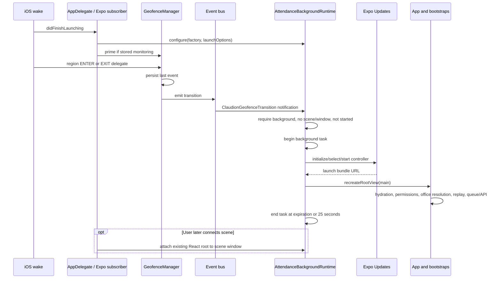

# iOS implementation

> Historical baseline at `de722c9`. Read [11-RELIABILITY-FIXES.md](11-RELIABILITY-FIXES.md) for the current fixes, regression results, native-build limits and physical-device validation plan. Source line anchors below refer to the baseline.

Source baseline and evidence labels: [00-OVERVIEW.md](00-OVERVIEW.md). No Swift compile, iOS build, simulator run, device wake, or live attendance submission was performed.

## Two cooperating native layers

1. **Local Expo module:** Core Location manager, Expo functions/events, UserDefaults store, event bus, and app-delegate subscriber under `modules/expo-auto-attendance/ios/`.
2. **Application runtime:** committed `ios/ClaudionCheckin/AttendanceBackgroundRuntime.swift`, configured from `AppDelegate.swift`, with an app-specific scene delegate. A source template lives under `native/ios/`; the config plugin copies and wires it during native generation. This layer attempts React startup during a wake without a connected scene. It does not make native attendance requests.

Module registration declares `ExpoAutoAttendanceModule` and `AutoAttendanceAppDelegateSubscriber`. The podspec uses iOS 16.4, Swift 5.9, static framework linkage, ExpoModulesCore, and CoreLocation. Podfile.lock references the local module and the Xcode project includes the runtime source in Sources. This proves configuration presence, not successful compilation or execution. [expo-module.config.json:6](../../modules/expo-auto-attendance/expo-module.config.json#L6), [podspec:13](../../modules/expo-auto-attendance/ios/ExpoAutoAttendance.podspec#L13), [Podfile.lock:39](../../ios/Podfile.lock#L39), [project.pbxproj:438](../../ios/ClaudionCheckin.xcodeproj/project.pbxproj#L438).

## Core Location lifecycle and registration

`GeofenceManager.shared` is a singleton NSObject/CLLocationManagerDelegate. Its lazy location manager installs itself as delegate. The Expo module primes it on the main queue at creation; `AutoAttendanceAppDelegateSubscriber.didFinishLaunchingWithOptions` primes it when stored monitoring is true, including a possible location-triggered launch. Priming reconnects delegate delivery; it is not a server configuration refresh or a fresh employee-scoped registration. [manager:18](../../modules/expo-auto-attendance/ios/GeofenceManager.swift#L18), [module:32](../../modules/expo-auto-attendance/ios/ExpoAutoAttendanceModule.swift#L32), [subscriber:13](../../modules/expo-auto-attendance/ios/AutoAttendanceAppDelegateSubscriber.swift#L13).

`startGeofence` checks coordinates/radius, any authorization, Always authorization, and full accuracy. Unlike the JS permission-status check alone, native reduced precision rejects start. `GeofenceManager.start` verifies region-monitoring availability and rejects concurrent pending registration. Radius is clamped to `maximumRegionMonitoringDistance` when applicable. It creates one CLCircularRegion with entry and exit notification enabled, stops relevant old regions, saves pending callbacks/configuration, then calls `startMonitoring`. Storage is committed only in matching `didStartMonitoringFor`; that callback requests initial state and resolves the start promise. [module:45](../../modules/expo-auto-attendance/ios/ExpoAutoAttendanceModule.swift#L45), [manager:145](../../modules/expo-auto-attendance/ios/GeofenceManager.swift#L145), [manager:253](../../modules/expo-auto-attendance/ios/GeofenceManager.swift#L253).

`stop` clears initial-state retry bookkeeping, stops matching circular regions (all circular regions if no stored identifier), clears saved registration, and resolves. It does **not** clear pending-start callbacks/configuration. Consequently a late matching `didStartMonitoringFor` can reach the pending-start success path after stop; actual OS callback timing is unverified. `isMonitoring` and `getRegisteredGeofences` read UserDefaults rather than compare live Core Location registrations. [manager:194](../../modules/expo-auto-attendance/ios/GeofenceManager.swift#L194), [module:96](../../modules/expo-auto-attendance/ios/ExpoAutoAttendanceModule.swift#L96).

## Initial inside detection and normal callbacks

`didDetermineState` applies only to the awaiting initial region identifier. `.inside` emits synthetic ENTER; `.outside` completes without EXIT; `.unknown` schedules main-queue retries after 2, 4, and 8 seconds, then settles after the maximum retry count. State retry cancellation tracks an identifier, not a unique registration generation. Replacing a registration under the same identifier is therefore a race surface. [manager:65](../../modules/expo-auto-attendance/ios/GeofenceManager.swift#L65), [manager:294](../../modules/expo-auto-attendance/ios/GeofenceManager.swift#L294).

`didEnterRegion`/`didExitRegion` both call `handleTransition`. It stores `{identifier, transition, timestamp}` using current callback time, posts an app-runtime notification through the event bus, and emits `onGeofenceEnter`/`onGeofenceExit` if a module listener is attached. It does not validate current login, employee, policy, tenant, stored monitoring flag, or whether the callback belongs to a current registration. The last-event slot overwrites prior events. [manager:227](../../modules/expo-auto-attendance/ios/GeofenceManager.swift#L227), [manager:328](../../modules/expo-auto-attendance/ios/GeofenceManager.swift#L328), [store:46](../../modules/expo-auto-attendance/ios/GeofenceStore.swift#L46), [bus:25](../../modules/expo-auto-attendance/ios/GeofenceEventBus.swift#L25).

`monitoringDidFailFor` rejects matching pending start or emits an error otherwise, without clearing monitoring storage or automatically re-registering. General `didFailWithError` logs. Authorization downgrade while monitoring emits `-1`; reduced precision emits `-3`; low-power activation emits `-2`. Those callbacks do not themselves stop/repair the monitor. The bootstrap has no native-error subscription; screen-level warnings do not implement background recovery. [manager:278](../../modules/expo-auto-attendance/ios/GeofenceManager.swift#L278), [manager:340](../../modules/expo-auto-attendance/ios/GeofenceManager.swift#L340), [hook:269](../../hooks/useAutoAttendance.js#L269).

## Wake without a scene: application-owned JavaScript startup

`AppDelegate` creates the Expo React factory, preserves Firebase configuration, and calls `AttendanceBackgroundRuntime.configure` before forwarding launch to Expo. The runtime observes `ClaudionGeofenceTransition` and `RNFBMessagingDidReceiveRemoteNotification` on the main queue. The Swift event bus posts the former even before an Expo module listener exists. [AppDelegate.swift:17](../../ios/ClaudionCheckin/AppDelegate.swift#L17), [runtime:21](../../ios/ClaudionCheckin/AttendanceBackgroundRuntime.swift#L21), [bus:25](../../modules/expo-auto-attendance/ios/GeofenceEventBus.swift#L25).

`startIfNeeded` requires a factory, `!hasStarted`, app state background, no connected scenes, and no provider window. A DEBUG-only environment probe can bypass the wake guards for simulation. It sets `hasStarted` before bundle/root success, begins a UIKit background task, and schedules ending it after 25 seconds; expiration also ends it. Ending the task does not unmount the React root. A failed root/controller start has no explicit runtime retry reset. [runtime:46](../../ios/ClaudionCheckin/AttendanceBackgroundRuntime.swift#L46).

The runtime uses `EXUpdates.AppController`, selecting its launch asset where active, otherwise the factory bundle URL. `createRootView` retains a single React view. `AttendanceSceneDelegate` uses Expo's normal scene connection unless the background runtime has started; otherwise it attaches the existing root and forwards incoming connection actions. This prevents the intended duplicate App mount after a windowless wake. Actual delegate timing and Updates interaction remain unverified. [runtime:75](../../ios/ClaudionCheckin/AttendanceBackgroundRuntime.swift#L75), [runtime:115](../../ios/ClaudionCheckin/AttendanceBackgroundRuntime.swift#L115).

This is an attempt to process an OS-delivered wake, not a scheduler that guarantees one. There is no attendance BGTaskScheduler registration, continuous `startUpdatingLocation`, or native background URLSession attendance implementation. Full application hydration, fonts/preferences, OTA startup, online employee fetch, GPS acquisition, and attendance requests still compete for available execution time. The normal request timeouts and unbounded office GPS call can exceed this runtime's 25-second task window. [App.js:130](../../App.js#L130), [bootstrap:442](../../components/AutoAttendanceBootstrap.jsx#L442), [manager:237](../../modules/expo-auto-attendance/ios/GeofenceManager.swift#L237).

## Configuration and plugin contract

Committed Info.plist includes foreground/Always location descriptions, motion description, a single scene configuration using `ClaudionAttendanceSceneDelegate`, and **only `remote-notification`** in UIBackgroundModes. The code uses region monitoring, not continuous background location. Absence of `location` background mode is not by itself evidence of a region-monitoring defect: Apple's archived guidance distinguishes region monitoring from continuous location updates. [Info.plist:53](../../ios/ClaudionCheckin/Info.plist#L53), [Info.plist:67](../../ios/ClaudionCheckin/Info.plist#L67), [Apple Core Location guidance](https://developer.apple.com/library/archive/documentation/UserExperience/Conceptual/LocationAwarenessPG/CoreLocation/CoreLocation.html).

`withAttendanceBackgroundRuntime` accepts the expected single default Expo scene configuration, patches AppDelegate without taking over Firebase/linking, adds the Swift file to the Xcode project, and copies the template. Its second `normalizeManifestOnly` invocation brackets the Expo build-properties scene-support transformation. It explicitly refuses unrecognized custom scene/delegate setups rather than guessing. The committed runtime and template were byte-equal at investigation. [plugin:42](../../plugins/withAttendanceBackgroundRuntime.js#L42), [plugin:62](../../plugins/withAttendanceBackgroundRuntime.js#L62), [app.json:27](../../app.json#L27), [native template:1](../../native/ios/AttendanceBackgroundRuntime.swift#L1).

## OS conditions and unknowns

Apple's archived region-monitoring guidance describes conditional delivery while an app is not running, limited time after a location wake, and suppression when Background App Refresh is disabled. It also describes initial-state querying and finite region capacity. These references establish platform conditions, not a tested modern-iOS force-quit guarantee. [Apple region monitoring guidance](https://developer.apple.com/library/archive/documentation/UserExperience/Conceptual/LocationAwarenessPG/RegionMonitoring/RegionMonitoring.html).

**UNVERIFIED:** physical-device location wake, ordinary termination versus explicit force-quit, post-reboot callback delivery, Background App Refresh restrictions, Always/reduced-accuracy changes, permission prompts during windowless startup, no-scene guard timing, background GPS resolution, expired token refresh, Updates startup failure, Firebase wake interoperability, task expiration during writes/API calls, and later scene attachment. Native comments claiming relaunch after user termination are intent, not evidence.
