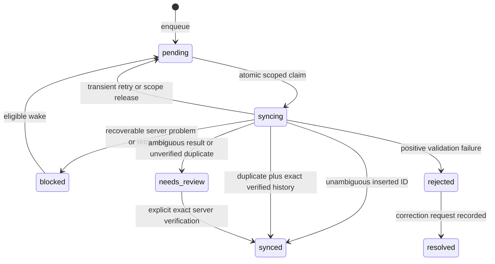

# Offline persistence, sync, and recovery

> Historical baseline at `de722c9`. Read [11-RELIABILITY-FIXES.md](11-RELIABILITY-FIXES.md) for the current fixes, regression results, native-build limits and physical-device validation plan. Source line anchors below refer to the baseline.

Source baseline and evidence labels: [00-OVERVIEW.md](00-OVERVIEW.md). The current implementation is schema version **4** and tenant-scoped. Older prose describing employee-only drains or unconditional duplicate success is not the current contract.

## Two different kinds of saved event

Native SharedPreferences/UserDefaults hold one latest transition. SQLite holds attendance submissions that JavaScript actually enqueued. Native persistence alone does not mean an attendance row exists, and queue acceptance does not mean server acceptance. The durable session commits a queued allowed response before upload, while separate acceptance fields record server evidence. [native Android store:57](../../modules/expo-auto-attendance/android/src/main/java/expo/modules/autoattendance/GeofenceStore.kt#L57), [native iOS store:46](../../modules/expo-auto-attendance/ios/GeofenceStore.swift#L46), [session:300](../../utils/attendanceSessionState.js#L300), [database:239](../../services/offline/AttendanceDatabase.js#L239).

## Queue admission

`submitManualAttendance` uses `submitOnlineOnly`: it attempts the real API regardless of NetInfo and never creates a new manual queue row. Existing manual/photo rows remain supported. `submitAutoAttendance` attempts online when transport is available and not forced to queue; eligible failures or unavailable transport use cached admission rules. [queue service:337](../../services/offline/AttendanceQueueService.js#L337), [queue service:405](../../services/offline/AttendanceQueueService.js#L405).

`isStateOnline` rejects `type: "none"` or `isConnected: false`; `isInternetReachable` is diagnostic only. Queue admission refuses admin-disabled, known-unsupported endpoint, or unavailable policy. Unknown capability permits queueing. Forced queue can fall back to online if queueing is refused and transport is available. Thus `forceQueue` is not an absolute guarantee that the punch stays behind older rows. [NetworkListener:57](../../services/offline/NetworkListener.js#L57), [queue service:521](../../services/offline/AttendanceQueueService.js#L521), [offlineCapability:50](../../services/offline/offlineCapability.js#L50).

Automatic `evaluateOfflineAttendance` uses cached flags/locations and bypasses radius enforcement. It can try a Balanced GPS fix for up to 12 seconds, then a last-known fix at most two minutes old; no fix still permits automatic queueing. GPS data here is upload tagging, not verification that the boundary crossed. `resolveNearestOffice` has an online-to-cache fallback for its callers, but the auto bootstrap does not call it. It attempts online office/GPS initialization before replay; caught failure or missing permission returns null and does not suppress replay, while an unresolved call delays it. [gate:29](../../services/offline/offlineAttendanceGate.js#L29), [gate:122](../../services/offline/offlineAttendanceGate.js#L122), [gate:166](../../services/offline/offlineAttendanceGate.js#L166), [bootstrap:458](../../components/AutoAttendanceBootstrap.jsx#L458).

## Provenance and scope

`captureAttendanceQueueScope` obtains normalized tenant, employee, authenticated generation, and account identity from persisted context. It removes the access token from the captured queue scope. Assertions compare current generation/suspension, tenant, employee, account identity, and authentication; rotated access tokens may remain within the same generation. Unknown historical provenance is never inferred from the login that happens to be active later. [provenance:14](../../services/offline/attendanceQueueProvenance.js#L14), [provenance:28](../../services/offline/attendanceQueueProvenance.js#L28), [provenance:65](../../services/offline/attendanceQueueProvenance.js#L65), [provenance:83](../../services/offline/attendanceQueueProvenance.js#L83).

Native events lack identity. Bootstrap captures a scope at effect start and passes it only when event timestamp is at/after that observation (or absent). Older replay passes NULL. At insertion, invalid/stale source scope also becomes NULL tenant instead of being attributed to the new session. Explicit old-origin scope that is still valid can retain its tenant; scoped upload rejects a different current tenant. [bootstrap:163](../../components/AutoAttendanceBootstrap.jsx#L163), [bootstrap:237](../../components/AutoAttendanceBootstrap.jsx#L237), [queue service:209](../../services/offline/AttendanceQueueService.js#L209).

**Confirmed structural consequence:** NULL-tenant rows cannot be selected by an authenticated non-NULL tenant drain, yet older NULL-tenant pending/syncing/review or non-endpoint blocked rows participate in dependencies for that same employee. Such a replay row can be locally accepted and keep newer attributable rows from being claimed. This is a preservation/attribution limitation, not proof that the old event belonged to the current tenant. [repository claim dependencies:119](../../services/offline/AttendanceQueueRepository.js#L119), [repository claim:324](../../services/offline/AttendanceQueueRepository.js#L324).

## Database and migrations

`AttendanceDatabase` lazily opens `claudion-attendance.db`, enables WAL/foreign keys, and runs transactional version steps. Concurrent opens share one promise; migration failures roll back and clear the cached handle. Fresh databases receive all current fields. [database:22](../../services/offline/AttendanceDatabase.js#L22), [database:249](../../services/offline/AttendanceDatabase.js#L249), [database:315](../../services/offline/AttendanceDatabase.js#L315).

| Field group | Current columns |
| --- | --- |
| Identity/order | `id`, `employeeId`, nullable `employeeDocname`, nullable `tenantKey`, `attendanceType`, `action`, naive wall-clock `timestamp` |
| Metadata | `latitude`, `longitude`, `accuracy`, `address`, `deviceId`, serialized `payload` |
| Progress | `status`, `retryCount`, `nextAttemptAt`, `createdAt`, `updatedAt`, `lastAttemptAt`, `attemptCount` |
| Server outcome | `serverCheckinId`, serialized `serverResponse`, `duplicate`, `duplicateMessage`, `error` |
| Failure/correction | `failureClass`, `blockedSince`, `resolutionDocname`, `resolvedAt` |
| Pairing | `sessionId`, `pairedAttendanceId` |
| Evidence | `acceptanceConfirmed`, `verifiedAt`, serialized `verificationEvidence`, `verificationCheckedAt`, `verificationIssue` |

Evidence: [base schema:125](../../services/offline/AttendanceDatabase.js#L125), [v2 fields:200](../../services/offline/AttendanceDatabase.js#L200), [v3:232](../../services/offline/AttendanceDatabase.js#L232), [v4:239](../../services/offline/AttendanceDatabase.js#L239).

Migration v2 converts old `failed` rows to recoverable unknown blocks and adds pairing/correction metadata. v3 adds nullable tenant provenance, leaves old rows NULL, and rebuilds deduplication. v4 adds evidence/attempt fields without pretending historical synced/duplicate rows have proof. Preserve existing version statements and legacy data; modifying only fresh-create SQL would not upgrade existing devices.

The unique key is `(IFNULL(tenantKey, ''), employeeId, timestamp, action)`. `enqueue` uses INSERT with ON CONFLICT DO NOTHING and reads the winning row. It deduplicates exact tenant/employee/second/action, not every semantically equivalent event. Dedupe excludes attendance type, payload, and native event identifier. [database:159](../../services/offline/AttendanceDatabase.js#L159), [repository:152](../../services/offline/AttendanceQueueRepository.js#L152).

## Pairing and atomic claims

Queued OUT searches for the most recent unpaired earlier/equal IN for the same tenant and employee among unresolved states. Pair links are written in separate updates, not a single transaction. Out-of-order arrival can sort correctly at drain time but does not retroactively pair an OUT inserted before its IN. [repository:229](../../services/offline/AttendanceQueueRepository.js#L229).

`claimNextRow` uses atomic UPDATE ... RETURNING to move one due pending row to syncing, recording attempt time/count. Candidate order is timestamp then ID. It refuses a candidate if an older same-employee row in the same tenant **or with NULL tenant** is pending/syncing/needs_review, or blocked for anything except missing endpoint. It also prevents a mismatched-scope unresolved paired row from being bypassed. Rejected/resolved/synced rows do not impose that older-row block. [repository:119](../../services/offline/AttendanceQueueRepository.js#L119), [repository:324](../../services/offline/AttendanceQueueRepository.js#L324).

Production `syncPendingAttendance` requires employee and captures authenticated tenant scope. Low-level repository nullable filters are not authorization by themselves. Per-scope stuck-sync release runs once per JS module lifetime and releases every scoped syncing row without an age-based lease; process-local single-flight prevents normal same-process overlap, but multiple JS contexts could conflict. [sync:402](../../services/offline/AttendanceSyncService.js#L402), [sync:455](../../services/offline/AttendanceSyncService.js#L455), [repository:790](../../services/offline/AttendanceQueueRepository.js#L790).

## Triggers and run lifecycle

`OfflineAttendanceBootstrap` starts `BackgroundSyncManager` for logged-in sessions, including drain-only mode when new queueing is disabled. Start installs NetInfo, reconnect, token-change, queue-kick, and AppState listeners plus a 60-second interval; launch refresh and drain are independent. Foreground and queue-kick debounces are 3 seconds. Timer execution is JavaScript-dependent and is not a native background execution guarantee. [offline bootstrap:107](../../components/OfflineAttendanceBootstrap.jsx#L107), [manager:57](../../services/offline/BackgroundSyncManager.js#L57), [manager:213](../../services/offline/BackgroundSyncManager.js#L213).

| Trigger | Drain behavior |
| --- | --- |
| Launch / transport reconnect | Wake blocked work forcibly as configured and refresh policy unless drain-only. |
| Foreground / periodic timer | Respect normal due times; refresh configuration when applicable. |
| Queue insertion | Debounced burst drain. |
| Token update | Force wake auth-blocked rows. |
| `syncNow` | Capture/reassert scope, wake pending/blocked; user recovery trigger skips policy/GPS refresh. |
| Logout/manager stop | Increment run cancellation generation, remove timers/listeners, retain rows. |

Evidence: [manager:143](../../services/offline/BackgroundSyncManager.js#L143), [manager:157](../../services/offline/BackgroundSyncManager.js#L157), [manager:176](../../services/offline/BackgroundSyncManager.js#L176), [manager:191](../../services/offline/BackgroundSyncManager.js#L191), [manager:255](../../services/offline/BackgroundSyncManager.js#L255), [manager:296](../../services/offline/BackgroundSyncManager.js#L296).

Each run asserts scope, releases scoped stuck claims once, wakes eligible blocked/pending work, checks work due and transport, then claims/uploads at most 50 rows. A same-scope concurrent run awaits the active run; another-scope run returns `another-session-syncing`. Offline, blocked, scope-changed, and review outcomes halt the run; positive rejection can continue after cascade. Scope-changed errors release a claim rather than attach new-session results. Successful responses are not reasserted before `markSynced`, so an already dispatched request can settle during a later scope change. [sync:117](../../services/offline/AttendanceSyncService.js#L117), [sync:149](../../services/offline/AttendanceSyncService.js#L149), [sync:420](../../services/offline/AttendanceSyncService.js#L420), [sync:519](../../services/offline/AttendanceSyncService.js#L519).

Diagram omits retained historical statuses and conditional pairing cascades; no review-to-pending automatic resend transition exists.

## Results, backoff, and capability

One-record uploads accept supported wrappers but require one nonblank inserted docname and consistent optional counts/status/exception metadata. Contradictory success moves to `needs_review`; a duplicate message is only a verification hint. Unknown failures block rather than reject. Endpoint-missing blocks disable **new** automatic queueing through cached capability; inserted success marks support. The duplicate-settlement path does not call `markOfflineSyncSupported`, despite comments elsewhere suggesting duplicates prove support. [AttendanceApi:110](../../services/offline/AttendanceApi.js#L110), [sync:119](../../services/offline/AttendanceSyncService.js#L119), [sync:149](../../services/offline/AttendanceSyncService.js#L149), [offlineCapability:128](../../services/offline/offlineCapability.js#L128).

Pending retry delays are 5 s, 15 s, 45 s, 2 min, then 5 min. The service checks stored retry count against 15 before incrementing another transient failure and then blocks as unknown. Blocked retry timing uses elapsed blocked duration and a 1 min / 5 min / 20 min / 1 h ladder; it is not simply the pending counter ladder. Forced triggers can wake earlier. Positive rejection can cascade to unresolved paired rows within the same tenant/employee; resolution marks the target and rejected partner. [repository:33](../../services/offline/AttendanceQueueRepository.js#L33), [repository:450](../../services/offline/AttendanceQueueRepository.js#L450), [repository:507](../../services/offline/AttendanceQueueRepository.js#L507), [sync:278](../../services/offline/AttendanceSyncService.js#L278), [repository:562](../../services/offline/AttendanceQueueRepository.js#L562), [repository:628](../../services/offline/AttendanceQueueRepository.js#L628).

`purgeSynced` currently returns zero and retains evidence. A seven-day constant/comment in the sync path is not an active purge policy. `clearOfflineAttendance` clears policy/capability only. Explicit full purge exists but is not called by normal logout/expiry. Growth/retention policy is a future decision. [repository:821](../../services/offline/AttendanceQueueRepository.js#L821), [queue service:722](../../services/offline/AttendanceQueueService.js#L722), [queue service:752](../../services/offline/AttendanceQueueService.js#L752).

## Verification and recovery UI

`verifyQueuedAttendance` queries at most 25 pages of 20 records under scope assertions before and after requests. A match needs nonempty server docname, employee equal to stored docname/code, exact supported canonical naive timestamp, and exact IN/OUT. Unsupported offset/fraction formats, multiple matches on a page, malformed history, errors, and bounded search with no match remain inconclusive. A missing match does not prove absence and does not authorize resend. Verification returns on the first page with exactly one match; global uniqueness across later pages is not established. [verification:10](../../services/offline/AttendanceVerification.js#L10), [verification:22](../../services/offline/AttendanceVerification.js#L22), [verification:32](../../services/offline/AttendanceVerification.js#L32).

`reconcileAttendanceRow` is explicit recovery for eligible nonpending/nonsyncing/nonblocked rows; it stores guarded proof or a verification issue, not a replacement punch. Recovery queries include current tenant rows and NULL-tenant rows for the employee, keep other-tenant rows out of the displayed list, and expose separate counts. `useAttendanceRecovery` guards Redux identity against persisted scope, listens to queue/sync/foreground, and offers sync/verify through `AttendanceRecoverySetting`. This path skips location acquisition on user sync. [verification:74](../../services/offline/AttendanceVerification.js#L74), [repository:1137](../../services/offline/AttendanceQueueRepository.js#L1137), [repository:1196](../../services/offline/AttendanceQueueRepository.js#L1196), [recovery hook:35](../../hooks/useAttendanceRecovery.js#L35), [recovery setting:39](../../components/settings/AttendanceRecoverySetting.jsx#L39).

General queue counts/history APIs remain employee-only. `mayAffectServerCount` includes pending/syncing/non-endpoint-blocked/review; it excludes rejected and endpoint-missing blocks. Presence and forced-IN guards therefore count same-code rows across tenants. History merge deduplicates by second/time and log type, not tenant, and can hide an unconfirmed local row if a same-time server row exists. Recovery's scoped evidence view is stricter than the general history timeline. [repository:1033](../../services/offline/AttendanceQueueRepository.js#L1033), [history hook:75](../../hooks/useAttendanceHistory.js#L75), [history merge:291](../../utils/attendanceHistory.js#L291).

## Cached policy and retained photos

The cache refresh captures scope and records tenant/employee. Reads do not reject another tenant/employee or expire data; six hours is a refresh threshold, not an admission TTL. An empty-location refresh preserves the previous entire config when previous nonempty locations match scope, potentially retaining old flags. Clearing the cache blob does not independently clear every legacy key. [cache:165](../../services/offline/attendanceConfigCache.js#L165), [cache:204](../../services/offline/attendanceConfigCache.js#L204), [cache:236](../../services/offline/attendanceConfigCache.js#L236), [cache:273](../../services/offline/attendanceConfigCache.js#L273), [cache:288](../../services/offline/attendanceConfigCache.js#L288).

Legacy queued photos upload best-effort only after attendance is marked synced; failure must not undo a confirmed punch. The helper passes FormData/custom_image to `putUserFile`, but that callee treats its first argument as employee code and builds an employee update body without consuming the custom_image FormData. This caller/callee contract mismatch is source-established; actual attachment outcome is **UNVERIFIED**. Preserve old photo rows and inspect this seam before future attachment work. [photo helper:32](../../services/offline/attendancePhotoUpload.js#L32), [upload service:55](../../services/api/upload.service.js#L55), [sync:173](../../services/offline/AttendanceSyncService.js#L173).
