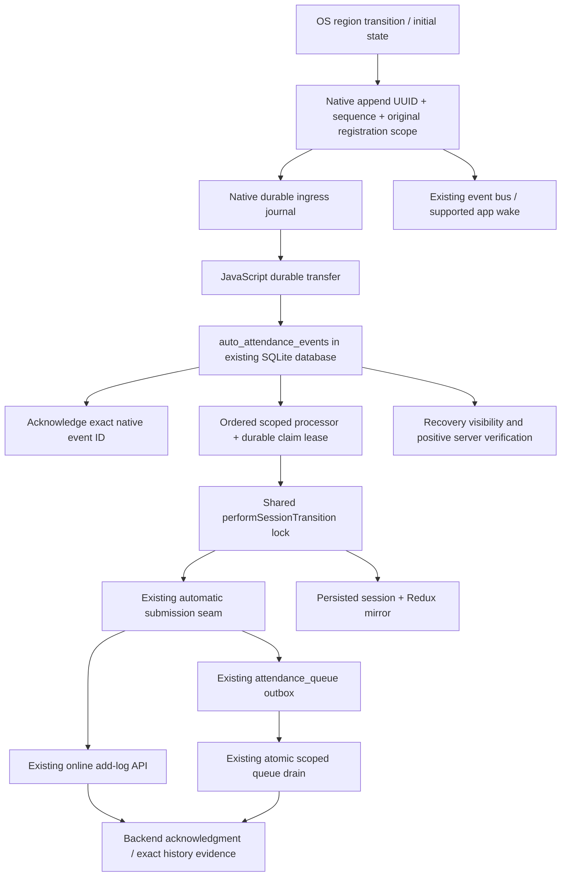

# Auto Attendance reliability fixes — 2026-10-13

> Historical implementation report. The journal implementation described here was subsequently committed by the repository owner as `14828da`. Read [12-HYBRID-RELIABILITY-FIXES.md](12-HYBRID-RELIABILITY-FIXES.md) for the 2026-10-14 follow-up. In particular, its queue-claim, manual timestamp, iOS pending-registration and initial-presence fixes supersede the remaining-risk statements below; it also clarifies iOS force-quit behavior.

This report supersedes implementation statements in the baseline context documents, which describe commit `de722c954621bd0eeb980917f397677df9bdc69e`. The baseline remains available for comparison. Changes are local and uncommitted. No production attendance request, EAS build, publication, commit, push, or physical-device experiment was performed.

## Findings and reproducible failures

The following are confirmed source defects with reproducible storage/JavaScript failure sequences. They establish failure mechanisms, not the exact cause of this client's device incident. The 36 m and 354 m snapshots do not establish that Android or iOS delivered a callback.

| Finding | Reproduction before the fix | Correction |
| --- | --- | --- |
| Single-event overwrite | JavaScript is absent; native captures ENTER, then EXIT. The last-event slot retains only EXIT. A closed local session cannot produce its missing IN, and EXIT is skipped. | Both native stores append UUID/sequence receipts. An exact-ID acknowledgment removes only a receipt transferred to SQLite. Display clearing, stop, and replacement retain pending receipts. |
| Stale geofence retention | Office geometry, radius, employee or tenant changes while `isMonitoring` remains true. Bootstrap refreshes its office but keeps the old OS region. The UI can show 36 m from the new office without that office being monitored. | Compare tenant, employee, logical ID, configuration fingerprint, policy and full geometry. Replace mismatches. A callback observed after a known configuration refresh cannot punch against an office/radius removed by that refresh. Valid earlier receipts retain their original registration snapshot. Unique physical OS identifiers reject delayed old callbacks. Account for iOS radius clamping. |
| Unattributed replay rows block uploads | A historical callback has no tenant/employee provenance. Replay assigns the current employee, queues a NULL-tenant IN, and later scoped punches cannot overtake it. | New captures carry registration ownership. Unknown captures become review receipts, not attendance queue rows. Existing NULL-tenant attendance evidence remains retained and cannot be guessed or uploaded to a new tenant. Historical blockers still require administrator verification. |
| Global replay/session authority | A newer device-global processed timestamp suppresses another account's old event; the same employee code across tenants inherits an unrelated active session or checkout floor. | The durable path uses per-event receipts and scope, never the global timestamp mark. Session ownership includes tenant plus employee under the shared transition lock. Archive unproven legacy state before clearing its active record/floor; require current-scope server reconciliation. |
| Online OUT overtakes queued IN | Offline ENTER is accepted locally and queues IN. Connectivity returns before its upload; EXIT directly submits OUT because only subsequent IN was ordered. A rejected IN can also leave the local session open. | Strict automatic submissions check all earlier unresolved scoped queue work in both directions. The session retains the IN source identity; OUT queues behind that parent or needs review if the parent was rejected. Atomic claims require positive parent acceptance even if a crash prevented pair-link writes. Native queue insertion order survives a wall-clock correction without changing captured timestamps. Manual actions also cannot overtake a newly queued scoped native punch; they remain online-only and can proceed after its server confirmation. Admission refusal retains the ingress event and cannot fall through to an online request. |
| Replay waits for fresh location | Startup waits for employee data and an unbounded high-accuracy fix before native replay. Indoors, cold GPS or absent network delays actual captured events. | Transfer/replay precedes registration and fresh configuration. Single-office registration needs no GPS; multiple-office selection uses a bounded fix and retains only still-valid geometry. |
| Interrupted request can duplicate or orphan attendance | A request reaches the backend, then the app dies before committing the local session/receipt. Blind replay sends it again. Alternatively, a rejected queue row is mistaken for a committed IN. | Persist the frozen timestamp and dispatch marker before POST. Recover an accepted source queue row or verify exact history evidence. Uncertain outcomes need review; rejected/unconfirmed rows cannot open a session. |
| Concurrent receipt recovery steals live work | Processor A awaits server time; processor B resets A's processing receipt to pending and also POSTs. | Durable 120-second leases and owner-checked SQL updates. Renew/check the claim across timestamp preparation, submission and session commit. Expired recovery retains the prior dispatch marker. |
| Location snapshot opens attendance | Restart inside after manual checkout creates a new IN without a delivered OS transition. | Removed JavaScript snapshot-generated IN. Android initial-trigger ENTER and iOS authoritative region-state callbacks remain supported; unknown state or current GPS distance creates no punch. |

## Current pipeline and recovery



| Stage | Files/functions | Lifecycle, loss prevention and retry |
| --- | --- | --- |
| Detection/registration | Kotlin `GeofenceManager`, Swift `GeofenceManager`, `autoAttendanceRegistration.reconcileAutoAttendanceRegistration` | Native OS geofencing remains the detector. Permissions and precision gate registration. Android cold native initialization and boot/package broadcasts restore desired scoped configuration; iOS compares saved identifiers with `monitoredRegions`. Registration mutations have cancellation/generation protection and bounded recovery. |
| Callback/capture | Android `GeofenceBroadcastReceiver.onReceive`, iOS `handleTransition` | Android snapshots registration ownership before asynchronous work and uses bounded `goAsync`. Swift attaches its delegate through the existing app subscriber. No native HTTP, worker, or second authentication mechanism was added. |
| Native durability | Android `GeofenceEventJournal`/`GeofenceStore`, Swift `GeofenceStore` | Android synchronous SharedPreferences commits; Swift atomic, synchronized Application Support file writes with until-first-unlock protection. Append before emit/wake. Stable UUID, monotonic sequence, no age/capacity eviction. Storage/corruption failures fail explicitly rather than replacing the journal with an empty one. Legacy last-event migration stays unattributed. |
| Transfer | `AutoAttendanceEventProcessor.ingestPendingNativeEvents` | SQLite insert commits before native ack. Repeated transfer is insert-on-conflict without outcome replacement. Ack failure retains native evidence and still permits processing its committed SQLite copy. |
| Validation/order | `AutoAttendanceEventRepository`, `AutoAttendanceEventProcessor` | Exact tenant/employee, logical region, fingerprint, finite geometry, timestamp and geotagging validation. Sequence orders callbacks; unresolved earlier work blocks later attendance. Unknown/stale inputs remain review evidence. Definite validation refusals cannot suppress a later valid callback; only unresolved eligible attendance/uncertain dispatches hold its ordering. No 24-hour discard on the journal path. |
| Session decision | `attendanceSessionState.performSessionTransition` | Same lock and two-state authority as manual attendance, spanning submission. Duplicate IN/OUT and OUT before session start are skipped with durable outcomes. Strict automatic reads fail closed on unreadable/corrupt storage. The IN source survives restart and reconciliation of the same session; a new manual IN clears it. Scope and claim are checked before submission and commit. No `readSession()` inside `execute`. |
| Online/offline acceptance | `AttendanceQueueService.submitAutoAttendance`, `attendance.service.autoCheckInOut` | Existing API payload/response shapes remain. Frozen event timestamps, scoped requests, source receipt deduplication, matching cached policy and existing queue capability. Connectivity transport governs attempts. Eligible automatic failures use the established queue; manual punches remain online-only. |
| Queue drain/acknowledgment | Existing `AttendanceSyncService` and `AttendanceVerification`, queue repository | Existing atomic claims, scope guard, one-row requests, pairing, retry/backoff and positive duplicate verification remain. New native child claims additionally require confirmed acceptance of their source parent. Queued acceptance remains distinct from backend confirmation. Unknown backend errors remain recoverable. |
| Restart/UI | `DurableAutoAttendanceBootstrap`, `OfflineAttendanceBootstrap`, recovery hook/setting | Replay on startup, foreground, reconnect, native callback/error and a live-JavaScript timer. Permission/GPS failure cannot discard already captured receipts. Session/Redux mirror reflects accepted transitions. Recovery displays pending/review events; checking an uncertain server record never resends it. Logout stops monitoring and cancels current-scope work while retaining evidence. |

There is one attendance outbox: `attendance_queue`. Native journals buffer ingress until transfer; `auto_attendance_events` is an ingress/outcome ledger in the same SQLite database, not a second punch queue or session authority. Schema migration **v4 → v5** adds the ledger and optional queue `sourceEventId`, preserving older attendance/photo records, deduplication constraints and migration rollback.

The optional session `sourceEventId` and queue JSON `sourceParentEventId` preserve native IN/OUT association across restart. These are internal storage fields; the existing offline API serializer does not send the parent field. Native-to-native ordering uses queue insertion order, while older records retain their established timestamp ordering. A missing, rejected or unconfirmed parent cannot authorize its child's upload. Unknown historical provenance still prevents unsafe overtaking.

An interrupted processing receipt waits for its live lease to expire before another runtime can claim it. If no POST was recorded, it can resume. If a POST may have run, exact positive history evidence is required; absence from visible history does not authorize another POST. Same-second distinct inputs of the same type are held for review because the existing seconds-resolution timestamp contract cannot distinguish them safely. UUIDs provide client identity, not server exactly-once guarantees.

Unproven legacy owner evidence is archived before removal. Only a matching intended tenant/employee can clear its marker after successful server reconciliation. A corrupt marker holds automatic processing. Known tenant switches clear the previous active session while retaining punch queues. Same-scope expiry does not discard a current scoped session. Automatic offline clock offsets are tenant-scoped; historical unscoped offsets are not assigned to a new tenant.

## Preserved contracts and release compatibility

- Geotagging 0 remains disabled, 1 remains warnings-only, and 2 allows automatic actions with the persisted opt-in. No callback is converted into attendance under warnings-only policy.
- Manual attendance remains online-only and shares the existing durable session machine. A manual action now waits for a new scoped automatic outbox record to be confirmed, rather than overtaking it; the app explains the need to synchronize or verify. Historical NULL-source records do not acquire that new manual restriction. Manual IN → automatic EXIT works; automatic IN → manual OUT makes a subsequent EXIT a no-op.
- QR/mobile authentication, token refresh ownership, SDK integration, endpoints, payloads, content types, API return/error shapes, offline capability gates, radius/photo business rules and one-record offline uploads remain intact. Added API arguments are optional internal scope/timestamp controls.
- The existing online `auto: true` payload and offline endpoint contract remain unchanged. Offline automatic attribution must still be verified against the live backend; no undocumented field was added.
- No attendance is inferred from a UI distance, a stale GPS fix, a denied permission, or an unknown iOS region state. OS initial-state ENTER may legitimately be captured on registration; its timestamp describes native observation, not a reconstructed earlier physical crossing.
- Request-body and raw error-response diagnostics were removed from `apiClient`; the refresh form previously exposed its unmasked credential through a diagnostic body. Tests use synthetic values. HTTP refresh behavior is unchanged.
- Native methods are additive. Older binaries import safely and retain the compatibility path, but cannot acquire durable capture through OTA. The compatibility path still has the old native single-slot/lifecycle limits and is not the journal rollout target.
- **A new Android and iOS EAS build is required.** Runtime `1.2.1-sdk57-attendance-journal-v1` is aligned in `app.json` and committed iOS `Supporting/Expo.plist`; the existing ignored generated Android runtime string was aligned for local validation. Marketing versions/build counters were not changed. Increment release counters under the normal release procedure. EAS requires committed changes, so build/publication remain the owner's later release action; no commit was made here.

## Validation executed

| Check | Result | What it establishes |
| --- | --- | --- |
| Full Jest | **94 suites passed; 2,094 tests passed; 13 existing TODOs** | JavaScript contracts, real SQLite via the existing WASM fixture, auth/session/queue regression and screen tests. Command: `npm test -- --runInBand --watchman=false --silent --forceExit`. Existing runs left asynchronous handles; final run used explicit `--forceExit` after tests completed. TODOs are not claimed coverage. |
| New durable bootstrap | 6 integration tests passed, included above | Transfer/replay before registration; no GPS dependency; denied-permission retention; live UI reconciliation; logout isolation; reconnect recovery after missing configuration. |
| Processor/storage/queue/session regressions | Included in full suite | ENTER/EXIT dedupe, both offline events, online OUT ordering, rapid transitions, ack/write failure, frozen time, tenant switching, logout during HTTP, restart, lease ownership, uncertain dispatch verification, rejected source rows/parents, clock-correction ordering, crash before pair links, positive parent confirmation, migration evidence/rollback and manual interoperability. |
| Recovery themes | Light/dark retained-native-event tests passed | Saved/review visibility without submission; device rendering remains unverified. |
| Android native journal harness | **13 cases passed** | Production Kotlin journal/store, filesystem-backed SharedPreferences test adapter, real UUID/order/restart/ack/concurrency/migration/failure logic. Does not exercise Android's actual SharedPreferences, receivers or Play Services delivery. |
| Android API compilation | Passed against Android 36, cached Play Services and AndroidX APIs | Changed manager, receiver, boot receiver, bus, store and journal compile. Expo module integration was excluded with an event-constant stand-in; this is not a full Android Gradle/app build. The added cold-module restore call remains a native integration/device check. |
| Swift native journal harness | **31 checks passed** | Real Foundation atomic file persistence/restart, exact ack, display clearing, legacy migration, concurrent capture, corruption/failure, requested-vs-clamped geometry and monitor invalidation. No Core Location delivery. |
| iOS native module | Unsigned arm64 `ExpoAutoAttendance` target build passed against iPhoneOS 27 SDK and ExpoModulesCore | All changed module Swift sources compile; does not validate the full application, launch wake path or a device. |
| Metro | Android/iOS exports passed to `/tmp/claudion-auto-attendance-export` | JavaScript imports, Expo bridge and platform bundles resolve. No OTA publication. |
| Diff/commit | `git diff --check` passed; HEAD remains `de722c954621bd0eeb980917f397677df9bdc69e` | No commit or push. Pre-existing SDK docs and provenance tests remain; one characterization expectation was updated for the intentional no-snapshot-attendance rule. |

The first broad run failed old tests that expected snapshot-generated IN; those expectations were corrected to the required OS-event behavior. Adding recovery actions required updating the recovery suite's Redux dispatch mock. Subsequent full checks passed. No ESLint/typecheck configuration exists; no successful configured lint/typecheck is claimed.

Re-run native checks:

```sh
sh modules/expo-auto-attendance/android/journal-tests/run-journal-tests.sh /path/to/json-java.jar
xcrun swiftc -module-cache-path /tmp/claudion-attendance-swift-cache modules/expo-auto-attendance/ios/GeofenceStore.swift native-tests/ios/GeofenceStoreTests.swift -o /tmp/claudion-geofence-store-tests
/tmp/claudion-geofence-store-tests
xcodebuild -project ios/Pods/Pods.xcodeproj -scheme ExpoAutoAttendance -configuration Debug -sdk iphoneos -derivedDataPath /tmp/claudion-ios-native-derived ARCHS=arm64 ONLY_ACTIVE_ARCH=NO OBJROOT=/tmp/claudion-ios-native-derived/Build/Intermediates.noindex SYMROOT=/tmp/claudion-ios-native-derived/Build/Products CLANG_MODULE_CACHE_PATH=/tmp/claudion-ios-native-derived/ModuleCache.noindex SWIFT_MODULE_CACHE_PATH=/tmp/claudion-ios-native-derived/ModuleCache.noindex CODE_SIGNING_ALLOWED=NO build
```

## Physical-device validation matrix — every row NOT EXECUTED

Use disposable staging employees on a supported Android with Play Services, an OEM device with restrictive battery management, and a physical iPhone. Record exact app build/runtime, OS/device, permissions, precision, location-service and battery settings. Use a configured 100 m office, clear planned physical inside/outside locations, and adequate dwell time for OS delivery. Repeat with policy 0/1/2 and opt-in off/on. Location snapshots supplement callback evidence; they do not replace it.

| Scenario | Android expected/limit | iOS expected/limit | Acceptance evidence |
| --- | --- | --- | --- |
| Foreground ENTER then EXIT | Supported when OS delivers both | Supported when OS delivers both | One UUID/sequence per capture; one accepted IN then OUT; original callback timestamps; correct UI. |
| Enable while initially inside | INITIAL_TRIGGER_ENTER if provider can establish presence | `requestState` inside; bounded unknown retries | Initial OS observation can create one needed IN; unknown state creates none. |
| Background app, JS still alive | Native delivery may be delayed; process when JS runs | Native delivery and JS budget remain OS-controlled | Native append precedes delivery; no duplicate API or queue rows. |
| Screen locked after first unlock | Subject to provider/power restrictions | Journal file uses until-first-unlock protection | Both receipts persist; upload or later replay remains ordered. |
| Android task removed from recents | Often receiver capture works; OEM restrictions can differ; this is not force-stop | Removing from iOS app switcher is user force-quit | Distinguish native capture from immediate backend upload. |
| System-terminated app | Receiver may capture without JS; no immediate JS upload guarantee | Always authorization can permit region relaunch; existing runtime has a bounded budget | Reopen finds every delivered receipt; iOS background root/FCM coexistence needs actual testing. |
| User force-stop / force-quit | **Unsupported while package remains stopped**; Android 15 cancels PendingIntents; explicit launch repairs registration | **No delivery/relaunch guarantee after explicit force-quit**; test after user relaunch separately | Do not fabricate missed crossings. Capture resumes only in supported states. |
| Network disconnected, ENTER + EXIT | Location provider must still deliver callbacks | Core Location must still deliver callbacks | Both captures retained; two ordered queue rows if policy/capability permits; otherwise visible retained receipts. |
| Restore network | Existing queue drain, plus ingress retry | Same, within available runtime | IN accepted before OUT; source identity unchanged; no duplicate concurrent drains. |
| Reopen while queue synchronization runs | Native/SQLite replay and scoped queue claims coexist | Same | No duplicate source enqueue/POST; UI cannot confuse queued with server-confirmed. |
| Device reboot, then first unlock | Boot restore uses bounded `goAsync`; provider/permissions and package state matter | Persisted regions/launch restoration remain OS-dependent; before-first-unlock storage is restricted | Actual registered region matches scoped desired configuration; retained journal survives. |
| Permission revoked and restored | Fine + background required; restored permission retries registration | Always + full precision required | No new snapshot punches; prior captured receipts retained; registration repaired on resume/sync. |
| GPS/location services disabled/restored | No detection guarantee while disabled; GEOFENCE_NOT_AVAILABLE invalidates healthy bookkeeping | No detection guarantee while disabled | Preserve receipts, expose native error/status, repair registration after restoration. |
| Office/radius/tenant/employee changes | Remove old physical registration; new UUID | Remove old region; new identifier; clamp respected | Old callback has original scope or review status, never the new owner; no old-radius monitor retained. |
| Repeated boundary transitions/jitter | OS latency/accuracy can coalesce physical movement | Same | Received events remain ordered; repeated target-state events do not punch twice; same-second ambiguity remains reviewable. |
| Manual IN then EXIT; auto IN then manual OUT | Shared session authority | Shared session authority | One legitimate OUT; subsequent duplicate EXIT does nothing. |
| Process killed immediately after queue insert / POST / session write | Inject each crash window independently | Same | Queue source dedupe or exact-history verification; uncertain POST is never blindly resent. |
| Battery saver/OEM restriction; iOS Low Power Mode/background restrictions | Delivery can be delayed/suppressed | Delivery/relaunch can be restricted | Record observed delay and missing callbacks explicitly; no unsupported guarantee. |

For each crossing inspect registration identity, native receipt ID/sequence/time, SQLite ingress status/dispatch marker/lease, queue source ID/pairing/attempts, backend acknowledgment and final durable session/Redux state. Inspect only the disposable employee's scope; remove credentials from any exported diagnostics. Verify live duplicate/history response shapes and timestamp timezone handling, including an offline outage and reconnect. Build both full applications before this matrix.

Platform boundaries are documented by [Android geofencing](https://developer.android.com/develop/sensors-and-location/location/geofencing), [Android stopped-state behavior](https://developer.android.com/about/versions/15/behavior-changes-all#stopped-state), [BroadcastReceiver execution](https://developer.android.com/reference/android/content/BroadcastReceiver), [Apple region monitoring](https://developer.apple.com/documentation/corelocation/monitoring-the-user-s-proximity-to-geographic-regions), and [Apple location authorization](https://developer.apple.com/documentation/corelocation/requesting-authorization-to-use-location-services). These establish OS constraints, not successful behavior of this app.

## Remaining risks and rollout gates

1. **The client's exact failure is unverified.** Obtain registration/callback/receipt/queue traces on the affected build/device. A missed OS callback cannot be reconstructed reliably from the two snapshots.
2. **Android without JS defers submission.** The native receiver persists captures; no new Headless JS/WorkManager upload runtime was introduced. Immediate server attendance while JS is absent would require an explicitly designed and device-tested runtime integration. iOS uses its existing wake/root path, which remains physically unverified.
3. **Legacy evidence remains ambiguous.** Existing NULL-tenant queue rows, unscoped session backups and uncertain POSTs can legitimately hold processing. Stale or invalid registration receipts remain visible but do not block later valid callbacks. Review is visible; no record is silently discarded or automatically assigned. An exact history match is positive evidence under the existing history contract, not proof of source-event identity or server exactly-once execution.
4. **OS/provider/storage limits remain.** Force-stop/force-quit, poor accuracy, GPS disabled, reboot before unlock, OEM battery restrictions, storage full/corruption and callback delay can prevent capture. Bounded receiver execution cannot guarantee a disk write after OS termination. iOS registration metadata before its confirmation callback is held in the pending native operation; a process death in that narrow window can leave a later callback unattributed and held for review.
5. **Time and backend contracts need staging.** Original native callback timestamps are preserved; the OS may deliver late. Existing naive server-time/timezone parsing, DST, device clock changes, missing scoped clock measurements and seconds-resolution collisions remain limits. Offline automatic classification/history shape and both auth methods' live employee/policy/refresh compatibility require staging; no backend change was made or proved necessary here.
6. **Retention/lease limits remain explicit.** No automatic evidence purge was added. Long outages/review backlogs grow storage. A restarted processor can wait up to the 120-second lease; time changes can affect lease timing. The established attendance queue's cross-runtime stuck-claim recovery was preserved; its single-runtime app ownership still needs lifecycle testing. New ingress leases prevent a second uncertain online POST.
7. **Full applications/devices remain untested.** iOS module build, Kotlin API compilation, harnesses and Metro do not establish full Android Expo integration, iOS application relaunch, platform UI rendering or client production delivery. Complete EAS builds and the matrix before rollout.

## Modified files

The list below records implementation/configuration/tests. All eleven baseline context documents are additionally marked as historical and linked to this report. Pre-existing SDK documentation and the provenance characterization suite were preserved.

- [__tests__/AutoAttendanceBootstrap.presence.test.jsx](../../__tests__/AutoAttendanceBootstrap.presence.test.jsx)
- [__tests__/apiClient.test.js](../../__tests__/apiClient.test.js)
- [__tests__/attendanceQueueMigration.test.js](../../__tests__/attendanceQueueMigration.test.js)
- [__tests__/attendanceRecovery.test.jsx](../../__tests__/attendanceRecovery.test.jsx)
- [__tests__/autoAttendance.characterization.test.jsx](../../__tests__/autoAttendance.characterization.test.jsx)
- [__tests__/autoAttendanceBootstrap.durable.test.jsx](../../__tests__/autoAttendanceBootstrap.durable.test.jsx)
- [__tests__/autoAttendanceDurableEvents.test.js](../../__tests__/autoAttendanceDurableEvents.test.js)
- [__tests__/autoAttendanceEventProcessor.test.js](../../__tests__/autoAttendanceEventProcessor.test.js)
- [__tests__/autoAttendanceOrderedQueue.test.js](../../__tests__/autoAttendanceOrderedQueue.test.js)
- [__tests__/autoAttendanceRegistration.test.js](../../__tests__/autoAttendanceRegistration.test.js)
- [__tests__/autoAttendanceScopedSession.test.js](../../__tests__/autoAttendanceScopedSession.test.js)
- [__tests__/offlineGateGeofence.test.js](../../__tests__/offlineGateGeofence.test.js)
- [__tests__/serverClock.test.js](../../__tests__/serverClock.test.js)
- [app.json](../../app.json)
- [components/AutoAttendanceBootstrap.jsx](../../components/AutoAttendanceBootstrap.jsx)
- [components/DurableAutoAttendanceBootstrap.jsx](../../components/DurableAutoAttendanceBootstrap.jsx)
- [components/OfflineAttendanceBootstrap.jsx](../../components/OfflineAttendanceBootstrap.jsx)
- [components/settings/AttendanceRecoverySetting.jsx](../../components/settings/AttendanceRecoverySetting.jsx)
- [hooks/useAttendanceRecovery.js](../../hooks/useAttendanceRecovery.js)
- [ios/ClaudionCheckin/Supporting/Expo.plist](../../ios/ClaudionCheckin/Supporting/Expo.plist)
- [modules/expo-auto-attendance/android/journal-tests/AndroidStorageTestAdapter.kt](../../modules/expo-auto-attendance/android/journal-tests/AndroidStorageTestAdapter.kt)
- [modules/expo-auto-attendance/android/journal-tests/GeofenceJournalHarness.kt](../../modules/expo-auto-attendance/android/journal-tests/GeofenceJournalHarness.kt)
- [modules/expo-auto-attendance/android/journal-tests/README.md](../../modules/expo-auto-attendance/android/journal-tests/README.md)
- [modules/expo-auto-attendance/android/journal-tests/run-journal-tests.sh](../../modules/expo-auto-attendance/android/journal-tests/run-journal-tests.sh)
- [modules/expo-auto-attendance/android/src/main/java/expo/modules/autoattendance/ExpoAutoAttendanceModule.kt](../../modules/expo-auto-attendance/android/src/main/java/expo/modules/autoattendance/ExpoAutoAttendanceModule.kt)
- [modules/expo-auto-attendance/android/src/main/java/expo/modules/autoattendance/GeofenceBootReceiver.kt](../../modules/expo-auto-attendance/android/src/main/java/expo/modules/autoattendance/GeofenceBootReceiver.kt)
- [modules/expo-auto-attendance/android/src/main/java/expo/modules/autoattendance/GeofenceBroadcastReceiver.kt](../../modules/expo-auto-attendance/android/src/main/java/expo/modules/autoattendance/GeofenceBroadcastReceiver.kt)
- [modules/expo-auto-attendance/android/src/main/java/expo/modules/autoattendance/GeofenceEventBus.kt](../../modules/expo-auto-attendance/android/src/main/java/expo/modules/autoattendance/GeofenceEventBus.kt)
- [modules/expo-auto-attendance/android/src/main/java/expo/modules/autoattendance/GeofenceEventJournal.kt](../../modules/expo-auto-attendance/android/src/main/java/expo/modules/autoattendance/GeofenceEventJournal.kt)
- [modules/expo-auto-attendance/android/src/main/java/expo/modules/autoattendance/GeofenceManager.kt](../../modules/expo-auto-attendance/android/src/main/java/expo/modules/autoattendance/GeofenceManager.kt)
- [modules/expo-auto-attendance/android/src/main/java/expo/modules/autoattendance/GeofenceStore.kt](../../modules/expo-auto-attendance/android/src/main/java/expo/modules/autoattendance/GeofenceStore.kt)
- [modules/expo-auto-attendance/index.js](../../modules/expo-auto-attendance/index.js)
- [modules/expo-auto-attendance/ios/AutoAttendanceAppDelegateSubscriber.swift](../../modules/expo-auto-attendance/ios/AutoAttendanceAppDelegateSubscriber.swift)
- [modules/expo-auto-attendance/ios/ExpoAutoAttendanceModule.swift](../../modules/expo-auto-attendance/ios/ExpoAutoAttendanceModule.swift)
- [modules/expo-auto-attendance/ios/GeofenceEventBus.swift](../../modules/expo-auto-attendance/ios/GeofenceEventBus.swift)
- [modules/expo-auto-attendance/ios/GeofenceManager.swift](../../modules/expo-auto-attendance/ios/GeofenceManager.swift)
- [modules/expo-auto-attendance/ios/GeofenceStore.swift](../../modules/expo-auto-attendance/ios/GeofenceStore.swift)
- [native-tests/ios/GeofenceStoreTests.swift](../../native-tests/ios/GeofenceStoreTests.swift)
- [services/api/apiClient.js](../../services/api/apiClient.js)
- [services/api/attendance.service.js](../../services/api/attendance.service.js)
- [services/offline/AttendanceDatabase.js](../../services/offline/AttendanceDatabase.js)
- [services/offline/AttendanceQueueRepository.js](../../services/offline/AttendanceQueueRepository.js)
- [services/offline/AttendanceQueueService.js](../../services/offline/AttendanceQueueService.js)
- [services/offline/AutoAttendanceEventProcessor.js](../../services/offline/AutoAttendanceEventProcessor.js)
- [services/offline/AutoAttendanceEventRepository.js](../../services/offline/AutoAttendanceEventRepository.js)
- [services/offline/index.js](../../services/offline/index.js)
- [services/offline/offlineAttendanceGate.js](../../services/offline/offlineAttendanceGate.js)
- [utils/attendanceSessionState.js](../../utils/attendanceSessionState.js)
- [utils/autoAttendanceRegistration.js](../../utils/autoAttendanceRegistration.js)
- [utils/serverClock.js](../../utils/serverClock.js)

Ignored generated local configuration: `android/app/src/main/res/values/strings.xml` (runtime string only).
