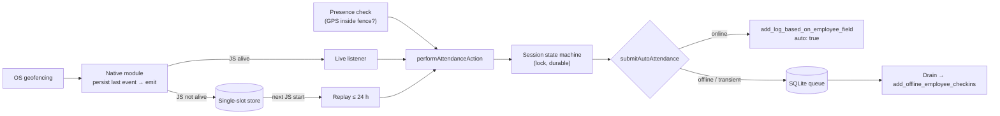

# Automatic Attendance — SDK Extraction Context (primary handoff)

**Read this first.** It is self-contained: an engineer or AI agent can understand how automatic attendance works in `claudion-checkin`, what must be preserved, and how to start building a standalone React Native SDK without re-reading the app. Detail lives in the linked documents.

| Doc | Purpose |
| --- | --- |
| [01-SOURCE_INVENTORY.md](01-SOURCE_INVENTORY.md) | Every file, function, line range, dependency, storage key and backend endpoint |
| [02-RUNTIME_FLOWS.md](02-RUNTIME_FLOWS.md) | 20 lifecycle scenarios, state machines, Mermaid sequence/state diagrams |
| [03-NATIVE_REQUIREMENTS.md](03-NATIVE_REQUIREMENTS.md) | Android/iOS implementation, permissions, plist/manifest, platform limits with citations |
| [04-SDK_ARCHITECTURE.md](04-SDK_ARCHITECTURE.md) | Proposed package, public TypeScript API, adapters, storage, examples |
| [05-EXTRACTION_PLAN.md](05-EXTRACTION_PLAN.md) | Milestones M0–M10 and the no-behaviour-change migration path |
| [06-TESTING_AND_RISKS.md](06-TESTING_AND_RISKS.md) | Test matrix (unit / native / device / not simulatable) and risk register |
| [07-OPEN_QUESTIONS.md](07-OPEN_QUESTIONS.md) | Unresolved product, backend, platform and packaging questions |

Audit baseline: commit `de722c9` on `feat/crashlytics` (2026-10-09). Stack: Expo SDK 57, React Native 0.86.3 (New Architecture, Hermes), iOS 16.4+, Android minSdk 24 / target 36. Tags: **[V]** verified in code, **[P]** platform documentation, **[I]** inference, **[D]** needs a device.

---

## 1. What the feature does

Employees opt in on the "Automatic Attendance" screen. The app registers **one circular geofence** (`office-main`) around the employee's **nearest configured office** and, when the operating system reports ENTER or EXIT, records an attendance check-in or check-out on the Frappe/ERPNext backend — even if the check-in was manual ("manual check-in → automatic check-out"). The server-side employee field `geotagging` controls it: `0` disabled, `1` detect and warn only, `2` record attendance. **[V]**

Monitoring runs only when **both** the server allows it (`geotagging ≠ 0`) and the user opted in (`userEnabled`, persisted in Redux). **[V]** (`redux/Slices/AutoAttendanceSlice.js:97-119`)

---

## 2. How it works (end to end)

1. **Native layer** (`modules/expo-auto-attendance/`, a local Expo module): Android uses Play Services `GeofencingClient` with a broadcast `PendingIntent` to `GeofenceBroadcastReceiver`; iOS uses `CLLocationManager` region monitoring in a singleton `GeofenceManager`. On ENTER/EXIT both **persist the transition into a single "last event" slot, then emit** it to JS if a React instance is attached. Neither submits attendance (the "Future integration" blocks are empty). **[V]**
2. **Orchestrator** (`components/AutoAttendanceBootstrap.jsx`, a React component rendering `null`, mounted in `App.js`): syncs the `geotagging` policy; when active it attaches ENTER/EXIT listeners **before** registering, then runs a serialized startup chain: `ensureMonitoring` (permissions check, office lookup + GPS, register only if `!isMonitoring()`) → `replayPendingEvent` (last native event, ≤ 24 h, newer than the high-water mark) → `reconcilePresence` (check in if the GPS fix is inside and evidence agrees). **[V]**
3. **Session machine** (`utils/attendanceSessionState.js`): every punch, manual or automatic, goes through `performSessionTransition`. IN only from `CHECKED_OUT`, OUT only from `CHECKED_IN`; the backend call runs inside a process-wide lock; state commits only when the call returns `allowed`. This is the duplicate guard. **[V]**
4. **Submission** (`services/offline/AttendanceQueueService.js`): automatic punches try the online endpoint first (unless an older punch is undelivered — then an IN is force-queued to keep order); transient or "blocked" failures and no-transport cases go to a SQLite queue drained later through a bulk endpoint. Manual punches are never queued. **[V]**
5. **Backdating** (`services/api/attendance.service.js:72-88`): a replayed transition is logged at server wall-clock time minus the device-measured age of the event. **[V]**
6. **iOS background**: when iOS relaunches the app for a region event with no UI scene, `GeofenceEventBus` posts `ClaudionGeofenceTransition`; the app-level `AttendanceBackgroundRuntime` starts a windowless React root (25 s background task cap) so the bootstrap can replay and submit. **[V]**
7. **Android background**: nothing starts JS when the process is dead; the event waits in the single slot until the user next opens the app. **[V]**

---

## 3. Architecture summary

| Layer | Files | Responsibility |
| --- | --- | --- |
| Native Android | `android/.../ExpoAutoAttendanceModule.kt`, `GeofenceManager.kt`, `GeofenceBroadcastReceiver.kt`, `GeofenceBootReceiver.kt`, `GeofenceEventBus.kt`, `GeofenceStore.kt` | Register/remove fence, receive transitions, persist (SharedPreferences `expo_auto_attendance`), restore after boot/upgrade, power warnings |
| Native iOS | `ios/ExpoAutoAttendanceModule.swift`, `GeofenceManager.swift`, `GeofenceStore.swift`, `GeofenceEventBus.swift`, `AutoAttendanceAppDelegateSubscriber.swift` | Region monitoring, initial-state detection with retries, persist (UserDefaults `expoAutoAttendance.*`), launch priming, wake notification, auth/power warnings |
| iOS app shell | `native/ios/AttendanceBackgroundRuntime.swift`, `plugins/withAttendanceBackgroundRuntime.js`, `ios/ClaudionCheckin/AppDelegate.swift:32`, `Info.plist` scene manifest | Windowless React startup on background wakes; scene root reuse |
| JS bridge | `modules/expo-auto-attendance/index.js` | `startGeofence`, `stopGeofence`, `isMonitoring`, `getLastEvent`, listeners, status queries |
| Orchestration | `components/AutoAttendanceBootstrap.jsx`, `hooks/useAutoAttendance.js`, `redux/Slices/AutoAttendanceSlice.js` | Policy, opt-in, registration ownership, replay, presence, Redux mirror, notifications |
| Domain | `utils/attendanceSessionState.js`, `utils/attendanceSession.js`, `utils/geofenceEventLog.js`, `utils/serverClock.js`, `utils/attendanceLocations.js` | Session machine, replay evaluation, timestamps, distance |
| API | `services/api/attendance.service.js` (`autoCheckInOut`, `getOfficeLocation`, `getAttendanceStatus`, `resolveServerTimestampAt`), `services/api/employee.service.js`, `services/api/apiClient.js` | Frappe calls, auth/refresh |
| Offline | `services/offline/*` + `components/OfflineAttendanceBootstrap.jsx` | Queue, gate, config cache, classification, scoped FIFO drain, triggers |

---

## 4. Android implementation (essentials)

- `Geofence.Builder` circle, `NEVER_EXPIRE`, ENTER|EXIT, **`INITIAL_TRIGGER_ENTER`**; one `PendingIntent` (request code 4821, `FLAG_MUTABLE` on S+). **[V]**
- Requires `ACCESS_FINE_LOCATION` and (API 29+) `ACCESS_BACKGROUND_LOCATION`; errors `ERR_INVALID_OPTIONS`, `ERR_LOCATION_PERMISSION`, `ERR_BACKGROUND_LOCATION_PERMISSION`, `ERR_GEOFENCE_REGISTRATION`, `ERR_GEOFENCE_REMOVAL`. **[V]**
- Receiver timestamps with `System.currentTimeMillis()` at receipt, saves with `apply()`, then emits via a volatile in-process bus. **[V]**
- `GeofenceBootReceiver` re-adds the stored fence on `BOOT_COMPLETED` and `MY_PACKAGE_REPLACED` (geofences are removed on reboot and on app upgrade **[P]**). **[V]**
- No WorkManager, HeadlessJS, foreground service, `GEOFENCE_NOT_AVAILABLE` recovery or permission-change handling. **[V]**
- Platform: 100 geofences/app; background latency 2–6 min; recommended radius ≥ 100–150 m; force stop removes fences (Android 15 re-delivers `BOOT_COMPLETED` on leaving the stopped state) **[P]**.

## 5. iOS implementation (essentials)

- `CLCircularRegion` (radius clamped to `maximumRegionMonitoringDistance`), `notifyOnEntry/Exit`; registration requires **Always** and **full accuracy** (`ERR_REDUCED_ACCURACY`). **[V]**
- After `didStartMonitoringFor`, `requestState`; `.inside` → synthetic ENTER; `.unknown` retried after 2, 4, 8 s. **[V]**
- `AutoAttendanceAppDelegateSubscriber` primes the manager at launch when the persisted flag is set, so relaunch events have a delegate. **[V]**
- Authorization downgrade → `onError -1`; precise off → `-3`; Low Power → `-2` (warnings only). **[V]**
- `UIBackgroundModes` contains only `remote-notification`; region monitoring does not need `location` mode. **[V]/[P]**
- Platform: 20 regions; Always required for relaunch; reduced accuracy disables region monitoring; average delivery 3–5 min; background time short and undocumented; force-quit relaunch stated by Apple staff but contested **[P]/[D]**.

## 6. JavaScript integration (essentials)

- `App.js` mounts the bootstraps only after fonts, preference hydration and (release) an OTA check/possible reload, inside Redux `PersistGate`. **[V]**
- Only `AutoAttendanceBootstrap` registers fences in production; the screen hook persists the opt-in, prompts for foreground then background permission, requests notification permission, validates an office, and bumps `syncRequestId` to make the bootstrap retry. **[V]**
- The bootstrap never prompts for permission. **[V]**
- Session changes are mirrored into Redux (`setCheckin`, `setCheckout`, `sessionOrigin`); automatic check-outs post a local notification whose text distinguishes "queued" from "server-confirmed". **[V]**

---

## 7. Attendance event lifecycle

| Stage | ENTER | EXIT |
| --- | --- | --- |
| OS → native | `didEnterRegion` / broadcast ENTER, or initial-state ENTER | `didExitRegion` / broadcast EXIT |
| Native | Save last event `{transition, identifier, timestamp}` → emit `onGeofenceEnter` | same with `onGeofenceExit` |
| Policy | `geotagging 1` → mark handled, stop; `2` → continue | same |
| Session | Skip if already `CHECKED_IN` | Skip if already `CHECKED_OUT` |
| Ordering | Force-queue if any older punch may still change the server | never forced |
| Submit | `autoCheckInOut` (`auto: true`, office coordinates, backdated timestamp) or queue | same |
| Commit | `CHECKED_IN`, `origin AUTO`, `startedAt = occurredAt` | `CHECKED_OUT`, `closedBy AUTO`, `endedAt = occurredAt` |
| After | Mark processed (high-water mark), Redux `setCheckin` | Mark processed, Redux `setCheckout`, local notification |

Live payload: `{identifier, identifiers: string[], transition: "ENTER"|"EXIT", timestamp: epochMs}`. Error payload: `{code, message}`. **[V]**

## 8. Offline and recovery behaviour

- Connectivity = "is there a transport" (NetInfo `type !== none`), never `isInternetReachable`. **[V]**
- Offline automatic punches need a cached configuration (`attendanceConfigCache`); the radius gate is skipped for geofence punches (EXIT is outside by definition). **[V]**
- Queue (`claudion-attendance.db`, table `attendance_queue`, schema v4): statuses `pending → syncing → synced | blocked | rejected | needs_review | resolved`; unique `(tenantKey, employeeId, timestamp, action)`; atomic FIFO claims per employee+tenant; one record per request; transient ladder 5 s, 15 s, 45 s, 2 m, 5 m (15 tries) then blocked; blocked ladder 1 m, 5 m, 20 m, 1 h floor forever; only positive validation matches are rejected; rejected check-ins cascade to paired check-outs; duplicates must be verified against history; rows are never auto-deleted. **[V]**
- Drain triggers (JS alive only): launch, foreground, reconnect, queued punch +3 s, online punch success, 60 s heartbeat, token refresh, pull-to-refresh. **[V]**
- Restart recovery: replay of the last native event, presence reconciliation, `releaseStuckSyncing`. **[V]**
- Logout keeps the queue and the session record; clears config cache and capability; stops the fence through `REVERT_ALL`. **[V]**

## 9. Backend dependencies

| Method (`{baseUrl}/api/method/…`) | Use |
| --- | --- |
| `employee_app.attendance_api.get_employee_data` | `geotagging`, policy flags, `employee_locations` (GeoJSON `reporting_location` or lat/lng, `reporting_radius`) |
| `employee_app.attendance_api.get_server_time` | Backdating, clock offset |
| `employee_app.attendance_api.add_log_based_on_employee_field` | Online punch `{device_id:"MobileAPP", employee_field_value, log_type, timestamp, auto, latitude?, longitude?, location?}` → `message.name` |
| `employee_app.attendance_api.add_offline_employee_checkins` | Queued punch `{logs:[{employee, timestamp, device_id, log_type, over_time:0, location?}]}` → `inserted[]/failed[]` |
| `employee_app.attendance_api.get_attendance_details` | Server session status, duplicate verification |
| `employee_app.gauth.create_refresh_token` | Token refresh (401) |
| `employee_app.gauth.employee_checkin_setting` | Feature flags (route gate for the screen, offline switch) |

## 10. Data contracts and storage keys

- Native: Android SharedPreferences `expo_auto_attendance` → `monitoring`, `geofence`, `last_event`; iOS UserDefaults `expoAutoAttendance.monitoring|geofence|lastEvent`. **[V]**
- AsyncStorage: `autoAttendanceLastProcessedEventAt`, `attendanceSessionState`, `attendanceSessionOwner`, `checkinStartTime`, `lastCheckoutTime`, `attendanceConfigCache`, `offlineSyncSupported`, `serverClockOffset`, legacy mirrors (`geotagging`, `restrict_location`, `unrestricted_checkout_location`, `photo`, `employee_locations`), Redux `root`. **[V]**
- Session record: `{status, origin, startedAt, endedAt, closedBy}`. **[V]**
- Timestamps sent to Frappe: naive `yyyy-MM-dd HH:mm:ss` in server wall-clock time. **[V]**

---

## 11. Non-negotiable behaviour to preserve

1. Native persists a transition **before** emitting it.
2. Listeners attach before registration (initial ENTER must not be missed).
3. A transition is a request to the session machine, never an unconditional API call; IN only when checked out, OUT only when checked in; EXIT closes manual and automatic sessions alike.
4. One process-wide lock for manual and automatic transitions; the backend call runs inside it; commit only on `allowed`; never read the session inside `execute`.
5. A queued punch is "accepted", not "server-confirmed", and every caller must keep that distinction.
6. Replay: never twice (monotonic mark), 24 h window, 60 s future tolerance, discard EXIT older than the open session, refused events stay replayable.
7. Policy `1` never produces attendance; policy `0` stops monitoring.
8. Automatic punches skip the radius gate (online and offline); manual punches keep it.
9. Backdated timestamps come from server time minus device-measured age.
10. Manual punches are never queued; automatic punches queue only on no-transport, transient or "blocked" failures, or for ordering.
11. Queue invariants: FIFO, single-flight, atomic claim, unknown → blocked (never rejected), cascade on rejection, duplicates verified, nothing auto-deleted, logout never deletes queued punches, drains scoped to the authenticated employee and tenant.
12. The bootstrap never prompts for permissions; opt-in requires a user gesture.
13. iOS requires Always + precise; Android requires fine + background.
14. Android restores fences on boot and app upgrade; iOS primes the delegate at launch.
15. Payloads, endpoint names, storage keys and native identifiers (`expo.modules.autoattendance.*`, `office-main`, request code 4821) stay identical until a deliberate migration.
16. A background wake never starts an interactive or cold-boot authentication flow (mobile sign-in deliberately avoids Auth SDK cold-boot reauthentication for this reason — `AUTH_CAFM_GAP_ANALYSIS.md:297-304`, `CLAUDE.md`).

## 12. Known limitations (highest impact first)

1. **Unattributed replay rows stall the queue (Critical, RK-01)**: a transition replayed after a cold start is processed without a scope; if it must be queued it gets `tenantKey NULL`, is never sent, blocks the employee's later rows, keeps presence check-in disabled, and lets later OUTs reach the server before their INs. No test covers it.
2. Android submits nothing while the process is dead; only the last transition survives until the next app open (RK-02/03).
3. `isMonitoring()` trusts a persisted flag; fences dropped by the OS are never re-registered (RK-04).
4. The fence never moves when office locations change (RK-05); only the nearest office is monitored (RK-13).
5. iOS background processing must fit startup, OTA check, network and an unbounded GPS fix into a short window (RK-06).
6. Presence reconciliation re-checks-in after a manual check-out while inside (RK-07).
7. Any logout, including token expiry, silently disables monitoring (RK-08).
8. No dwell/debounce, no shift awareness, no spoofing defence, PII in release logs, inaccurate purpose strings (RK-09, RK-31, RK-40, RK-41).

## 13. SDK extraction requirements

- Backend-independent core; Frappe as an optional adapter package.
- Native durable **journal** with event ids and acknowledgements (replacing the single slot, keeping `getLastEvent` for compatibility).
- Scope (tenant + subject) and policy stamped natively at capture.
- React-free engine (callable from app root, headless task or background wake).
- Single session authority shared with the host's manual punches.
- Honest status: desired vs OS-registered vs effective, with degraded reasons.
- Optional delivery layer (outbox, retries, triggers) behind a host transport.
- Compatibility mode reproducing today's keys, identifiers and decisions.
- Redacting logger; configurable device-location capture and retention.
- Config plugin for iOS strings and the optional background runtime.

## 14. Recommended architecture (summary)

An **Expo Module (Kotlin/Swift on `expo-modules-core`) with a config plugin**, published as `@your-org/react-native-auto-attendance`, layered as: native geofencing + journal → typed native facade (+ legacy API) → engine (intake, policy, replay, presence, ordering) → session machine → optional delivery (outbox, retries) → host `AttendanceTransport`. A separate `@your-org/react-native-auto-attendance-frappe` package implements the current backend. Events-only mode is always available; delivery mode is opt-in and defaults to today's online-first semantics. Full API in [04](04-SDK_ARCHITECTURE.md).

## 15. Where to start

Begin with **M0** in [05](05-EXTRACTION_PLAN.md): add characterization tests in this app for the behaviours listed in §12 items 1, 4 and 6 (and the cross-employee replay residue), so every later milestone can prove parity before anything moves.
