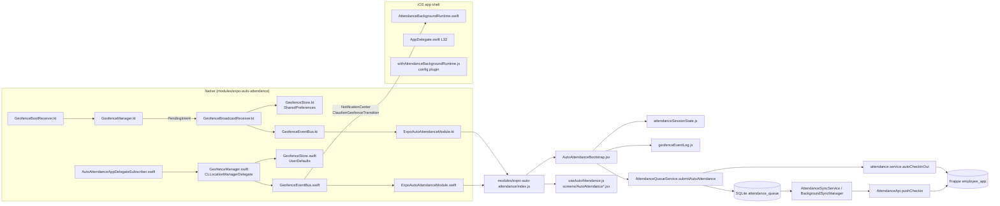
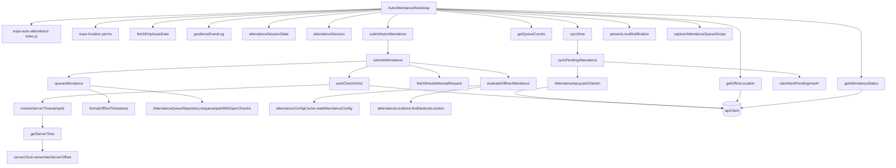

# 01 — Source Inventory: Automatic Attendance

Audit baseline: branch `feat/crashlytics`, commit `de722c9` (2026-10-09). Every path below is relative to the repository root. Line ranges were read from source at that commit; re-check them before editing because they move.

Legend used throughout this folder:

- **[V]** verified by reading the cited source.
- **[I]** inference from verified code; not executed.
- **[R]** recommendation.
- **[D]** requires a real device/backend to confirm.

Related documents: [00 context](00-SDK_CONTEXT.md) · [02 runtime flows](02-RUNTIME_FLOWS.md) · [03 native requirements](03-NATIVE_REQUIREMENTS.md) · [04 SDK architecture](04-SDK_ARCHITECTURE.md) · [05 extraction plan](05-EXTRACTION_PLAN.md) · [06 testing and risks](06-TESTING_AND_RISKS.md) · [07 open questions](07-OPEN_QUESTIONS.md)

---

## 1. Component map

The native layer only **detects, persists (one slot) and emits** transitions. All attendance semantics — policy gating, session state, submission, offline queueing, replay — live in JavaScript. **[V]** ([GeofenceBroadcastReceiver.kt:63-67](../../modules/expo-auto-attendance/android/src/main/java/expo/modules/autoattendance/GeofenceBroadcastReceiver.kt#L63-L67) and [GeofenceManager.swift:237-241](../../modules/expo-auto-attendance/ios/GeofenceManager.swift#L237-L241) are empty "Future integration" placeholders.)

---

## 2. Native module: `modules/expo-auto-attendance/`

A local Expo module, autolinked by `expo-modules-autolinking` because it lives under `modules/`. It is `private: true` and has no TypeScript types. **[V]**

### 2.1 Package and configuration

| File | Lines | Responsibility |
| --- | --- | --- |
| [package.json](../../modules/expo-auto-attendance/package.json) | 1-7 | Name `expo-auto-attendance`, version `0.1.0`, `main: index.js`, `private: true`. Description says "Android" only although iOS is implemented. |
| [expo-module.config.json](../../modules/expo-auto-attendance/expo-module.config.json) | 1-10 | Platforms `android`, `apple`; Android module class `expo.modules.autoattendance.ExpoAutoAttendanceModule`; Apple module `ExpoAutoAttendanceModule`; **`appDelegateSubscribers: ["AutoAttendanceAppDelegateSubscriber"]`**. |
| [android/build.gradle](../../modules/expo-auto-attendance/android/build.gradle) | 1-19 | `com.android.library` + `expo-module-gradle-plugin`; namespace `expo.modules.autoattendance`; **only dependency: `com.google.android.gms:play-services-location:21.3.0`**. No minSdk override (inherits app's). |
| [android/src/main/AndroidManifest.xml](../../modules/expo-auto-attendance/android/src/main/AndroidManifest.xml) | 1-32 | Declares `ACCESS_FINE_LOCATION`, `ACCESS_COARSE_LOCATION`, `ACCESS_BACKGROUND_LOCATION`, `RECEIVE_BOOT_COMPLETED`; registers `GeofenceBroadcastReceiver` (exported=false) and `GeofenceBootReceiver` (exported=false) with `BOOT_COMPLETED` and `MY_PACKAGE_REPLACED`. Merged into the app manifest automatically. |
| [ios/ExpoAutoAttendance.podspec](../../modules/expo-auto-attendance/ios/ExpoAutoAttendance.podspec) | 1-30 | Pod `ExpoAutoAttendance`; iOS `16.4`; Swift `5.9`; `static_framework = true`; depends on `ExpoModulesCore`; framework `CoreLocation`; `DEFINES_MODULE`, whole-module compilation; `source_files "**/*.{h,m,swift}"`. Homepage/author hard-coded to ERPGulf; `source = { git: '' }` (not publishable as is). |

### 2.2 JavaScript bridge — [index.js](../../modules/expo-auto-attendance/index.js)

| Export | Lines | Contract **[V]** |
| --- | --- | --- |
| `EVENT_ENTER` / `EVENT_EXIT` / `EVENT_ERROR` | 19-21 | `"onGeofenceEnter"`, `"onGeofenceExit"`, `"onError"`. |
| `OFFICE_GEOFENCE_IDENTIFIER` | 26 | `"office-main"` — the single fence id used by production and dev tools. |
| `isAvailable()` | 29-31 | `requireOptionalNativeModule("ExpoAutoAttendance") != null` (L17). False on web, Expo Go, old binaries. |
| `startGeofence({latitude, longitude, radius, identifier})` | 51-58 | `Promise<void>`; requires foreground + background permission already granted. |
| `stopGeofence()` | 64-66 | `Promise<void>`. |
| `isMonitoring()` | 69-71 | **Synchronous**; returns the persisted *flag*, not the OS registration (see §2.3/§2.4). |
| `hasFullAccuracy()` | 79-84 | Sync; falls back to `true` if function missing. |
| `isLowPowerModeEnabled()` | 91-96 | Sync; falls back to `false`. |
| `isIgnoringBatteryOptimizations()` | 105-113 | Sync; Android only in practice; falls back to `true`. |
| `getRegisteredGeofences()` | 118-120 | Sync; `[{identifier, latitude, longitude, radius}]` from the persisted store. |
| `getLastEvent()` | 127-129 | Sync; `{transition: "ENTER"|"EXIT", identifier, timestamp}` or `null`; survives restarts. |
| `clearLastEvent()` | 131-133 | Sync; production never calls it (only `__DEV__` tools). |
| `addGeofenceEnterListener` / `addGeofenceExitListener` | 139-149 | Live event payload `{identifier, identifiers: string[], transition, timestamp}`. |
| `addErrorListener` | 155-157 | Payload `{code: number, message: string}`. |

Calling any non-guarded function without the native module throws `"expo-auto-attendance is only available in native builds that include the module"` (L33-40).

### 2.3 Android (Kotlin) — `android/src/main/java/expo/modules/autoattendance/`

| File | Lines | Class / function | Responsibility **[V]** |
| --- | --- | --- | --- |
| [ExpoAutoAttendanceModule.kt](../../modules/expo-auto-attendance/android/src/main/java/expo/modules/autoattendance/ExpoAutoAttendanceModule.kt) | 18-31 | `GeofenceOptions : Record` | Defaults: lat/lng `0.0`, radius `100.0`, identifier `"office"`. |
| | 47-76 | `registerPowerSaveReceiver` | Dynamic `ACTION_POWER_SAVE_MODE_CHANGED` receiver (`RECEIVER_NOT_EXPORTED` on API 33+); emits `onError {code:-2}` when Battery Saver turns on **and** the store flag says monitoring. Lives only while the React context lives. |
| | 83-94 | `OnCreate` / `OnDestroy` | Attach/detach `GeofenceEventBus` listener (`sendEvent`), register/unregister power receiver. |
| | 96-144 | `AsyncFunction("startGeofence")` | Validates lat ∈ [-90,90], lng ∈ [-180,180], radius > 0 → `ERR_INVALID_OPTIONS`; requires `ACCESS_FINE_LOCATION` → `ERR_LOCATION_PERMISSION`; requires background (API 29+) → `ERR_BACKGROUND_LOCATION_PERMISSION`; then `GeofenceManager.startMonitoring`; failure → `ERR_GEOFENCE_REGISTRATION`. |
| | 146-158 | `AsyncFunction("stopGeofence")` | `GeofenceManager.stopMonitoring`; failure → `ERR_GEOFENCE_REMOVAL`. |
| | 160-207 | Sync `Function`s | `isMonitoring` (prefs flag), `hasFullAccuracy` (= fine permission), `isLowPowerModeEnabled` (PowerManager.isPowerSaveMode), `isIgnoringBatteryOptimizations`, `getRegisteredGeofences` (from prefs), `getLastEvent`, `clearLastEvent`. |
| [GeofenceManager.kt](../../modules/expo-auto-attendance/android/src/main/java/expo/modules/autoattendance/GeofenceManager.kt) | 27-29 | constants | `TAG = "ExpoAutoAttendance"`, `PENDING_INTENT_REQUEST_CODE = 4821`. |
| | 38-53 | `geofencePendingIntent` | One broadcast PendingIntent to `GeofenceBroadcastReceiver`; `FLAG_UPDATE_CURRENT | FLAG_MUTABLE` on API 31+. |
| | 55-89 | permission/power helpers | `hasForegroundLocationPermission`, `hasBackgroundLocationPermission` (true below API 29), `hasFullAccuracy`, `isPowerSaveModeEnabled`, `isIgnoringBatteryOptimizations`. |
| | 96-131 | `startMonitoring` | `Geofence.Builder` circular, `NEVER_EXPIRE`, `ENTER | EXIT`; `GeofencingRequest` with **`INITIAL_TRIGGER_ENTER`**; on success persist + log + `onSuccess`. No loitering/dwell, no responsiveness setting. |
| | 134-150 | `stopMonitoring` | `removeGeofences(pendingIntent)` (removes everything added with that intent); clears store **only on success**. |
| | 157-180 | `restoreFromStore` | Re-adds persisted fence if flag set and fine+background permission present. Called by `GeofenceBootReceiver` only. |
| [GeofenceBroadcastReceiver.kt](../../modules/expo-auto-attendance/android/src/main/java/expo/modules/autoattendance/GeofenceBroadcastReceiver.kt) | 22-78 | `onReceive` | `GeofencingEvent.fromIntent`; on error emits `onError {code: errorCode, message: GeofenceStatusCodes string}` (L30-41) and returns; maps ENTER/EXIT; timestamp = **`System.currentTimeMillis()` at receipt** (L57), not the location fix time; `saveLastEvent` (L61) **then** emits (L69-77). No `goAsync`, no WorkManager, no JS start. |
| [GeofenceBootReceiver.kt](../../modules/expo-auto-attendance/android/src/main/java/expo/modules/autoattendance/GeofenceBootReceiver.kt) | 13-21 | `onReceive` | On `BOOT_COMPLETED` / `MY_PACKAGE_REPLACED` → `GeofenceManager.restoreFromStore`. |
| [GeofenceEventBus.kt](../../modules/expo-auto-attendance/android/src/main/java/expo/modules/autoattendance/GeofenceEventBus.kt) | 12-31 | `object GeofenceEventBus` | Single `@Volatile` listener; `emit` is a no-op when no module instance is attached (event already persisted). |
| [GeofenceStore.kt](../../modules/expo-auto-attendance/android/src/main/java/expo/modules/autoattendance/GeofenceStore.kt) | 15-72 | `object GeofenceStore` | SharedPreferences `expo_auto_attendance`: `monitoring` (bool), `geofence` (JSON `{identifier, latitude, longitude, radius}`), `last_event` (JSON `{transition, identifier, timestamp}`). All writes use **`apply()`** (asynchronous). Single slot for the last event. |

### 2.4 iOS (Swift) — `ios/`

| File | Lines | Symbol | Responsibility **[V]** |
| --- | --- | --- | --- |
| [ExpoAutoAttendanceModule.swift](../../modules/expo-auto-attendance/ios/ExpoAutoAttendanceModule.swift) | 5-18 | `GeofenceOptions: Record` | Same defaults as Android. |
| | 32-43 | `OnCreate` / `OnDestroy` | Sets `GeofenceEventBus.shared.listener` → `sendEvent`; dispatches `primeOnLaunch()` to main queue. |
| | 45-88 | `startGeofence` (`runOnQueue(.main)`) | Same validation; `ERR_LOCATION_PERMISSION` if neither Always nor WhenInUse; `ERR_BACKGROUND_LOCATION_PERMISSION` if not Always; **`ERR_REDUCED_ACCURACY` if Precise Location is off** (iOS only; message hard-codes "Claudion Checkin"). |
| | 90-124 | `stopGeofence` (main) and sync functions | `isMonitoring` (UserDefaults flag), `hasFullAccuracy`, `isLowPowerModeEnabled`, `getRegisteredGeofences`, `getLastEvent`, `clearLastEvent`. No `isIgnoringBatteryOptimizations` (JS wrapper falls back to `true`). |
| [GeofenceManager.swift](../../modules/expo-auto-attendance/ios/GeofenceManager.swift) | 18-27 | `GeofenceManager` singleton | Lazy `CLLocationManager` with `delegate = self`. Must be used on main thread (comment L15-16). |
| | 31-40 | `PendingStart` | One in-flight registration; resolved by `didStartMonitoringFor`, rejected by `monitoringDidFailFor`. **No timeout.** |
| | 46-88 | initial-state policy | `awaitingInitialStateFor: String?`; `maxInitialStateAttempts = 3`; `decideInitialState` pure: `.inside` → synthetic ENTER, `.outside` → settled, `.unknown` → retry after `2^(n+1)` s (2, 4, 8 s). |
| | 90-112 | `init` / `powerStateDidChange` | Observes `NSProcessInfoPowerStateDidChange`; emits `onError {code:-2}` when Low Power Mode turns on while monitoring. |
| | 120-123 | `primeOnLaunch` | Touches the lazy manager so the delegate exists before JS (background relaunch). |
| | 125-138 | auth helpers | `hasAnyLocationAuthorization`, `hasAlwaysAuthorization`, `hasFullAccuracy` (`accuracyAuthorization == .fullAccuracy`). |
| | 145-191 | `start` | Rejects if region monitoring unavailable or a start is pending; **clamps radius to `maximumRegionMonitoringDistance`**; `notifyOnEntry/Exit = true`; stops the previously stored identifier and the same identifier, then `startMonitoring(for:)`. |
| | 194-218 | `stop`, `stopMonitoredRegions` | Clears pending initial-state request; stops matching regions; **with `nil` identifier stops every `CLCircularRegion` in the app**; clears store; resolves immediately. |
| | 227-249 | `handleTransition` | Timestamp = `Date()` at callback; `saveLastEvent` **then** `GeofenceEventBus.emit`. |
| | 253-276 | `didStartMonitoringFor` | Persists config, starts initial-state request (`requestState`), resolves promise. |
| | 278-292 | `monitoringDidFailFor` | Rejects pending start or emits `onError {code: NSError.code}`. |
| | 294-326 | `didDetermineState` | Acts only on the region it asked about; applies `decideInitialState`. |
| | 328-338 | enter/exit/failure delegates | `didEnterRegion`/`didExitRegion` → `handleTransition`; `didFailWithError` only logs. |
| | 340-355 | `locationManagerDidChangeAuthorization` | While monitoring: not Always → `onError {code:-1}`; Always but reduced accuracy → `onError {code:-3}`. Does not stop or re-register. |
| [GeofenceStore.swift](../../modules/expo-auto-attendance/ios/GeofenceStore.swift) | 11-61 | `GeofenceStore` | `UserDefaults.standard` keys `expoAutoAttendance.monitoring`, `expoAutoAttendance.geofence` (dict), `expoAutoAttendance.lastEvent` (dict). Single slot. |
| [GeofenceEventBus.swift](../../modules/expo-auto-attendance/ios/GeofenceEventBus.swift) | 4-8, 18-32 | `GeofenceEvents`, `GeofenceEventBus` | For ENTER/EXIT, **posts `Notification.Name("ClaudionGeofenceTransition")`** (L26-30) before calling the listener — the app-specific wake hook consumed by the background runtime. |
| [AutoAttendanceAppDelegateSubscriber.swift](../../modules/expo-auto-attendance/ios/AutoAttendanceAppDelegateSubscriber.swift) | 13-22 | `ExpoAppDelegateSubscriber` | At `didFinishLaunchingWithOptions`, primes the manager **only if the persisted monitoring flag is true**. |

---

## 3. iOS application shell (outside the module)

| File | Lines | Responsibility **[V]** |
| --- | --- | --- |
| [native/ios/AttendanceBackgroundRuntime.swift](../../native/ios/AttendanceBackgroundRuntime.swift) | 9-111 | `AttendanceBackgroundRuntime` (main actor). `configure(factory:launchOptions:)` (L21-44) observes `ClaudionGeofenceTransition` and `RNFBMessagingDidReceiveRemoteNotification`. `startIfNeeded` (L46-73) runs once per process, only when the app is in background **with no connected scene and no window**; begins a background task named "Attendance JS startup", ended by its expiration handler or after **25 s** (L54-59); starts Expo Updates' `AppController` (or Metro/embedded bundle) and creates a React root without a window (L80-92). DEBUG probe via env `CLAUDION_TEST_BACKGROUND_STARTUP=1` (L37-43). |
| | 115-142 | `ClaudionAttendanceSceneDelegate` (`ExpoAppSceneDelegate` subclass): when a scene connects after a background start, reuses the existing React root instead of mounting `App` twice; forwards URL contexts, user activities and shortcut items. |
| [ios/ClaudionCheckin/AttendanceBackgroundRuntime.swift](../../ios/ClaudionCheckin/AttendanceBackgroundRuntime.swift) | — | Plugin-copied duplicate; byte-identical to the canonical file at audit time. |
| [plugins/withAttendanceBackgroundRuntime.js](../../plugins/withAttendanceBackgroundRuntime.js) | 1-101 | Config plugin: selects `ClaudionAttendanceSceneDelegate` in the scene manifest (L33-40), refuses unknown scene layouts (L16-23), injects `AttendanceBackgroundRuntime.shared.configure(...)` before the `super.application(...)` launch return (L42-60), adds the Swift file to the Xcode project and copies it (L80-95). `normalizeManifestOnly` mode (L63-67) restores Expo's delegate name so Expo's own scene mod can re-run. |
| [ios/ClaudionCheckin/AppDelegate.swift](../../ios/ClaudionCheckin/AppDelegate.swift) | 32 | `AttendanceBackgroundRuntime.shared.configure(factory: factory, launchOptions: launchOptions)` before `super.application` (which dispatches Expo subscribers, including the geofence subscriber). |
| [ios/ClaudionCheckin/Info.plist](../../ios/ClaudionCheckin/Info.plist) | 53-62, 67-87 | Location/motion usage strings; scene manifest with `ClaudionAttendanceSceneDelegate`; **`UIBackgroundModes = [remote-notification]` only** (no `location`). |
| [ios/ClaudionCheckin/Supporting/Expo.plist](../../ios/ClaudionCheckin/Supporting/Expo.plist) | — | `EXUpdatesCheckOnLaunch = ALWAYS`, `EXUpdatesLaunchWaitMs = 0`, runtime `1.2.1-sdk57` — governs which bundle a background wake loads. |
| [app.json](../../app.json) | 15-19, 27, 43-48, 69, 74-83, 95-106 | `expo-location` plugin (Always string, `isAndroidBackgroundLocationEnabled`), the background runtime plugin (twice: main + `normalizeManifestOnly`), iOS deployment target 16.4, iOS strings, background modes, Android permissions list. |

---

## 4. JavaScript orchestration and domain logic

### 4.1 Entry points and lifecycle

| File | Lines | Responsibility **[V]** |
| --- | --- | --- |
| [App.js](../../App.js) | 22-24, 182-210 | Mounts `<AutoAttendanceBootstrap/>`, `<OfflineAttendanceBootstrap/>`, `<FeatureSettingsBootstrap/>` inside Redux `Provider` + `PersistGate`, outside the `ErrorBoundary`. |
| | 133-176 | Render is gated on `appReady`: font loading, appearance/home-experience hydration and, in release, **an OTA `checkForUpdateAsync` → `fetchUpdateAsync` → `reloadAsync`** — all before the bootstrap mounts, including on a background wake. |
| | 63-65 | Forced-logout cleanup handler runs `clearFcmRegistration` + `clearOfflineAttendance` (never deletes the queue). |
| [components/AutoAttendanceBootstrap.jsx](../../components/AutoAttendanceBootstrap.jsx) | 86-650 | **The orchestrator.** Renders `null`. |
| | 107-147 | Effect 1: on login/employee change, `fetchEmployeeData` → `setAutoAttendanceGeotagging`; on failure reads AsyncStorage `geotagging`. |
| | 149-647 | Effect 2 (deps `isLoggedIn, active, employeeCode, syncRequestId`): stop when inactive (L152-155); capture scope (L163-164); attach listeners **before** registration (L359-366); serialized startup chain `ensureMonitoring → replayPendingEvent → reconcilePresence` (L629-641); cleanup removes listeners (L643-646). |
| | 211-353 | `performAttendanceAction(type, occurredAt, {markProcessed})`: policy gate (L224-230), `performSessionTransition` with `execute` → ordering guard `forceQueue` (L266-267) → `submitAutoAttendance` (L275-288); marks handled on COMPLETED/SKIPPED (L294-299); Redux mirror + local notification on OUT (L318-348). |
| | 377-428 | `replayPendingEvent`: `getLastEvent()` + `evaluatePendingEvent`; discards expired; discards EXIT older than the open session (L405-418). |
| | 442-484 | `ensureMonitoring`: requires fg+bg permission (never prompts), `getOfficeLocation` (network + GPS), registers **only if `!isMonitoring()`** with id `office-main` and radius fallback `100`. |
| | 525-615 | `reconcilePresence`: evidence-first initial check-in when already inside. |
| [redux/Slices/AutoAttendanceSlice.js](../../redux/Slices/AutoAttendanceSlice.js) | 22-26, 55-58 | `GEOTAGGING = {DISABLED:0, WARNINGS_ONLY:1, ALL_ACTIONS:2}`; `normalizeGeotagging` (unknown → 0). |
| | 60-88 | State `{geotagging, userEnabled, syncRequestId}`; `REVERT_ALL` resets (logout). |
| | 97-119 | `selectAutoAttendanceActive = allowed && userEnabled`; `selectAutoAttendanceFullActions = geotagging === 2`. |
| [redux/Store.js](../../redux/Store.js) | 16-21 | Entire root reducer persisted to AsyncStorage key `root`, so `userEnabled` survives relaunch. |
| [redux/Slices/AttendanceSlice.js](../../redux/Slices/AttendanceSlice.js) | 26-38 | `setCheckin`/`setCheckout` mirror for UI incl. `sessionOrigin`. |

### 4.2 Domain utilities

| File | Lines | Exports and behaviour **[V]** |
| --- | --- | --- |
| [utils/geofenceEventLog.js](../../utils/geofenceEventLog.js) | 24, 27, 30 | `LAST_PROCESSED_EVENT_KEY = "autoAttendanceLastProcessedEventAt"`, `MAX_REPLAY_AGE_MS = 24h`, `FUTURE_TOLERANCE_MS = 60s`. |
| | 52-79 | `evaluatePendingEvent({lastEvent, lastProcessedAt, nowMs, maxAgeMs})` → `{status: ready|none|expired, type, occurredAt}`. Pure. |
| | 81-102 | `getLastProcessedEventAt`, `markEventProcessed` (monotonic), `clearProcessedEventMark` (**no production caller**). |
| [utils/attendanceSessionState.js](../../utils/attendanceSessionState.js) | 37-60 | Key `attendanceSessionState`; `SESSION_STATUS`, `SESSION_ORIGIN {MANUAL, AUTO, UNKNOWN}`, `TRANSITION_RESULT {completed, skipped, failed}`. |
| | 174-186 | Module-level promise chain lock `withSessionLock` (per JS runtime only); `readSession` takes the lock. |
| | 198-201 | `canTransition`: IN only when not checked in; OUT only when checked in. |
| | 259-311 | `performSessionTransition({type, origin, execute, at})` — runs `execute` **inside** the lock; commits only when `response.allowed`; returns `queued`/`serverConfirmed`. |
| | 335-409 | `reconcileSessionFromServer({activeStartedAt, origin, fetchedAt})` with in-flight and stale-checkout guards. |
| | 412-465 | `clearSessionState`; `SESSION_OWNER_KEY = "attendanceSessionOwner"`; `applySessionOwner` clears only on employee change. |
| [utils/attendanceSession.js](../../utils/attendanceSession.js) | 3-4, 27-61, 89-149 | Legacy keys `checkinStartTime`/`lastCheckoutTime`; `toTimestampMs` (seconds→ms promotion below `1e12`); `normalizeCustomIn`; `resolveActiveSessionStart` (rejects ≤ last checkout and > now+60 s); persistence helpers. |
| [utils/autoAttendance.js](../../utils/autoAttendance.js) | 18-31, 101-130 | `WARNING_CODES {LOW_POWER_MODE:-2, REDUCED_ACCURACY:-3}`; `DEFAULT_GEOFENCE` (dev only: Doha coordinates, 100 m); `readDevicePosition` (8 s timeout → last known ≤10 min); `waitForMonitoring` (15 s / 400 ms polling). Presentation helpers L162-209. |
| [utils/attendanceLocations.js](../../utils/attendanceLocations.js) | 30-56, 77-126 | `resolveLocationCoordinates` (GeoJSON `reporting_location` `[lng,lat]` first, then flat fields); `scoreLocations` (`withinRadius` false when radius ≤ 0); `pickNearest`; `findNearestLocation`. Pure, shared online/offline. |
| [utils/serverClock.js](../../utils/serverClock.js) | 24-27, 38-115 | Key `serverClockOffset`; format `yyyy-MM-dd HH:mm:ss`; `parseServerWallClock`; `rememberServerOffset` (discard > 24h); `formatOfflineTimestamp(atMs)` = device time + offset. |
| [utils/authSessionGuard.js](../../utils/authSessionGuard.js) | 1-14 | Process-local auth generation counter + `suspended` flag. |
| [utils/featureSettings.js](../../utils/featureSettings.js) | 85, 157-177, 334 | `attendance_action.auto_attendance` flag gates **only the "Auto attendance" route**; `geo_tagging_level` parsed but **not used** by the bootstrap. |

### 4.3 API services

| File | Lines | Function | Contract **[V]** |
| --- | --- | --- | --- |
| [services/api/attendance.service.js](../../services/api/attendance.service.js) | 31-55 | `getServerTime()` | GET `employee_app.attendance_api.get_server_time` → `message.server_time`; records clock offset. |
| | 72-88 | `resolveServerTimestampAt(occurredAt)` | Server wall clock − device-measured event age, formatted `yyyy-MM-dd HH:mm:ss`; falls back to server now. |
| | 92-244 | `getOfficeLocation(employeeCode)` | GET `get_employee_data`; mobile auth asserts complete policy; mirrors `restrict_location`, `unrestricted_checkout_location`, `photo`, `geotagging`, `employee_locations` to AsyncStorage; returns `null` if no locations; **calls `requestForegroundPermissionsAsync`** then **`getCurrentPositionAsync({accuracy: Highest})` with no timeout** (L191-198); returns nearest candidate `{locationName, latitude, longitude, source, distance, radius, withinRadius}`. |
| | 438-519 | `autoCheckInOut({employeeCode, type, office, occurredAt})` | POST `add_log_based_on_employee_field` with `{device_id:"MobileAPP", employee_field_value, log_type, timestamp, auto:true, latitude?, longitude?, location?}`; success requires `message.name`; never throws — returns `{allowed:false, message, location, error}`. No radius gate. |
| | 587-655 | `getAttendanceStatus()` | Latest of 10 `get_attendance_details` rows → `{custom_in, checkin_time, log_type}`, or `{custom_in:0, unavailable:true}` on failure. |
| [services/api/employee.service.js](../../services/api/employee.service.js) | 10-34 | `fetchEmployeeData(code)` | GET `get_employee_data` (10 s timeout) → `data.message`. Used for `geotagging`. |
| [services/api/apiClient.js](../../services/api/apiClient.js) | 129-146, 155-203 | `addTokenChangeListener`, `saveTokens` | Token-change listeners wake auth-blocked queue rows. |
| | 204-217, 353-380 | `clearStore`, `clearTokens`, `expireSession` | Logout paths; `invalidateAuthSession()` bumps generation. |
| | 485-493, 523 | interceptors | `attendanceSyncScope` config re-asserts tenant/employee/generation per request. |
| [services/notifications/localNotifications.js](../../services/notifications/localNotifications.js) | 10, 45-81 | `ensureNotificationSetup`, `presentLocalNotification` | Android channel `attendance`; used for the auto check-out notification only. |

### 4.4 Offline queue and synchronization (`services/offline/`)

| File | Key lines | Responsibility **[V]** |
| --- | --- | --- |
| [AttendanceQueueService.js](../../services/offline/AttendanceQueueService.js) | 405-596, 615-631 | `submitAttendance` / `submitAutoAttendance`: manual → online only (L425-427); auto → online attempt unless `forceQueue`; transient failure → gate → queue. `refuseOrFallBack` sends a forced-queue punch online if the queue refuses (L521-529). |
| | 199-305 | `queueAttendance`: offline timestamp, tenant provenance only if `sourceScope` validates (L211-216), `enqueue`, check-out pairing, drain kick. |
| | 722-755 | `clearOfflineAttendance` (config + capability only) vs `purgeAttendanceQueue` (explicit, unused). |
| [AttendanceDatabase.js](../../services/offline/AttendanceDatabase.js) | 22-23, 45-185, 249-343 | DB `claudion-attendance.db`, table `attendance_queue`, schema v4, statuses, failure classes, indexes, migrations, WAL. |
| [AttendanceQueueRepository.js](../../services/offline/AttendanceQueueRepository.js) | 33-89, 119-133, 324-364, 1033-1128 | Retry ladders; FIFO dependency SQL; atomic claim; `countByStatus` incl. `mayAffectServerCount`. |
| [AttendanceSyncService.js](../../services/offline/AttendanceSyncService.js) | 149-304, 402-607 | Per-row upload outcome mapping; single-flight scoped drain, max 50 rows/run. |
| [AttendanceApi.js](../../services/offline/AttendanceApi.js) | 34-38, 73-100, 110-222 | Bulk endpoint `add_offline_employee_checkins`, one record per request, response interpretation. **No `auto` field.** |
| [BackgroundSyncManager.js](../../services/offline/BackgroundSyncManager.js) | 57-73, 213-341 | Triggers: launch, foreground (3 s debounce), reconnect, queued punch (+3 s), 60 s interval, token change; `syncNow`. No OS background task. |
| [NetworkListener.js](../../services/offline/NetworkListener.js) | 58-62, 108-111, 172-203 | Transport-only connectivity predicate. |
| [attendanceErrors.js](../../services/offline/attendanceErrors.js) | 39-141, 181-280 | Message-first classification: duplicate / endpoint-missing / auth / configuration / validation; status fallbacks. |
| [offlineAttendanceGate.js](../../services/offline/offlineAttendanceGate.js) | 29-32, 51-98, 166-295 | Offline gate; `enforceRadius:false` for geofence punches; GPS 12 s budget, last known ≤ 2 min. |
| [attendanceConfigCache.js](../../services/offline/attendanceConfigCache.js) | 34-45, 59-139, 204-290 | `attendanceConfigCache` blob; policy completeness; docname resolution; 6 h staleness. |
| [offlineCapability.js](../../services/offline/offlineCapability.js) | 30, 50-58, 128-158 | `offlineSyncSupported` tri-state; in-memory admin switch. |
| [attendanceQueueProvenance.js](../../services/offline/attendanceQueueProvenance.js) | 14-89 | Tenant key normalization; scope capture/assert (employee, tenant, account=`api_key`, auth generation). |
| [AttendanceVerification.js](../../services/offline/AttendanceVerification.js) | 10-93 | Exact server punch match via history pages (max 25×20). |
| [AttendanceDiagnostics.js](../../services/offline/AttendanceDiagnostics.js) | 11-58 | Support-only read seam. |
| [attendancePhotoUpload.js](../../services/offline/attendancePhotoUpload.js) | 32-62 | Photo attach after sync (manual legacy rows only). |
| [components/OfflineAttendanceBootstrap.jsx](../../components/OfflineAttendanceBootstrap.jsx) | 72-113 | `applySessionOwner`; mirrors admin switch; starts/stops `BackgroundSyncManager` (drain-only when disabled). |

### 4.5 UI and consumers

| File | Lines | Role **[V]** |
| --- | --- | --- |
| [hooks/useAutoAttendance.js](../../hooks/useAutoAttendance.js) | 354-439 | User opt-in: persists `userEnabled` first, prompts foreground → background permission, bumps `syncRequestId` on first grant, sets up notifications, validates an office exists, polls `waitForMonitoring`. **Never calls `startGeofence` in production.** |
| | 146-169, 176-222, 226-303 | Reliability warnings (precise/low power/battery optimization), presence card, listeners for UI, focus refresh. |
| | 443-582 | `__DEV__`-only tools (manual fence, start/stop, clear status, policy simulation). |
| [screens/AutoAttendance.jsx](../../screens/AutoAttendance.jsx) / [screens/AutoAttendanceLegacy.jsx](../../screens/AutoAttendanceLegacy.jsx) | 463-615 / 454-617 | Two skins over the same hook; dev tools inside `__DEV__`. |
| [navigation/app-navigator.jsx](../../navigation/app-navigator.jsx) | 68-71, 120 | Route `"Auto attendance"` wrapped by `withFeatureGate`. |
| [hooks/useAttendanceAction.js](../../hooks/useAttendanceAction.js) | 81-86, 176-262, 511-576 | Manual punches use the same `performSessionTransition` (origin MANUAL) and the same queue counts guard; shows "checked out automatically" when `closedBy === AUTO`. |
| [screens/AttendanceCamera.jsx](../../screens/AttendanceCamera.jsx) | 139-143 | Photo punch, same machine. |
| [utils/attendanceHistory.js](../../utils/attendanceHistory.js) / [components/AttendanceHistory/AttendanceHistoryCard.jsx](../../components/AttendanceHistory/AttendanceHistoryCard.jsx) | 11-26 / 74-93 | Server records carry `auto`; queued rows merged into history. |
| [hooks/useOfflineStatus.js](../../hooks/useOfflineStatus.js), [utils/offlineStatus.js](../../utils/offlineStatus.js), [hooks/useAttendanceRecovery.js](../../hooks/useAttendanceRecovery.js), [utils/attendanceRecovery.js](../../utils/attendanceRecovery.js) | — | Banner phases, recovery sheet; NULL-tenant rows are "Cannot verify company … will not be resent automatically" (`attendanceRecovery.js:3-6`). |
| Home tiles: [components/Home/YourLavas.jsx](../../components/Home/YourLavas.jsx) L77-79, [components/HomeLegacy/YourLavas.jsx](../../components/HomeLegacy/YourLavas.jsx) L127-129, [utils/quickAccess.js](../../utils/quickAccess.js) L42-44 | — | Navigation entry points only. |
| [services/api/mobileAuth.service.js](../../services/api/mobileAuth.service.js) | 303-312 | Clears session state when the tenant changes at mobile sign-in. |
| [screens/Profile.jsx](../../screens/Profile.jsx) | 322-370 | Manual logout: FCM cleanup, `clearOfflineAttendance`, `clearTokens`, `clearAuthCache`, `clearStore` (→ `REVERT_ALL` → `userEnabled=false` → bootstrap stops the fence). |

### 4.6 Supporting references (found in the final verification sweep)

| File | Lines | Relevance **[V]** |
| --- | --- | --- |
| [screens/AttendanceAction.jsx](../../screens/AttendanceAction.jsx) / [screens/AttendanceActionLegacy.jsx](../../screens/AttendanceActionLegacy.jsx) | 179-190 / 165-171 | "Automatic checkout is enabled" banner shown when checked in and `autoActionsEnabled` (Redux `active && fullActions`) — it does **not** consult `isMonitoring()`, permissions or accuracy, so it can promise a check-out the OS will not deliver. |
| [components/AutoAttendance/](../../components/AutoAttendance/) | — | Modern-screen presentation only: `CollapsibleCard`, `PolicyOption` (dev policy simulator), `CoordinateField` (dev manual fence), `EventLogItem` (session event log), `index.js` re-exporting `StatusBadge`. |
| [components/FeatureSettingsBootstrap.jsx](../../components/FeatureSettingsBootstrap.jsx), [hooks/useFeatureSettings.js](../../hooks/useFeatureSettings.js), [redux/Slices/FeatureSettingsSlice.js](../../redux/Slices/FeatureSettingsSlice.js) | 57-139 / — / — | Fetch and persist `employee_checkin_setting` (scope = base URL + employee code); source of `attendance_action.auto_attendance` (route gate) and `attendance_action.offline_attendance` (queueing switch via `OfflineAttendanceBootstrap`). `geo_tagging` is exposed but unused by automatic attendance. |
| [hooks/useAttendanceHistory.js](../../hooks/useAttendanceHistory.js) | 76-159 | Merges queued rows into history; pull-to-refresh calls `syncNow({employeeId})` — the only user-driven drain besides Profile recovery. |
| [redux/RootReducer.js](../../redux/RootReducer.js) | 12-21 | Registers `autoAttendance`, `attendance`, `featureSettings` slices (all persisted under `root`). |
| [ios/ClaudionCheckin.xcodeproj/project.pbxproj](../../ios/ClaudionCheckin.xcodeproj/project.pbxproj) | 17, 26, 72, 438 | Build-phase and file references for `AttendanceBackgroundRuntime.swift` (added by the plugin; committed). |
| [ios/Podfile.lock](../../ios/Podfile.lock) | 39, 2532, 2680-2681, 2916 | Pod `ExpoAutoAttendance (0.1.0)` from `../modules/expo-auto-attendance/ios` — changes when the module moves to a package (M1 requires `pod install` and a committed lockfile). |
| [jest.setup.js](../../jest.setup.js) | 32 | Default `expo-location` permission mocks used by bootstrap tests; `expo-sqlite` default stub (queue suites override with `test-utils/expoSqliteMock.js`). |
| [CLAUDE.md](../../CLAUDE.md), [AGENTS.md](../../AGENTS.md), [docs/expo-native-upgrade-audit.md](../../docs/expo-native-upgrade-audit.md), [docs/expo-sdk57-migration.md](../../docs/expo-sdk57-migration.md), [docs/attendance-sync-forensic-audit.md](../../docs/attendance-sync-forensic-audit.md) | — | Prior design rationale: background runtime, native contracts to preserve, pending device checks, queue forensic findings (NULL-provenance rows, duplicate handling). |

| [AUTH_CAFM_GAP_ANALYSIS.md](../../AUTH_CAFM_GAP_ANALYSIS.md) | 297-304 | Mobile sign-in deliberately does **not** enable Auth SDK cold-boot reauthentication, because app startup may be a background geofence relaunch; "geofence launch never triggers interactive reauthentication". The SDK must keep background wakes free of auth flows. |

Incidental mentions only (no behaviour): `components/common/AttachmentSheet.jsx:46`, `components/ShortcutDetails/ShortcutDetailsModern.jsx:189` (design comments).

---

## 5. Dependency graph (who calls whom)

Import-cycle avoidance is deliberate: `AttendanceQueueService` exposes `registerQueueDrainHandler` instead of importing `BackgroundSyncManager` ([AttendanceQueueService.js:106-132](../../services/offline/AttendanceQueueService.js#L106-L132)); `apiClient` exposes `registerSessionCleanupHandler` / `addTokenChangeListener` ([apiClient.js:122-146, 230-240](../../services/api/apiClient.js#L122-L146)). **[V]**

---

## 6. Third-party libraries in the automatic-attendance path

| Library | Version (installed) | Used for | Where |
| --- | --- | --- | --- |
| `com.google.android.gms:play-services-location` | 21.3.0 | `GeofencingClient`, `GeofencingEvent` | module `build.gradle` |
| `expo-modules-core` (Kotlin/Swift) | 57.0.21 | Module DSL, events, records, AppDelegate subscribers | module |
| CoreLocation / UIKit (Apple) | iOS 16.4+ | Region monitoring | module |
| `expo` (`requireOptionalNativeModule`) | ~57.0.27 | Optional native module | `index.js` |
| `expo-location` | 57.0.20 | Permission requests/status, GPS fixes | bootstrap, hook, service, gate |
| `expo-sqlite` | 57.0.4 | Offline queue | `AttendanceDatabase.js` |
| `expo-notifications` | 57.0.22 | Auto check-out notification | `localNotifications.js` |
| `@react-native-async-storage/async-storage` | 2.2.0 | Session record, high-water mark, caches, tokens, Redux persist | many |
| `@react-native-community/netinfo` | 12.0.1 | Transport detection, reconnect edges | `NetworkListener.js` |
| `geolib` | 3.3.4 | `getPreciseDistance` | `attendanceLocations.js`, hook |
| `date-fns` | ^2.30.0 | Timestamp formatting | service, serverClock |
| `axios` | ^1.12.2 | HTTP + interceptors | `apiClient.js` |
| `@reduxjs/toolkit`, `react-redux`, `redux-persist` | 2.x / 9.x / 6.x | Policy/opt-in state and UI mirror | slices, bootstrap |
| `expo-updates` (EXUpdates) | 57.0.25 | Bundle selection for background React root | background runtime |
| `@expo/config-plugins` | (transitive) | Background runtime plugin | `plugins/` |
| `@react-native-firebase/messaging` | 24.0.0 | Only as a second wake source (`RNFBMessagingDidReceiveRemoteNotification`) | background runtime |

Not used anywhere in the automatic path **[V]**: `expo-task-manager`, `expo-background-fetch`/`expo-background-task`, WorkManager, HeadlessJS, Core Motion (despite `NSMotionUsageDescription`), Fused Location continuous updates.

---

## 7. Persistent state inventory

| Store | Key / table | Written by | Read by | Cleared by |
| --- | --- | --- | --- | --- |
| Android SharedPreferences `expo_auto_attendance` | `monitoring`, `geofence`, `last_event` | `GeofenceStore.kt` | module, boot receiver | `clearGeofence` (on successful stop); `clearLastEvent` (dev only) |
| iOS UserDefaults | `expoAutoAttendance.monitoring` / `.geofence` / `.lastEvent` | `GeofenceStore.swift` | module, subscriber | `stop()`; `clearLastEvent` (dev only) |
| AsyncStorage | `autoAttendanceLastProcessedEventAt` | `markEventProcessed` | replay | **nothing in production** |
| AsyncStorage | `attendanceSessionState`, `attendanceSessionOwner` | state machine | bootstrap, manual hook | employee switch; tenant change at mobile sign-in |
| AsyncStorage | `checkinStartTime`, `lastCheckoutTime` | state machine commits | `resolveActiveSessionStart` | checkout / owner switch |
| AsyncStorage | `geotagging`, `restrict_location`, `unrestricted_checkout_location`, `photo`, `employee_locations` | `getOfficeLocation`, config cache mirror | bootstrap fallback, manual paths | overwritten on next fetch |
| AsyncStorage | `attendanceConfigCache` | `refreshAttendanceConfig` | offline gate | logout (`clearAttendanceConfig`) |
| AsyncStorage | `offlineSyncSupported` | sync service | `submitAttendance` | logout |
| AsyncStorage | `serverClockOffset` | `getServerTime` | offline timestamps | never |
| AsyncStorage | `root` (redux-persist) incl. `autoAttendance.{geotagging,userEnabled,syncRequestId}` | Redux | bootstrap | `REVERT_ALL` on logout |
| AsyncStorage | `baseUrl`, `access_token`, `refresh_token`, `employee_code`, `employee_id`, `api_key`, `auth_method` | auth flows | services, provenance | logout/expiry (tokens) |
| SQLite `claudion-attendance.db` | `attendance_queue` (schema v4) | queue service/repository | sync, history, recovery | never automatically (`purgeSynced` returns 0) |

---

## 8. Backend dependencies (Frappe `employee_app`)

All are `{baseUrl}/api/method/<method>` with `Authorization: Bearer <access_token>`. **[V]**

| Method | Verb | Request | Response fields read | Caller |
| --- | --- | --- | --- | --- |
| `employee_app.attendance_api.get_employee_data` | GET | `employee_id` | `message.{geotagging, restrict_location, unrestricted_checkout_location, photo, employee_locations[{location, reporting_location, latitude, longitude, reporting_radius}], name/employee/employee_name_id/employee_id, employee_name}` | bootstrap (policy), `getOfficeLocation`, config cache, mobile hand-off |
| `employee_app.attendance_api.get_server_time` | GET | — | `message.server_time` (`YYYY-MM-DD HH:mm:ss[.ffffff]`, naive) | `autoCheckInOut` via `resolveServerTimestampAt` |
| `employee_app.attendance_api.add_log_based_on_employee_field` | POST JSON | `{device_id:"MobileAPP", employee_field_value, log_type:"IN"|"OUT", timestamp, auto:true, latitude?, longitude?, location?}` | `message.name` (Employee Checkin docname) | `autoCheckInOut` (online) |
| `employee_app.attendance_api.add_offline_employee_checkins` | POST JSON | `{logs:[{employee, timestamp, device_id, log_type, over_time:0, location?}]}` | `message|data|top-level .{status, inserted[], failed[{error}], inserted_count, failed_count, message}` | queue drain |
| `employee_app.attendance_api.get_attendance_details` | GET | `employee_id, limit_start, limit_page_length` | `message[{name, employee, log_type, time, custom_in?, auto?, …}]` | status, verification, history |
| `employee_app.gauth.create_refresh_token` | POST form | `refresh_token` | `access_token`, `refresh_token` (rotated) | `apiClient` 401 handling |
| `employee_app.gauth.employee_checkin_setting` | GET | — | `attendance_action.{auto_attendance, offline_attendance, geo_tagging, …}` | feature settings (route gate, offline switch) |

---

## 9. Application-specific assumptions that block reuse

| # | Assumption | Evidence | Recommended SDK treatment |
| --- | --- | --- | --- |
| 1 | Exactly one geofence, id `office-main`, nearest office at registration time | `index.js:26`, bootstrap L466-474 | Multi-region API; host supplies regions (§04). |
| 2 | Native wake notification name `ClaudionGeofenceTransition` | `GeofenceEventBus.swift:29`, runtime L30 | SDK-namespaced constant exported from the package. |
| 3 | iOS background startup requires Expo factory, scene subclass, EXUpdates, and an app-owned plugin | runtime + plugin | Optional SDK config-plugin feature, Expo SDK ≥ 57 only; documented native hook for others. |
| 4 | Error message mentions "Claudion Checkin" | `ExpoAutoAttendanceModule.swift:74` | Generic messages; host localizes. |
| 5 | Frappe endpoints, `device_id:"MobileAPP"`, `employee_field_value`, docname resolution | service/API files | Transport adapter (separate Frappe adapter package). |
| 6 | Policy `geotagging` 0/1/2 from HR record; `userEnabled` in Redux | slice, bootstrap | `policy: 'off' | 'detect-only' | 'record'` config + host-owned persistence. |
| 7 | Redux dispatches (`setCheckin`, `setCheckout`) inside the orchestrator | bootstrap L318-327 | Engine emits `sessionChanged`; host maps to its store. |
| 8 | Identity read from Redux `user.userDetails.employeeCode` and AsyncStorage keys (`employee_code`, `api_key`, `baseUrl`) | bootstrap L92-94, provenance L28-47 | Host passes an explicit `AttendanceScope {tenantId, subjectId}`. |
| 9 | AsyncStorage key names (`attendanceSessionState`, …) | §7 | Configurable key prefix; compatibility mode keeps current names. |
| 10 | SQLite schema/name `claudion-attendance.db` | `AttendanceDatabase.js:22` | Optional outbox with its own namespace; compatibility adapter for this app. |
| 11 | Frappe error wording patterns | `attendanceErrors.js` | Host-provided classifier; Frappe patterns ship with the adapter. |
| 12 | Local notification copy and Android channel `attendance` | bootstrap L338-347, `localNotifications.js:10` | Host callback; SDK never posts notifications by default. |
| 13 | Console logging of PII (employee record, coordinates) | `attendance.service.js:118-121,154,203-206,481`; native `Log.i`/`NSLog` with coordinates | Injected redacting logger. |
| 14 | `auth_method === "mobile"` policy assertions | `attendance.service.js:124-127` | Host policy adapter. |
| 15 | In-app copy about force-stop/swipe behaviour | `AutoAttendance.jsx:441-460` | Host-owned; SDK documents platform behaviour. |
