# 02 — Runtime Flows: Automatic Attendance

Reconstructed from source at commit `de722c9`. Tags: **[V]** verified in code, **[I]** inference from code, **[D]** needs a real device or backend to confirm, **[R]** recommendation. File references are listed in [01-SOURCE_INVENTORY.md](01-SOURCE_INVENTORY.md).

The single most important fact for an SDK: **native code never submits attendance**. It detects a transition, stores it in a single "last event" slot, and emits it to JavaScript if a React context happens to be alive. Everything else happens in JavaScript, inside a React component (`AutoAttendanceBootstrap`) that only exists while the app's React tree is mounted. **[V]**

---

## 1. Actors and where they run

| Actor | Runs in | Alive when |
| --- | --- | --- |
| Play Services geofencing / Core Location region monitoring | OS | Always, once registered (subject to OS rules) |
| `GeofenceBroadcastReceiver` (Android) | App process, no JS | Process started by the OS for the broadcast |
| `GeofenceManager` delegate (iOS) | App process, main thread | Process launched or resumed by iOS; delegate primed at launch if the monitoring flag is set |
| `AttendanceBackgroundRuntime` (iOS app shell) | App process | Only after a background wake with no connected scene; once per process |
| `ExpoAutoAttendanceModule` + event bus listener | React instance | A React instance has created the module |
| `AutoAttendanceBootstrap` | React tree | `App` has rendered past `appReady` and `PersistGate` |
| `BackgroundSyncManager` | JS | Logged in, JS running, timers not suspended |

---

## 2. Architecture overview

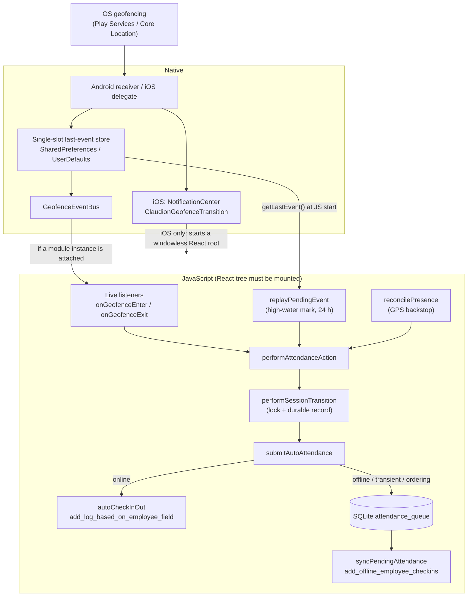

---

## 3. Core state machines

### 3.1 Attendance session (durable, AsyncStorage `attendanceSessionState`)

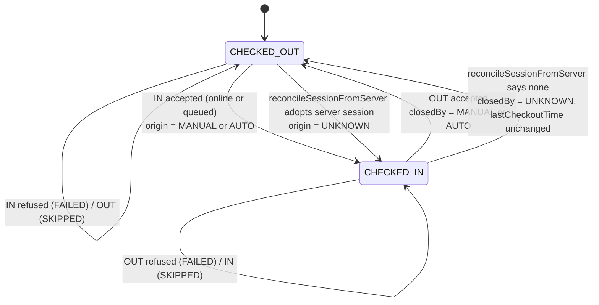

Rules **[V]** (`utils/attendanceSessionState.js`):

- `canTransition`: IN only from CHECKED_OUT; OUT only from CHECKED_IN (L198-201). This is the only duplicate guard between the OS and the backend.
- `execute()` runs **inside** the lock (L269-282); the state commits only when `execute` returns `{allowed: true}` (L284-298).
- A queued punch commits locally and returns `queued: true, serverConfirmed: false` (L300-309).
- The lock is a module-level promise chain (L174-183): it serializes within one JS runtime only.

### 3.2 Native monitoring flag (both platforms)

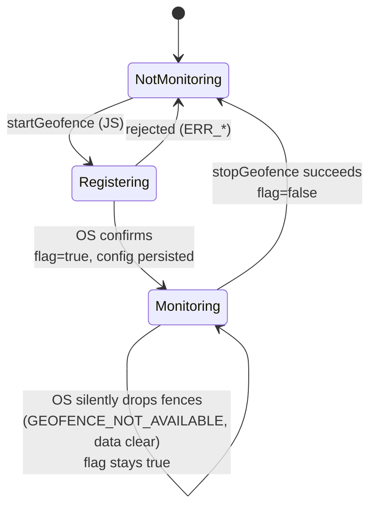

`isMonitoring()` returns the persisted flag, never the OS registration (Android `GeofenceStore.isMonitoring`, iOS `GeofenceStore.isMonitoring`). JS registers **only** when the flag is false (`AutoAttendanceBootstrap.jsx:466-474`). **[V]** The last transition in the diagram is a platform behaviour **[D]** that the code does not detect.

### 3.3 Offline queue row (`attendance_queue.status`)

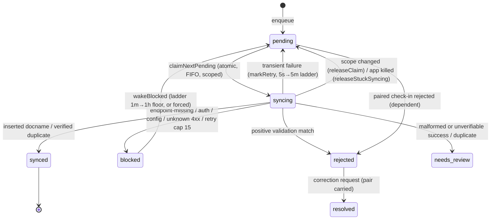

---

## 4. Scenario walkthroughs

Each scenario lists: entry point → sequence; native vs JS responsibility; events; state transitions; persisted data; retry/recovery; errors; expected vs actual; limitations.

### S1 — Application launch (cold, user-initiated)

**Sequence [V]**

1. iOS: `AppDelegate.application(_:didFinishLaunchingWithOptions:)` creates the Expo factory, configures Firebase, calls `AttendanceBackgroundRuntime.shared.configure` (observers only) then `super`, which dispatches `AutoAttendanceAppDelegateSubscriber` → `GeofenceManager.primeOnLaunch()` **if** `expoAutoAttendance.monitoring` is true. Expo's scene delegate (subclass `ClaudionAttendanceSceneDelegate`) starts React when the scene connects.
   Android: `MainApplication.onCreate` (lazy `reactHost`, no JS) → `MainActivity` starts React.
2. JS module scope in `App.js`: crash reporting, crypto install, FCM background handler, forced-logout cleanup handler (L46-65). Importing `localNotifications.js` sets the foreground notification handler.
3. `App` effect: fonts → appearance/home-experience hydration → (release only) `Updates.checkForUpdateAsync`, possibly `fetchUpdateAsync` + `reloadAsync` → `appReady` (L133-176).
4. `PersistGate` rehydrates Redux (`autoAttendance.userEnabled`, `geotagging`, user identity).
5. Mount order: `FcmBootstrap`, `AutoAttendanceBootstrap`, `OfflineAttendanceBootstrap`, `FeatureSettingsBootstrap`, `CrashReportingBootstrap`, `ErrorBoundary > Navigator` (L187-199).
6. `AutoAttendanceBootstrap` effect 1 (logged in + employee code): `fetchEmployeeData` → `setAutoAttendanceGeotagging`; on failure falls back to AsyncStorage `geotagging` (L111-147).
7. Effect 2: returns if `!isAvailable()`; if logged out or inactive → `stopGeofence()` (idempotent, errors swallowed); otherwise capture `scopeObservedAt`/`queueScope`, attach ENTER/EXIT listeners, then chain `ensureMonitoring → replayPendingEvent → reconcilePresence` onto `startupRef` (L149-641).
8. `OfflineAttendanceBootstrap`: `applySessionOwner(employeeCode)`, mirrors the admin offline switch, `startBackgroundSync` → forced config refresh + `runSync("launch", {wakeAllBlocked: true})`.

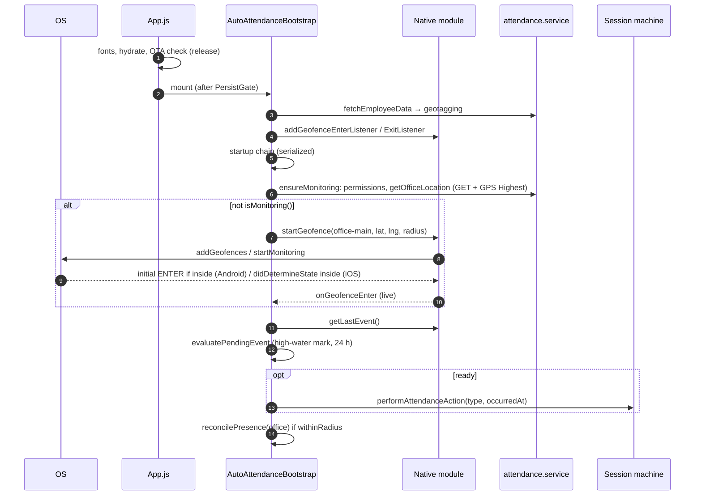

**Persisted data read**: Redux `root`; AsyncStorage high-water mark, session record, queue counts; native flag and last event.

**Limitations [V/I]**

- The replay of a missed transition waits behind `ensureMonitoring`, which performs a 10 s-timeout network request **and** an unbounded `getCurrentPositionAsync({accuracy: Highest})` (`attendance.service.js:196-198`). A slow or hanging fix delays (or, on iOS background wakes, may prevent) replay. **[V]** code path; timing **[D]**.
- Presence reconciliation runs on **every** effect run (every launch, login, employee change, sync request) — see S16/S20 consequences.

### S2 — Employee successfully authenticates

**Sequence [V]**: QR/password (`Login` → `saveTokens` → `setSignIn`) or mobile hand-off (`completeMobileSignIn` → persists `baseUrl`, `employee_code`, tokens, policy cache → clears session state if the tenant changed (`mobileAuth.service.js:303-312`) → `setEmployeeCode` → `setSignIn`). `isLoggedIn` flips; the navigator swaps; all bootstraps re-run.

**State**: after any logout, `REVERT_ALL` reset `autoAttendance` to `{geotagging: 0, userEnabled: false}`. Therefore **a fresh login never resumes monitoring automatically** — effect 2 sees `active === false` and calls `stopGeofence()`. The employee must re-enable it on the screen. **[V]** (`AutoAttendanceSlice.js:60-75`, `apiClient.js:204-208`).

**Session**: `applySessionOwner` keeps the session record for the same employee and clears it for a different employee.

**Limitation**: this includes forced logout on token expiry (`expireSession` → `clearStore`), so a terminal refresh failure silently turns automatic attendance off until the user opts in again. **[V]**

### S3 — Automatic Attendance is enabled

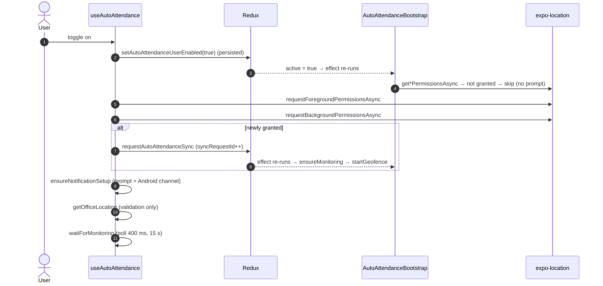

- Preconditions: `geotagging ∈ {1, 2}` (the switch is hidden when 0), native module available, employee code loaded (`useAutoAttendance.js:354-439`). **[V]**
- The opt-in is persisted **before** the permission prompt, so a declined prompt still leaves `userEnabled = true`; the screen then shows "Grant location access". **[V]**
- Only the bootstrap registers; the hook never calls `startGeofence` in production (L346-353). **[V]**
- Two GPS fixes and two `get_employee_data` requests happen on first enable (bootstrap + hook validation). **[V]**
- Errors: generic "Could not turn on monitoring" alert; no office → "No office location configured". Registration rejections inside the bootstrap are only logged. **[V]**

### S4 — Work location is retrieved

`getOfficeLocation(employeeCode)` (`attendance.service.js:92-244`) **[V]**:

1. GET `get_employee_data?employee_id=` (10 s timeout). For `auth_method === "mobile"`, `assertCompleteAttendancePolicy` throws when flags are missing or a restricted employee has no usable location.
2. Mirrors `restrict_location`, `unrestricted_checkout_location`, `photo`, `geotagging`, `employee_locations` into AsyncStorage (auth-generation guarded).
3. No locations → returns `null` → no registration, no presence check.
4. `requestForegroundPermissionsAsync()` (non-prompting when already granted), then a Highest-accuracy fix without timeout.
5. Scores each location: coordinates from GeoJSON `reporting_location` (`[lng, lat]`) else flat fields; `withinRadius = radius > 0 && distance <= radius`; picks the nearest **regardless of distance**.

The bootstrap registers the nearest office with `radius > 0 ? radius : 100` (L471). The fix accuracy (`coords.accuracy`) is never considered. **[V]**

**Limitations**: only one office is monitored — the nearest at the moment of registration. An employee with several reporting locations is not monitored at the others. **[V]**

### S5 — Location permissions are requested

| Path | Prompts? | Calls **[V]** |
| --- | --- | --- |
| Enable toggle / "Grant location access" button | Yes | `requestForegroundPermissionsAsync` → `requestBackgroundPermissionsAsync` (`useAutoAttendance.js:317-339`); then notification permission |
| Bootstrap | Never | `getForegroundPermissionsAsync` + `getBackgroundPermissionsAsync`; skip if either not granted (L444-456) |
| `getOfficeLocation` | Only if not already granted | `requestForegroundPermissionsAsync` (L191) — reached by the bootstrap only after the check above |
| Native `startGeofence` | Never | Rejects with `ERR_LOCATION_PERMISSION` / `ERR_BACKGROUND_LOCATION_PERMISSION` / `ERR_REDUCED_ACCURACY` (iOS) |

- iOS Precise Location is never requested (no temporary full-accuracy request); registration simply fails while it is off, and the screen shows a reliability warning. **[V]**
- No in-app pre-permission disclosure screen exists beyond the toggle description and the caption under "Grant location access" (`AutoAttendance.jsx:337-363`). Whether this satisfies Google Play's background-location prominent-disclosure requirement is an open question ([07](07-OPEN_QUESTIONS.md)). **[V]/[D]**

### S6 — Geofences are registered

**Android [V]** (`ExpoAutoAttendanceModule.kt:96-144`, `GeofenceManager.kt:96-131`): validation → permission checks → `addGeofences(GeofencingRequest{INITIAL_TRIGGER_ENTER, Geofence{id, circle, NEVER_EXPIRE, ENTER|EXIT}}, PendingIntent#4821)` → on success persist `{identifier, lat, lng, radius}` and `monitoring=true` → resolve. Re-adding the same request id replaces it; a different id would be **added**, not replaced (only the last is stored).

**iOS [V]** (`GeofenceManager.swift:145-191, 253-326`): on main queue; reject if monitoring unavailable or a start is pending; clamp radius to `maximumRegionMonitoringDistance`; stop previously stored and same-id regions; `startMonitoring(for:)` → `didStartMonitoringFor` → persist → `requestState(for:)` → resolve. Initial state `.inside` → synthetic ENTER (timestamp = now); `.unknown` → retry after 2 s, 4 s, 8 s (max 3), then give up ("JS presence check is the backstop").

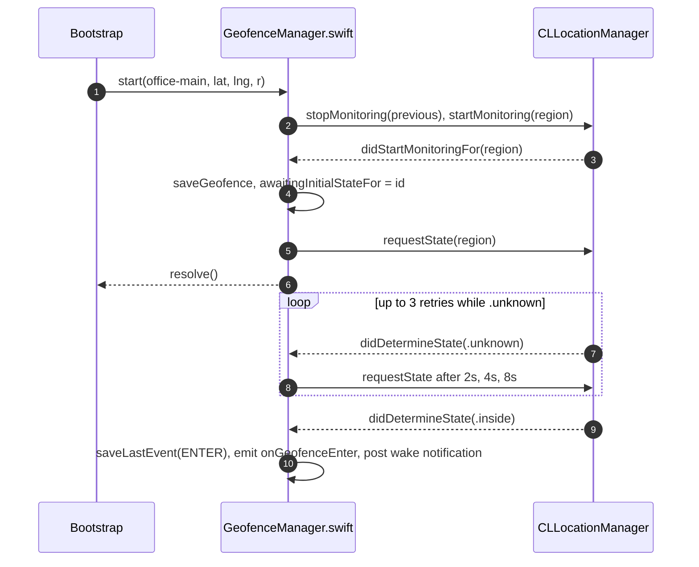

**Limitations**: iOS `pendingStart` has no timeout — if Core Location never answers, every later `start` is rejected for the process lifetime. **[V]** code; likelihood **[D]**.

### S7 — The employee enters a geofence

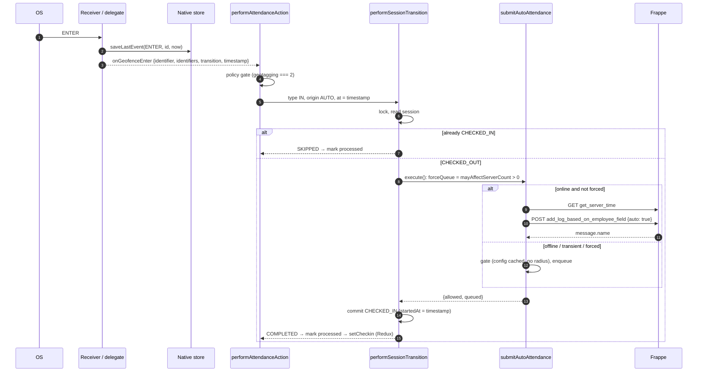

- Policy 1 (warnings only): the event is marked processed and nothing is sent (L224-230). Policy 0: monitoring is not running. **[V]**
- No employee code: returns without marking (transient) (L233-234). **[V]**
- The listener ignores `identifier`; any ENTER from this module is treated as the office. **[V]**
- No local notification is posted for a check-in (only for check-outs). **[V]**

### S8 — The employee exits a geofence

As S7 with `OUT`, except: never force-queued (L266-267); SKIPPED when already checked out (for example after a manual check-out); commit sets `endedAt`, `closedBy = AUTO`, `lastCheckoutTime`; Redux `setCheckout`; local notification "Checked out" / "Checked out offline" with `data: {type: "auto-checkout", pendingSync}` (L338-347). The manual screen later explains "You were checked out automatically" when a tap is SKIPPED with `closedBy === AUTO` (`useAttendanceAction.js:538-553`). **[V]**

Because the geofence EXIT closes **whatever** session is open, manual check-in → automatic check-out works by design. **[V]**

### S9 — An attendance request is created

**Online payload [V]** (`attendance.service.js:460-479`):

```json
{
  "device_id": "MobileAPP",
  "employee_field_value": "<employee code>",
  "log_type": "IN",
  "timestamp": "2026-10-09 08:01:12",
  "auto": true,
  "latitude": 25.2861,
  "longitude": 51.5348,
  "location": "<office name or 'Automatic (geofence)'>"
}
```

- `timestamp` = `resolveServerTimestampAt(occurredAt)`: server wall clock minus the device-measured age of the event; falls back to server "now" (L72-88). Coordinates are the **office's**, not the device's. **[V]**
- Success requires `response.data.message.name`. **[V]**

**Queued row [V]** (`AttendanceQueueService.js:218-249`): `employeeId`, `employeeDocname` (only when the cache matches the row's tenant/employee), `tenantKey` (only when `sourceScope` validates), `attendanceType: "auto"`, `action: checkin|checkout`, `timestamp = formatOfflineTimestamp(occurredAt)` (device time + last server offset), device GPS fix (`latitude/longitude/accuracy`, may be null), `address`, `deviceId: "MobileAPP"`, `payload {location, distance, radius, over_time: 0}`.

**Uploaded record [V]** (`AttendanceApi.js:73-100`): `{logs: [{employee: docname || code, timestamp, device_id, log_type, over_time, location?}]}`. **No `auto` flag, no coordinates**; `location` is the gate's location name or `"lat, lng"` of the device fix.

### S10 — The device loses internet connectivity

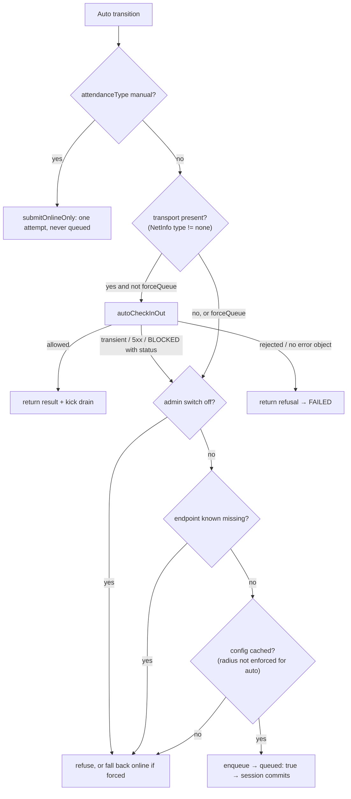

- Connectivity is "is there a transport" only; `isInternetReachable` is ignored (`NetworkListener.js:58-62`). **[V]**
- Without a cached configuration (`attendanceConfigCache`) offline automatic attendance is refused (`NO_CONFIG_MESSAGE`), the transition FAILS, and the event is **not** marked processed. **[V]**
- Offline the gate takes a Balanced fix with a 12 s budget, falling back to a last-known fix ≤ 2 min old, only to tag the row (`offlineAttendanceGate.js:51-98, 207-238`). **[V]**
- The OFFLINE banner appears via `addNetworkChangeListener` consumers. **[V]**

### S11 — The attendance request fails

| Failure | Classification ([attendanceErrors.js](../../services/offline/attendanceErrors.js)) | Live path result | Event marked processed? |
| --- | --- | --- | --- |
| Timeout, network error, `ECONN*`, 5xx | PENDING | Queued | Yes (COMPLETED, queued) |
| 401/403 or auth wording | BLOCKED/auth (after the 401 refresh interceptor) | Queued (BLOCKED with status queues) | Yes |
| Endpoint-missing / config wording / unknown 4xx | BLOCKED | Queued (unless capability already `false`, then refused) | Yes / No |
| Validation wording (inactive employee, future date, …) | REJECTED | Returned → FAILED | **No** → replay at next launch if still the native last event and ≤ 24 h |
| `allowed:false` with no `error` (e.g., no `message.name`) | — | FAILED | **No** |
| Terminal refresh failure | — | `expireSession` → logout → monitoring stopped | n/a |

During queue sync ([AttendanceSyncService.js:149-304](../../services/offline/AttendanceSyncService.js#L149-L304)): inserted → synced; duplicate → verified against history → synced (or `needs_review`); rejected → cascade to the paired row; blocked → slow ladder; transient → `markRetry` (5 s, 15 s, 45 s, 2 m, 5 m, then 5 m) and after 15 retries → blocked. **[V]**

### S12 — Connectivity is restored

`NetworkListener` fires an offline→online edge → `BackgroundSyncManager.handleReconnect` → forced-config refresh (unless drain-only) and `runSync("reconnect", {wakeAllBlocked: true})`. Additional triggers: foreground (3 s debounce), 60 s interval, queued punch (+3 s), successful online punch, token change (auth-blocked rows), pull-to-refresh (`syncNow`). All are JS-process triggers; nothing fires while JS is not running. **[V]**

### S13 — Previously queued events are synchronized

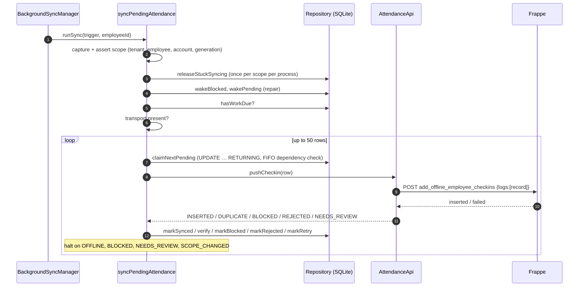

Invariants **[V]**: one row per request; per-employee FIFO enforced in SQL (older pending/syncing/needs_review, or blocked other than endpoint-missing, block younger rows — **including older rows with NULL `tenantKey`**, `AttendanceQueueRepository.js:119-133`); duplicates must be positively verified (`AttendanceVerification.js`); rows are never deleted (`purgeSynced` returns 0).

**Important consequence [V by static trace; no test]**: rows with `tenantKey = NULL` are never claimed by a production drain (`claimNextPending` adds `candidate.tenantKey = ?` whenever the scope has a tenant), yet they block every younger row of the same employee and are counted by `countByStatus(employeeId)` (not tenant-scoped) in `mayAffectServerCount`. See S15 for how automatic replays create such rows.

### S14 — The application moves to the background

- **iOS**: JS keeps running briefly, then the process is suspended. A region crossing resumes the process in the background, the delegate fires, the event bus calls the still-attached listener, and the JS thread runs `performAttendanceAction`. There is **no `beginBackgroundTask` around the attendance submission** on this path (the runtime's 25 s task only covers windowless cold starts). If iOS suspends the app mid-request, the high-water mark is not advanced; a later replay may resend after an uncertain commit. **[V]** code / timing **[D]**.
- **Android**: the process usually stays alive; the receiver delivers into the live module → JS. Doze/App Standby may defer network and geofence responsiveness. **[D]**
- `BackgroundSyncManager`'s interval is a JS `setInterval`; it stops with the JS thread.
- `ExpoAutoAttendanceModule` (Android) emits a Battery Saver warning while alive; iOS emits Low Power warnings.

### S15 — The application is terminated

#### iOS (process not running)

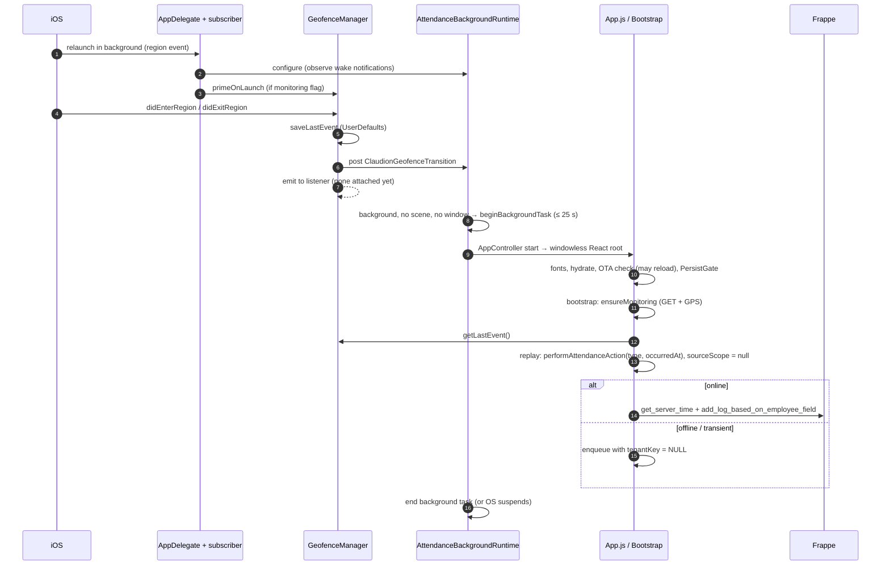

- The same runtime also starts on `RNFBMessagingDidReceiveRemoteNotification`; any background push therefore runs replay and presence reconciliation too. **[V]**
- **Provenance gap [V]**: the event occurred before `scopeObservedAt` (set when the effect ran), so `performAttendanceAction` passes `sourceScope: null` (`AutoAttendanceBootstrap.jsx:237-238`). If the punch is queued, `queueAttendance` cannot validate a scope and stores `tenantKey = NULL` (`AttendanceQueueService.js:210-216`). Such a row is shown in Profile recovery as "Cannot verify company … will not be resent automatically" (`utils/attendanceRecovery.js:3-6`), is never drained, and — per S13 — holds back the employee's later automatic punches and keeps `reconcilePresence` from opening sessions. This is the typical case the queue was built for (crossing while the app is not running and the network is poor). Not covered by tests.
- **Time budget [I/D]**: all of JS startup, an OTA check, an employee fetch, a Highest GPS fix (no timeout), server time and the POST must fit in the background window. If the process is suspended first, the event stays unprocessed and is replayed at the next JS start (if it is still the last event and < 24 h old).
- **Platform rules [D]**: Apple staff (developer forums, 2026) state region monitoring relaunches an app even after a user force-quit, while the app's own copy (`AutoAttendance.jsx:441-460`) tells users a swipe-kill stops relaunches; an unanswered May 2026 forum report claims no relaunch on iOS 26.4.2. Apple also documents a 3–5 minute average delivery latency, a launch throttle, and a short, undocumented background window (archived guide: "around 10 seconds"; DTS: up to ~30 s with `beginBackgroundTask`). See [03 §4](03-NATIVE_REQUIREMENTS.md).

#### Android (process not running)

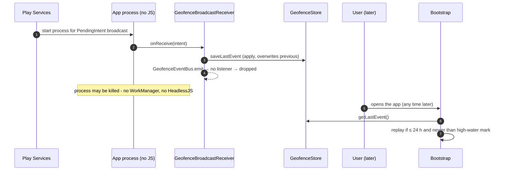

- **Only the most recent transition survives.** ENTER then EXIT while killed leaves only EXIT; replay finds CHECKED_OUT and SKIPS it — the whole visit produces no attendance. **[V]**
- Attendance is submitted only when the employee next opens the app (or the process is otherwise revived with the React tree mounted). "Automatic" attendance with the app killed is therefore deferred, and limited to the last event within 24 h. **[V]**
- `apply()` writes asynchronously; durability if the process dies immediately after `onReceive` is not guaranteed by the code **[D]**.
- **Force stop**: Google's `GeofencingClient` reference states geofences "are automatically removed when … the user force-restarts or force-quits" the app. On Android 15+ the system delivers `ACTION_BOOT_COMPLETED` when the app leaves the stopped state, so `GeofenceBootReceiver` re-registers. On Android ≤ 14 nothing re-registers: the persisted flag stays `true`, so `ensureMonitoring` skips registration on the next launch and monitoring stays dead until a reboot or an off/on toggle. The in-app copy ("stops automatic check-in/out until you reopen the app") is therefore optimistic for Android ≤ 14. **[V]** code + platform docs; device confirmation **[D]**.

### S16 — The device restarts

- **Android [V]**: `GeofenceBootReceiver` (`BOOT_COMPLETED`, also `MY_PACKAGE_REPLACED` on app update — Google documents that geofences are removed when the app is upgraded, so this second action is required, not optional) → `restoreFromStore` → re-adds the **stored** fence (old coordinates) with `INITIAL_TRIGGER_ENTER` — if the device is inside, an ENTER is recorded with the receipt time, without a real crossing, and is replayed as a check-in on the next app open (unless a session is already open). Restoration is skipped without fine+background permission.
- **iOS [V/D]**: no code runs; the OS keeps monitored regions across restarts (per the code comment and platform documentation). The first region event after reboot relaunches the app as in S15.

### S17 — Permissions are revoked

| Change | Native reaction | JS reaction | Recovery |
| --- | --- | --- | --- |
| iOS Always → When In Use / Never | `onError {code: -1}` while monitoring (L340-348); regions not removed | Bootstrap does not subscribe to `onError`; screen logs it; next run `ensureMonitoring` skips (no presence) | User re-grants on the screen → `requestAutoAttendanceSync` → `isMonitoring()` still true → **no re-registration** |
| iOS Precise off | `onError {code: -3}` | Screen reliability warning ("may be unreliable") | none. Apple documents that with reduced accuracy "your app can't use region monitoring" (`CLLocationManager.accuracyAuthorization`), so monitoring effectively stops while the flag and UI still say "Monitoring". |
| Android background/fine revoked | None (no listener); OS behaviour for existing fences **[D]** | Next run skips registration; flag stays true | After re-grant, **no re-registration** because `isMonitoring()` is true |
| Notifications revoked | — | `presentLocalNotification` logs and returns | — |

**Gap [V]**: no path verifies the OS still has the fence after a permission change; the persisted flag is trusted.

### S18 — The employee logs out

```mermaid
sequenceDiagram
  autonumber
  actor User
  participant P as Profile.handleLogout
  participant Redux
  participant Boot as AutoAttendanceBootstrap
  participant Off as OfflineAttendanceBootstrap
  participant N as Native module
  User->>P: Log out
  P->>P: invalidateAuthSession (generation++)
  P->>P: clearFcmRegistration, clearOfflineAttendance (config + capability only)
  P->>P: clearTokens, clearAuthCache
  P->>Redux: clearStore → setSignOut + REVERT_ALL
  Redux-->>Boot: isLoggedIn=false, userEnabled=false → cleanup listeners, stopGeofence()
  Boot->>N: removeGeofences / stopMonitoring, flag=false (Android only on success)
  Redux-->>Off: stopBackgroundSync, setOfflineQueueingAllowed(null)
```

Retained after logout **[V]**: SQLite queue (all statuses), `attendanceSessionState` + owner (same employee may return), `checkinStartTime`/`lastCheckoutTime`, `autoAttendanceLastProcessedEventAt`, native `last_event`, `serverClockOffset`, `employee_locations` legacy mirror. Cleared: tokens, Redux state, config cache, capability, native geofence (if removal succeeds).

Forced logout (`expireSession`) runs the same cleanup handler and `clearStore`. **[V]**

### S19 — The employee switches account, company or tenant

- **Different employee, same device [V]**: `applySessionOwner` clears the session record and `checkinStartTime`; queue rows of the previous employee remain and are skipped by scoped drains; the new employee must opt in again (Redux reset).
- **Different tenant via mobile sign-in [V]**: session state cleared when the normalized tenant key changes (`mobileAuth.service.js:303-312`). QR re-provisioning relies on `applySessionOwner` (employee-code comparison only; codes can collide across tenants — noted in that file).
- **Residue risk [V by trace]**: the native last event and the JS high-water mark are device-global. If employee A's last transition was never processed (FAILED or not yet replayed) and employee B enables monitoring within 24 h, B's bootstrap replays A's transition under B's identity (an ENTER would check B in at A's crossing time). Narrow but real.

### S20 — Work location or feature configuration changes

| Change | What happens **[V]** | Gap |
| --- | --- | --- |
| `geotagging` 2 → 1 | Effect 1 refetches on launch/login (and the screen refetches on focus); `fullActionsRef` updates; later crossings are detection-only | — |
| `geotagging` → 0 | `active` false → `stopGeofence()` | — |
| `geotagging` 0 → 1/2 | Resumes if `userEnabled` was still true | — |
| Office coordinates / radius changed, or a new nearer office added | `ensureMonitoring` resolves the new nearest office every run but registers **only if `!isMonitoring()`** → the native fence keeps the **old** coordinates; `officeRef` and presence use the **new** nearest | Fence and presence disagree until the employee toggles off/on or logs out/in. Android reboot restores the old stored fence. |
| `attendance_action.auto_attendance = false` | Route shows "Not available"; **monitoring continues** if already enabled | Policy/feature-flag mismatch |
| `attendance_action.offline_attendance = false` | New automatic punches are not queued (online only); existing rows still drain | — |
| `restrict_location`, `unrestricted_checkout_location` | Not applied to automatic punches (by design) | — |

---

## 5. Decision flows

### 5.1 Replay of the native last event (`evaluatePendingEvent` + bootstrap)

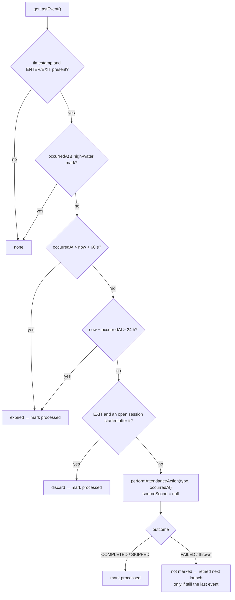

### 5.2 Presence reconciliation (`reconcilePresence`)

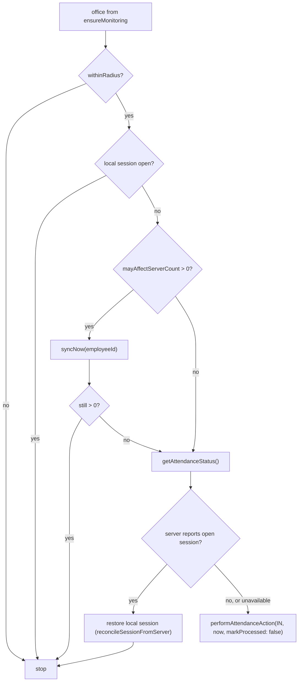

**Consequence [V by trace; no test]**: because this runs on every bootstrap run, an employee who checks out **manually** while still inside the fence is checked in again automatically the next time the app launches (or is woken in the background on iOS), once the server confirms no open session. Whether that is intended is a product question ([07](07-OPEN_QUESTIONS.md)).

---

## 6. Special behaviour audit — implemented vs intended

| Behaviour | Status | Evidence / notes |
| --- | --- | --- |
| Initial ENTER detection | **Implemented** | Android `INITIAL_TRIGGER_ENTER`; iOS `requestState` + 3 retries; JS presence backstop |
| Current-location check after registration | **Implemented** | `reconcilePresence` using `getOfficeLocation` fix (no accuracy threshold) |
| Duplicate ENTER/EXIT suppression | **Partial** | Session machine + high-water mark; no native debounce, dwell or minimum session; boundary flapping produces multiple IN/OUT pairs **[I]** |
| Event ordering / high-water mark | **Partial** | Monotonic mark; single native slot loses intermediate events; queue FIFO + `forceQueue` for IN |
| Attendance idempotency | **Partial** | Local unique index `(tenantKey, employeeId, timestamp, action)`; no idempotency key to the server; online and queued timestamps for the same crossing can differ after an uncertain commit |
| Delayed event replay | **Implemented (limited)** | Last event only, ≤ 24 h, at JS start |
| Offline SQLite queue | **Implemented** | Automatic punches only |
| Background queue draining | **Partial** | Only while JS runs (iOS background wake window; no Android/OS background task) |
| Failed attendance retries | **Implemented** | Queue ladders; refused transitions retried only via replay |
| Battery optimization handling | **Detection only** | `isIgnoringBatteryOptimizations`, power-save warnings, "Open app settings"; no exemption request |
| GPS accuracy checks | **Partial** | iOS precise required for registration; no fix-accuracy gating for presence or tags |
| Location permission recovery | **Partial** | Re-checked each run; iOS warns; no re-registration after re-grant |
| Geofence re-registration | **Partial** | Android boot + package replaced; not after GEOFENCE_NOT_AVAILABLE, Play Services data clear, backup restore, or location change |
| App restart recovery | **Implemented** | Replay, presence, `releaseStuckSyncing` |
| Shift awareness | **Not implemented** | No shift/time-window logic in the automatic path |
| Attendance-session awareness | **Implemented** | Shared durable session machine with manual punches |
| Mock-location / spoofing defence | **Not implemented** | No mock-provider checks; office coordinates sent instead of device position |
| Multi-office monitoring | **Not implemented** | Nearest office only |
