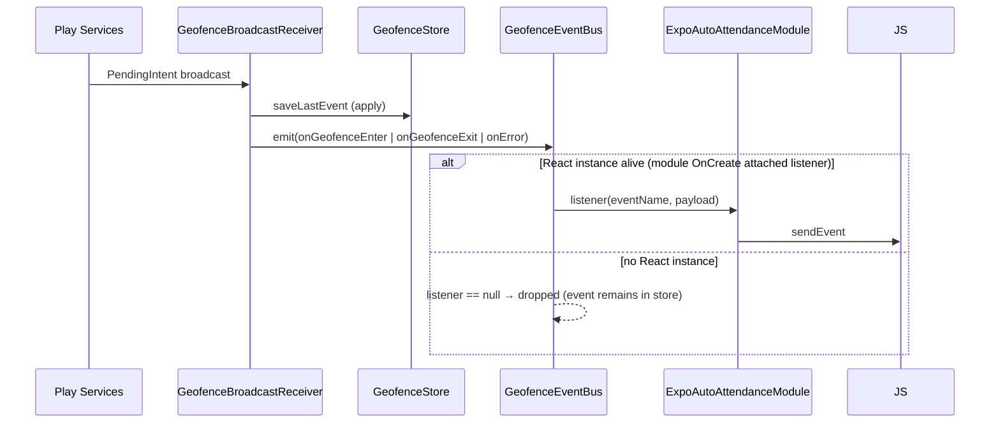
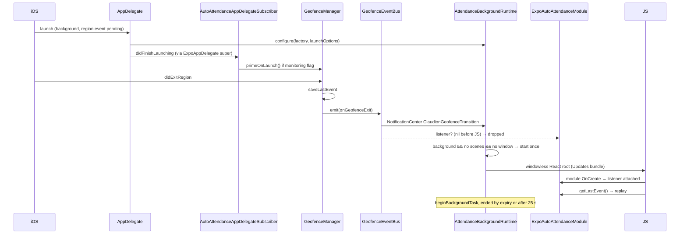

# 03 — Native Requirements: Android, iOS, Expo

Tags: **[V]** verified in this repository, **[P]** stated in official platform documentation (sources in §8), **[I]** inference, **[D]** requires real-device confirmation, **[R]** recommendation.

---

## 1. Compatibility snapshot (this repository)

| Item | Value | Source |
| --- | --- | --- |
| React Native | 0.86.3 | `package.json`, `node_modules/react-native` **[V]** |
| React | 19.2.3 | `package.json` **[V]** |
| Expo SDK | 57 (`expo ~57.0.27`, `expo-modules-core 57.0.21`) | `package.json`, installed **[V]** |
| Workflow | Hybrid: `ios/` committed (not regenerated), root `android/` generated by prebuild and gitignored; module sources committed under `modules/` | `.gitignore`, `CLAUDE.md` **[V]** |
| New Architecture | Enabled — `newArchEnabled=true` (generated `android/gradle.properties`), `RCTNewArchEnabled = true` (`ios/ClaudionCheckin/Info.plist:65-66`) | **[V]** |
| JS engine | Hermes (`hermesEnabled=true`; RN 0.86 default on iOS) | **[V]** |
| Android SDK levels | `minSdk 24`, `targetSdk 36`, `compileSdk 36` (RN 0.86 `libs.versions.toml` defaults; no override in `app.json`) | **[V]** |
| iOS deployment target | 16.4 (`app.json:69`, module podspec L13-15) | **[V]** |
| Swift | 5.9 (podspec) | **[V]** |
| iOS linkage | `useFrameworks: static`, `forceStaticLinking` for RNFB pods, `enableSceneSupport: true` (`app.json:28-41`) | **[V]** |
| Node / tooling | Node ≥ 22.13 (`engines`), EAS Node 22.14.0, `requireCommit: true` | **[V]** |
| OTA | `expo-updates`, runtime `1.2.1-sdk57`; iOS runtime comes from `Expo.plist`, not `app.json` | **[V]** |

Hermes/New-Architecture compatibility of the module **[V]**: the JS bridge uses only `requireOptionalNativeModule` and native event subscriptions; native code uses the Expo Modules DSL (`Module`, `Events`, `AsyncFunction`, `Function`, `Record`), which is JSI-based and runs under the New Architecture. Nothing uses the legacy bridge directly.

---

## 2. Android

### 2.1 What is implemented **[V]**

| Concern | Implementation | File |
| --- | --- | --- |
| API | `LocationServices.getGeofencingClient(applicationContext)` | `GeofenceManager.kt:31-32` |
| Geofence | `Geofence.Builder().setRequestId(id).setCircularRegion(lat, lng, radius).setExpirationDuration(NEVER_EXPIRE).setTransitionTypes(ENTER or EXIT)` — no loitering delay, no DWELL, default notification responsiveness | `GeofenceManager.kt:106-111` |
| Request | `GeofencingRequest.Builder().setInitialTrigger(INITIAL_TRIGGER_ENTER).addGeofence(...)` | L113-118 |
| PendingIntent | `PendingIntent.getBroadcast(appContext, 4821, Intent(GeofenceBroadcastReceiver), FLAG_UPDATE_CURRENT | FLAG_MUTABLE on S+)` | L38-53 |
| Removal | `removeGeofences(pendingIntent)` | L139 |
| Receiver | `GeofenceBroadcastReceiver`, `exported="false"`, synchronous `onReceive`, persists then emits | receiver + manifest |
| Reboot / upgrade | `GeofenceBootReceiver` for `BOOT_COMPLETED`, `MY_PACKAGE_REPLACED` → `restoreFromStore` | boot receiver + manifest |
| Persistence | SharedPreferences `expo_auto_attendance` via `apply()` | `GeofenceStore.kt` |
| Native → JS | `GeofenceEventBus` (volatile single listener) → `Module.sendEvent` while the React instance lives | `GeofenceEventBus.kt`, module L83-94 |
| Power | Dynamic `ACTION_POWER_SAVE_MODE_CHANGED` receiver (`RECEIVER_NOT_EXPORTED` on API 33+); `isIgnoringBatteryOptimizations` query | module L47-76, manager L75-89 |
| Gradle | `com.android.library`, `expo-module-gradle-plugin`, `play-services-location:21.3.0` | `android/build.gradle` |

Not implemented **[V]**: foreground service, WorkManager/JobScheduler, `goAsync()`, HeadlessJS, `LOCKED_BOOT_COMPLETED` (Direct Boot), handling of `GEOFENCE_NOT_AVAILABLE` beyond emitting `onError`, permission-change listeners, mock-location detection, battery-optimization exemption requests, verification that the OS still holds the fence.

### 2.2 Manifest and permissions

Declared by the module's library manifest (merged automatically) **[V]**:

```xml
<uses-permission android:name="android.permission.ACCESS_FINE_LOCATION"/>
<uses-permission android:name="android.permission.ACCESS_COARSE_LOCATION"/>
<uses-permission android:name="android.permission.ACCESS_BACKGROUND_LOCATION"/>
<uses-permission android:name="android.permission.RECEIVE_BOOT_COMPLETED"/>
<receiver android:name="expo.modules.autoattendance.GeofenceBroadcastReceiver" android:enabled="true" android:exported="false"/>
<receiver android:name="expo.modules.autoattendance.GeofenceBootReceiver" android:enabled="true" android:exported="false">
  <intent-filter>
    <action android:name="android.intent.action.BOOT_COMPLETED"/>
    <action android:name="android.intent.action.MY_PACKAGE_REPLACED"/>
  </intent-filter>
</receiver>
```

Also present in the app but **not needed by automatic attendance** **[V]**: `FOREGROUND_SERVICE`, `FOREGROUND_SERVICE_LOCATION` and `expo.modules.location.services.LocationTaskService` (added by the `expo-location` plugin's `isAndroidBackgroundLocationEnabled`; no TaskManager code exists). `POST_NOTIFICATIONS` is used by the local auto-checkout notification. `android:allowBackup="true"` in the generated manifest (Expo default).

Permission facts **[P]**:

- Apps that create and monitor geofences and **target** API 29+ must declare `ACCESS_BACKGROUND_LOCATION`; the `GeofencingClient` reference says "clients are required to hold `ACCESS_FINE_LOCATION` and `ACCESS_BACKGROUND_LOCATION`" to use most geofencing APIs. The condition is the target SDK, not only the device version. The module's `hasBackgroundLocationPermission` returns `true` below API 29 at runtime, which is correct for those devices. **[V]**
- Android 12+ "Approximate only" leaves `ACCESS_FINE_LOCATION` ungranted; the module treats that as "no full accuracy" and rejects registration. **[V]**
- Background location is requested separately after foreground (`requestBackgroundPermissionsAsync` in `useAutoAttendance.js:327`); on Android 11+ the user is sent to the system settings page by the platform. **[I]**
- Google Play requires a prominent in-app disclosure and a policy declaration for background location. The app shows a short caption only; adequacy is unconfirmed (see [07](07-OPEN_QUESTIONS.md)).

### 2.3 Background execution and process death

| Situation | What happens | Basis |
| --- | --- | --- |
| App foreground / background with process alive | Receiver → event bus → JS listener → submission | **[V]** |
| Process not running | Play Services broadcasts the PendingIntent; Android starts the process; `Application.onCreate` runs (`reactHost` is `lazy`, no JS); receiver persists one event; emit is dropped | **[V]** `MainApplication.kt`, receiver |
| Later app open | Bootstrap replays only the latest persisted event (≤ 24 h) | **[V]** |
| Force stop | "Geofences are automatically removed when the client application is reset (… upgraded or removed, or the user force-restarts or force-quits it)" **[P]**. Android 15 cancels pending intents in the stopped state and delivers `ACTION_BOOT_COMPLETED` when the app leaves it **[P]** → boot receiver re-registers. Android ≤ 14: no re-registration path; `isMonitoring()` stays true **[V]** | §8 |
| App upgrade | Geofences removed **[P]**; `MY_PACKAGE_REPLACED` restores the stored fence **[V]** | |
| Reboot | Re-register required **[P]**; boot receiver does it if permissions are still granted **[V]** | |
| App data cleared / Play services data cleared / `GEOFENCE_NOT_AVAILABLE` (network location provider disabled) | Re-registration required **[P]**; module does not handle the last two; the persisted flag remains true → JS never re-registers **[V]** | |
| Auto Backup restore after reinstall | SharedPreferences and databases may be restored while the OS holds no fences **[I/D]** → flag true, nothing registered | `allowBackup="true"` |

Timing and limits **[P]**:

- 100 geofences per app per device user; at most 5 distinct PendingIntents (`GEOFENCE_TOO_MANY_PENDING_INTENTS`). The module uses one geofence and one PendingIntent.
- Background responsiveness on Android 8.0+: "every couple of minutes"; "about 2–3 minutes on average … may increase (up to 6 minutes)" when stationary.
- Recommended minimum radius 100–150 m. The module accepts any positive radius; the bootstrap falls back to 100 m only when the server radius is ≤ 0.
- `INITIAL_TRIGGER_ENTER` fires ENTER at registration if already inside; there is no initial EXIT.
- Doze, App Standby buckets and OEM battery managers can delay or suppress delivery and network access; the app only detects `isIgnoringBatteryOptimizations` and Battery Saver **[V]**. Real impact **[D]**.

### 2.4 Native-to-JS delivery on Android



### 2.5 Android requirements for the SDK **[R]**

1. Persist each transition with `SharedPreferences.commit()` or a small SQLite/Room journal before returning from `onReceive`; use `goAsync()` if any I/O is asynchronous.
2. Store a **journal** (bounded, e.g. 200 entries) of events with a native-generated `eventId`, not a single slot.
3. Handle `GEOFENCE_NOT_AVAILABLE` and permission/location-provider changes by marking registration `degraded` and re-registering when possible (`LocationManager.PROVIDERS_CHANGED_ACTION`, app start).
4. Track registration truth separately from the user's desired state: `desired` (host asked to monitor) vs `registered` (OS acknowledged since last process start/boot).
5. Register the PendingIntent with a request code and intent action namespaced to the SDK.
6. Optional background processing (v2): `WorkManager` expedited work from the receiver, running either a HeadlessJS task or a native delivery adapter. Validate HeadlessJS under RN 0.86 New Architecture on devices before committing to it **[D]**.
7. Do not declare foreground-service permissions unless a feature needs them.

---

## 3. iOS

### 3.1 What is implemented **[V]**

| Concern | Implementation | File |
| --- | --- | --- |
| Manager | Singleton `GeofenceManager: NSObject, CLLocationManagerDelegate`, lazy `CLLocationManager` with `delegate = self` | `GeofenceManager.swift:18-27` |
| Thread | Registration/stop run on main (`runOnQueue(.main)`); sync status functions run on the JS thread and may touch the lazy manager first **[I]** | module L45-124 |
| Region | `CLCircularRegion(center, radius: min(radius, maximumRegionMonitoringDistance), identifier)`, `notifyOnEntry/Exit = true` | L163-170 |
| Replacement | Stops the stored and same-id regions before `startMonitoring(for:)`; with no stored id, `stop()` stops **all** circular regions in the app | L175-218 |
| Confirmation | Promise resolved in `didStartMonitoringFor`, rejected in `monitoringDidFailFor`; one pending start at a time, no timeout | L253-292 |
| Initial state | `requestState(for:)`; `.unknown` retried at 2 s, 4 s, 8 s; `.inside` → synthetic ENTER | L46-88, 294-326 |
| Transitions | `didEnterRegion` / `didExitRegion` → persist → emit; `didFailWithError` logged only | L227-249, 328-338 |
| Authorization | Registration requires `.authorizedAlways` and `.fullAccuracy`; changes while monitoring emit `-1` / `-3` warnings | module L57-77, manager L340-355 |
| Power | `NSProcessInfoPowerStateDidChange` → `-2` warning | L90-112 |
| Launch priming | `AutoAttendanceAppDelegateSubscriber` primes the manager at `didFinishLaunching` when the persisted flag is true | subscriber |
| Persistence | `UserDefaults.standard` keys `expoAutoAttendance.*` | `GeofenceStore.swift` |
| Wake hook | `GeofenceEventBus` posts `ClaudionGeofenceTransition` for ENTER/EXIT | `GeofenceEventBus.swift:26-30` |
| Background JS | App-level `AttendanceBackgroundRuntime` + scene subclass + config plugin (Expo SDK 57 scene lifecycle, EXUpdates `AppController`, `ExpoReactNativeFactory.recreateRootView`) | `native/ios/`, `plugins/` |
| Pod | `ExpoAutoAttendance`, iOS 16.4, Swift 5.9, static framework, `ExpoModulesCore`, `CoreLocation` | podspec |

### 3.2 Info.plist and capabilities

| Key | Value / status | Needed for automatic attendance? |
| --- | --- | --- |
| `NSLocationWhenInUseUsageDescription` | Present (generic wording mentioning "drivers during trips") | Yes |
| `NSLocationAlwaysAndWhenInUseUsageDescription` | Present (same wording) | Yes (Always) |
| `NSLocationAlwaysUsageDescription` | Present in the committed plist only ("Allow … to access your location") | Legacy; harmless |
| `NSMotionUsageDescription` | Present; **no Core Motion code exists** **[V]** | No |
| `UIBackgroundModes` | `remote-notification` only | Region monitoring does not require the `location` mode **[P]**; do not add it mechanically (`docs/expo-native-upgrade-audit.md`) |
| `UIApplicationSceneManifest` | Single scene, delegate `ClaudionAttendanceSceneDelegate` | Only for the background runtime |
| `RCTNewArchEnabled` | true | — |

The usage strings describe "real-time location updates for drivers during trips" (`app.json:17, 74-75`), which does not describe geofence-based attendance. App Store review and user consent depend on accurate purpose strings **[R]**.

### 3.3 Platform behaviour — supported vs not guaranteed

| Behaviour | Status | Basis |
| --- | --- | --- |
| Regions persist across app launches and reboots | Supported | **[P]** current docs; module comment L10-13 |
| Relaunch of a terminated app for a region event | Supported with **Always** authorization; not with When In Use | **[P]** "Yes for significant location change, visits, and region monitoring" (Always) |
| Relaunch after user force-quit | Apple staff say yes (forum, 2026); retired guide says iOS 8+; an unanswered May 2026 report claims otherwise on iOS 26.4.2 | **[P]/[D]** — conflicts with the app's own copy |
| Monitoring after reboot | Only after the first unlock | **[P]** |
| Delivery latency | "within 3 to 5 minutes on average, if not sooner"; archived guide: must move ~200 m past the boundary and stay ≥ 20 s; Apple engineer: launch throttle "once every 3-5 minutes", minimum radius varies 100–500 m | **[P]** |
| Network connectivity | "the region monitoring service requires network connectivity" | **[P]** |
| Reduced accuracy | "your app can't use region monitoring" | **[P]** — the module rejects registration but only warns after a later downgrade |
| Region limit | 20 per app | **[P]** — module uses 1 |
| Background execution after a wake | Undocumented today; archived guide "around 10 seconds"; DTS: varies, up to ~30 s with `beginBackgroundTask` | **[P]** — runtime caps its task at 25 s |
| Background App Refresh disabled | Archived guide: no region wake (even foreground events affected) | **[P]** archived only |
| Low Power Mode | Not documented for region monitoring; UIKit says Low Power Mode disables Background App Refresh → likely affects wakes | **[I]/[D]** |
| Initial state | `requestState` answers best-effort; `.unknown` is common right after registration | **[V]** code comment; **[D]** frequency |

### 3.4 Termination, relaunch and native-to-JS delivery



When the process is suspended but alive, iOS resumes it, the delegate fires on main, and the already attached listener sends the event to JS directly; no background task is started around the submission on that path **[V]**.

### 3.5 iOS requirements for the SDK **[R]**

1. Create `CLLocationManager` explicitly on the main thread at module/subscriber initialization; never lazily from a JS-thread call.
2. Add a timeout (e.g., 30 s) to a pending registration.
3. Namespace region identifiers (e.g., `aa.<regionId>`) and never stop regions the SDK did not create.
4. Persist a bounded event journal with `eventId`; write it before emitting; use a file protection class that is writable after first unlock.
5. On `locationManagerDidChangeAuthorization`, recompute status (Always, accuracy) and emit a typed `status` event; treat reduced accuracy as **monitoring unavailable**.
6. Wrap any JS-visible processing started from a wake in `beginBackgroundTask` (owned by the SDK's background bridge), and expose the remaining time to JS.
7. Ship the windowless React startup as an **optional** config-plugin feature guarded to Expo SDK ≥ 57 with scene support, and provide a documented hook (`AutoAttendanceBackgroundWake`) for hosts that start JS themselves.

---

## 4. Expo integration requirements

| Requirement | Current mechanism | SDK implication |
| --- | --- | --- |
| Autolinking | Local module under `modules/` with `expo-module.config.json` | Publishable package with the same config; works in bare RN via `install-expo-modules` **[I]** |
| AppDelegate hook | `apple.appDelegateSubscribers` | Keep: it is the only way to prime Core Location before JS without host code |
| Android manifest | Library manifest merge | Keep (no plugin needed for receivers/permissions) |
| iOS strings | `expo-location` plugin + committed `Info.plist` | SDK config plugin writes/validates strings; bare iOS hosts edit Info.plist manually |
| Background JS on iOS | App-level plugin + Swift file + AppDelegate edit + scene manifest | Optional SDK plugin feature; strict compatibility checks (existing plugin already refuses unknown layouts) |
| OTA safety | `requireOptionalNativeModule` returns null on binaries without the module | Keep: JS must degrade when native is absent |
| Native changes | Need a new binary and runtime-version bump (`app.json` + `ios/.../Expo.plist`) | SDK major/minor native changes = app store release |
| Committed `ios/` | Plugins do not re-run unless prebuild is run for iOS; `Info.plist`, `Expo.plist`, `AppDelegate.swift` are edited by hand | SDK docs must give manual steps for non-CNG iOS projects |

---

## 5. Module type recommendation

| Option | Fit with current code | Pros | Cons |
| --- | --- | --- | --- |
| **Expo Module (Kotlin/Swift on `expo-modules-core`) + config plugin** | Identical to today | Zero rewrite of native code; AppDelegate subscribers; typed records; events; New Architecture via JSI; config plugin for Info.plist and optional background runtime | Requires `expo-modules-core` in host (bare RN must install Expo modules) |
| Conventional TurboModule (codegen) | Rewrite needed | No Expo dependency | Must re-create AppDelegate priming via manual host instructions; more boilerplate; loses `requireOptionalNativeModule` pattern |
| Combination (Expo module core + plain native hooks) | Partial | Hosts without JS wake support can still integrate | Two integration paths to test |

**Recommendation [R]**: an **Expo Module with a config plugin**, plus exported native hook points (Swift notification name and Kotlin callback) for hosts that need custom background startup. This preserves the existing, field-tested native code paths and the AppDelegate subscriber that background relaunch depends on.

---

## 6. Native configuration the SDK must own

| Platform | Item | Owner in SDK |
| --- | --- | --- |
| Android | Location + boot permissions, two receivers | Library manifest |
| Android | `play-services-location` dependency (version range) | `build.gradle`, overridable via `rootProject.ext` |
| Android | Optional: WorkManager dependency (v2 background processing) | `build.gradle` feature flag |
| iOS | `CoreLocation` framework, pod, minimum iOS | Podspec (match host Expo SDK minimum) |
| iOS | `NSLocationWhenInUseUsageDescription`, `NSLocationAlwaysAndWhenInUseUsageDescription` | Config plugin (`locationWhenInUsePermission`, `locationAlwaysPermission` options; refuse empty strings) |
| iOS | AppDelegate subscriber | `expo-module.config.json` |
| iOS | Optional background React runtime, scene delegate, AppDelegate injection | Config plugin feature `ios.backgroundRuntime: true` |
| Both | Wake notification / intent action names | SDK constants (no app names) |

---

## 7. Native contracts to preserve during extraction

1. Persist **before** emit (both platforms).
2. ENTER/EXIT payload `{identifier, identifiers[], transition: "ENTER"|"EXIT", timestamp (epoch ms)}` and error payload `{code, message}`; warning codes `-1`, `-2`, `-3`.
3. Registration preconditions and error codes: `ERR_INVALID_OPTIONS`, `ERR_LOCATION_PERMISSION`, `ERR_BACKGROUND_LOCATION_PERMISSION`, `ERR_REDUCED_ACCURACY` (iOS), `ERR_GEOFENCE_REGISTRATION`, `ERR_GEOFENCE_REMOVAL` (Android).
4. Android `INITIAL_TRIGGER_ENTER`; iOS initial-state retries (2 s/4 s/8 s, max 3) and synthetic ENTER.
5. iOS radius clamp to `maximumRegionMonitoringDistance`.
6. Android restore on `BOOT_COMPLETED` and `MY_PACKAGE_REPLACED`, guarded by permissions.
7. iOS priming at launch when monitoring is persisted.
8. `getLastEvent()` remains readable after restarts (compatibility layer over the new journal).

---

## 8. Sources for platform statements

Android:

- Geofencing guide — re-registration list, 100 geofences, minimum radius 100–150 m, FLAG_MUTABLE sample: https://developer.android.com/develop/sensors-and-location/location/geofencing
- `GeofencingClient` reference — FINE + BACKGROUND requirement, FLAG_MUTABLE on S+, removal on upgrade/force-quit: https://developers.google.com/android/reference/com/google/android/gms/location/GeofencingClient
- `GeofencingRequest` / `Geofence.Builder` — `INITIAL_TRIGGER_ENTER`, notification responsiveness: https://developers.google.com/android/reference/com/google/android/gms/location/GeofencingRequest
- `GeofenceStatusCodes` — `GEOFENCE_NOT_AVAILABLE`, `GEOFENCE_TOO_MANY_PENDING_INTENTS`: https://developers.google.com/android/reference/com/google/android/gms/location/GeofenceStatusCodes
- Background location limits (2–3 min, up to 6 min): https://developer.android.com/about/versions/oreo/background-location-limits
- Android 10 privacy changes (background permission for geofencing): https://developer.android.com/about/versions/10/privacy/changes
- Android 15 stopped state and `BOOT_COMPLETED`: https://developer.android.com/about/versions/15/behavior-changes-all

Apple:

- `startMonitoring(for:)` — 20 regions, 3–5 min latency, network requirement: https://developer.apple.com/documentation/corelocation/cllocationmanager/startmonitoring(for:)
- Requesting authorization — Always vs When In Use relaunch table: https://developer.apple.com/documentation/corelocation/requesting-authorization-to-use-location-services
- `accuracyAuthorization` — reduced accuracy disables region monitoring: https://developer.apple.com/documentation/corelocation/cllocationmanager/accuracyauthorization
- `backgroundRefreshStatus` — Low Power Mode disables Background App Refresh: https://developer.apple.com/documentation/uikit/uiapplication/backgroundrefreshstatus
- Archived Location and Maps Programming Guide (region monitoring: 20 s / ~200 m, ~10 s background, Background App Refresh): https://developer.apple.com/library/archive/documentation/UserExperience/Conceptual/LocationAwarenessPG/RegionMonitoring/RegionMonitoring.html
- Apple Developer Forums threads 818908, 815618, 685525, 826964 (force-quit relaunch, wake duration, launch throttle; 826964 is an unanswered counter-report).

Statements marked **[P]** from archived guides or forum answers may be outdated; treat them as hypotheses for the device test plan in [06](06-TESTING_AND_RISKS.md).
