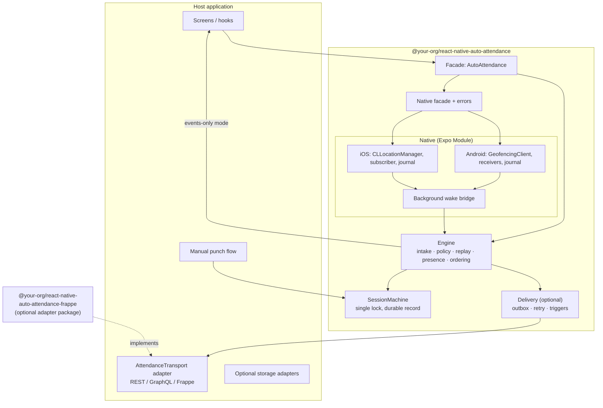
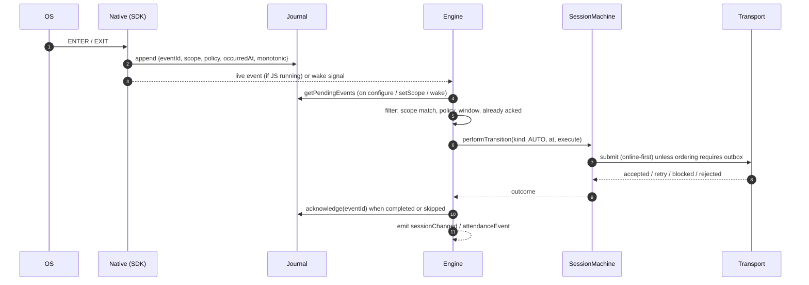

# 04 — Proposed SDK Architecture: `@your-org/react-native-auto-attendance`

Status: **proposal**. Nothing here is implemented. Every design choice cites the current behaviour it preserves or deliberately changes. Tags: **[V]** current verified behaviour, **[R]** recommendation, **[C]** compatibility-mode default (reproduces today's behaviour exactly), **[Δ]** behaviour change that needs product sign-off before it is enabled.

---

## 1. Design goals and constraints

1. **No backend coupling in the core.** Frappe/ERPNext moves to an optional adapter package. The core never builds a URL, payload or auth header.
2. **Durability first.** A transition the OS delivered must survive process death, logout and token expiry until a host or adapter acknowledges it. Today only one event survives **[V]**; the SDK keeps a journal.
3. **Provenance at capture.** Each native event is stamped with the scope (tenant + subject) that was active when monitoring was configured, so a replay can prove ownership. Today replays carry no identity and queued replays become unattributable rows **[V]** ([02 §S15](02-RUNTIME_FLOWS.md)).
4. **React-free engine.** The attendance logic currently lives in a React component (`AutoAttendanceBootstrap`) that only runs after `App` renders **[V]**. The SDK engine is a plain TypeScript object that can start from the app root, a headless task, or a background wake.
5. **One session authority per process.** Manual and automatic punches must share the same lock and record, exactly as today **[V]**.
6. **Compatibility mode.** The Claudion app must be able to adopt the SDK with zero behaviour change (same storage keys, same identifiers, same decisions). Improvements are opt-in flags.
7. **Honest status.** Report what the OS has actually acknowledged, separately from what the host asked for. Today `isMonitoring()` is a persisted flag **[V]**.
8. **Privacy by default.** Redacting logger, optional device-location capture, explicit retention.

---

## 2. Layered architecture



| Layer | Owns | Must not own |
| --- | --- | --- |
| Native | Registration, OS callbacks, durable journal (bounded), scope stamping, registration truth, permission/accuracy/power status, background wake signal | Attendance semantics, HTTP |
| Native facade (TS) | Typed bindings, error mapping, legacy compatibility exports | Business rules |
| Engine (TS) | Live/journal intake, de-duplication by `eventId`, policy gate, replay window, presence strategy, ordering guard, acknowledgements | Network, UI |
| SessionMachine (TS) | `CHECKED_OUT ⇄ CHECKED_IN`, origin/closedBy, single per-process lock, reconcile, owner | Network |
| Delivery (TS, optional) | Outbox, FIFO per scope, retry ladders, failure taxonomy, sync triggers, verification hooks | Payloads, auth, endpoint names |
| Transport adapter (host) | Payloads, auth, refresh, endpoints, server time, error classification | Persistence ordering |

---

## 3. Decision: who owns submission and offline synchronization?

| Option | What the SDK does | Pros | Cons |
| --- | --- | --- | --- |
| A. Events only | Detect, journal, interpret into `AttendanceEvent`, emit; host acknowledges | Smallest surface; any backend; host keeps its queue | Every host re-implements the hardest parts (session lock, ordering, retry, blocked vs rejected, scoped drains) that this app needed ~10 iterations to get right **[V]** (`docs/attendance-sync-forensic-audit.md`) |
| B. Full delivery | Also owns outbox, retries, triggers; calls a host transport | Reliability rules enforced once | Larger surface; needs storage dependency; classification contract |
| **C. Layered (recommended)** | A is always on; B is enabled when `delivery.transport` is configured | Hosts choose; the Claudion app can start with A while keeping its existing queue, then move to B | Two modes to document and test |

**Recommendation [R]: C.** The engine and session machine are mandatory; delivery is opt-in. Without a transport, events stay pending in the journal until `acknowledge()`. With a transport, the SDK performs the same online-first decision the app makes today **[C]**:

1. Inside the session lock, attempt `transport.submit()` unless an older event for the same scope is undelivered (`forceQueue` rule for IN **[V]**).
2. `accepted` → commit session, acknowledge.
3. `retry` / `blocked` → persist to the outbox, commit session as **queued**.
4. `rejected` (positive validation only) or a host-side refusal → do **not** commit; leave the journal event un-acknowledged (today: retried at next launch only if it is still the last event **[V]**).

An `outbox-first` mode (always persist, then deliver) is offered for hosts that prefer it **[Δ]**; it changes when the session commits relative to a server refusal and is not the default.

---

## 4. Public API

The facade is a singleton (`AutoAttendance`) because the session lock must be process-wide **[V]** (`attendanceSessionState.js:174-183`).

### 4.1 Core types

```ts
export type Platform = 'ios' | 'android';
export type Transition = 'ENTER' | 'EXIT';
export type AttendanceKind = 'IN' | 'OUT';
export type Origin = 'MANUAL' | 'AUTO' | 'UNKNOWN';

/** Who owns the events captured while monitoring. Stamped natively onto every event. */
export interface AttendanceScope {
  tenantId: string;      // e.g. normalized backend origin; opaque to the SDK
  subjectId: string;     // e.g. employee code; opaque to the SDK
  scopeVersion?: number; // bump to invalidate in-flight work after re-provisioning
}

export type MonitoringPolicy =
  | 'off'      // geotagging 0: no monitoring
  | 'detect'   // geotagging 1: detect + emit transitions, never attendance
  | 'record';  // geotagging 2: transitions become attendance events

export interface GeofenceRegion {
  id: string;            // host id; SDK namespaces it natively (e.g. "aa:<id>")
  latitude: number;      // [-90, 90]
  longitude: number;     // [-180, 180]
  radiusM: number;       // > 0; iOS clamps to maximumRegionMonitoringDistance
  label?: string;        // e.g. office name; used for tagging/notifications only
  metadata?: Record<string, string>;
}

/** One OS delivery, as journaled by native code before any JS runs. */
export interface TransitionRecord {
  eventId: string;                 // UUID generated natively
  regionId: string;
  transition: Transition;
  source: 'os' | 'initial-state' | 'restore'; // restore = initial trigger after re-registration
  occurredAt: number;              // epoch ms, device wall clock at native receipt
  elapsedRealtimeMs?: number;      // monotonic clock + bootId, for skew-safe ageing
  bootId?: string;
  scope: AttendanceScope | null;   // scope persisted with the monitoring config
  policy: MonitoringPolicy;        // policy persisted with the monitoring config [Δ]
  appState: 'active' | 'background' | 'not-running';
  triggeringLocation?: { latitude: number; longitude: number; accuracyM: number; at: number; isMock?: boolean };
  platform: Platform;
  sdkVersion: string;
}

/** What the engine asks the host/transport to record. */
export interface AttendanceEvent {
  eventId: string;                 // TransitionRecord.eventId, or a UUID for presence
  idempotencyKey: string;          // `${tenantId}:${subjectId}:${eventId}`, stable across retries
  kind: AttendanceKind;
  origin: 'AUTO';
  trigger: 'geofence' | 'initial-state' | 'replay' | 'presence' | 'restore';
  occurredAt: number;              // epoch ms (device); see ServerClock for server time
  region: GeofenceRegion;
  scope: AttendanceScope;
  deviceLocation?: TransitionRecord['triggeringLocation']; // only if captureDeviceLocation
}

export interface SessionRecord {
  status: 'CHECKED_IN' | 'CHECKED_OUT';
  origin: Origin | null;
  startedAt: number | null;
  endedAt: number | null;
  closedBy: Origin | null;
}

export interface TransitionOutcome {
  status: 'completed' | 'skipped' | 'failed';
  session: SessionRecord;
  previousSession: SessionRecord;
  queued: boolean;           // accepted locally, not yet confirmed by the server
  serverConfirmed: boolean;
  response?: unknown;
}
```

### 4.2 Configuration

```ts
export interface AutoAttendanceConfig {
  /** Storage namespace. 'claudion-v1' reproduces today's keys exactly. */
  compatibility?: 'none' | 'claudion-v1';
  keyPrefix?: string;                         // default 'autoAttendance:'
  storage?: KeyValueStore;                    // default AsyncStorage (peer, optional)
  replay?: { maxAgeMs?: number; futureToleranceMs?: number };      // [C] 24 h, 60 s
  presence?: {
    enabled: boolean;                          // [C] true
    when: 'every-start' | 'on-registration';   // [C] 'every-start'; [R][Δ] 'on-registration'
    fixTimeoutMs?: number;                     // [C] none; [R][Δ] 15000
    maxAccuracyM?: number;                     // [C] none; [R][Δ] e.g. 100
    remoteSessionCheck: boolean;               // [C] true (requires transport.getRemoteSession)
  };
  ordering?: { forceQueueInBehindUndelivered: boolean };            // [C] true
  delivery?: {
    transport: AttendanceTransport;
    mode?: 'online-first' | 'outbox-first';    // [C] 'online-first'
    outbox?: OutboxStore;                      // default expo-sqlite implementation
    retry?: Partial<RetryPolicy>;
    triggers?: { appState?: boolean; network?: NetworkAdapter | false; heartbeatMs?: number };
  };
  captureDeviceLocation?: boolean;            // [R] false; [C] true (queued rows store device fix today)
  logger?: Logger;                            // default: redacting console logger in __DEV__, silent in release
  clock?: ServerClock;                        // backdating + offline offset
}

export interface RetryPolicy {
  transientDelaysMs: number[];  // [C] [5s, 15s, 45s, 2m, 5m]
  maxTransientAttempts: number; // [C] 15, then blocked (never terminal)
  blockedDelaysMs: number[];    // [C] [1m, 5m, 20m, 1h] (1h floor forever)
  maxRowsPerRun: number;        // [C] 50
  heartbeatMs: number;          // [C] 60000 (foreground only)
  queueKickDelayMs: number;     // [C] 3000
}
```

### 4.3 Methods

| Method | Arguments → returns | Errors | Native deps | Lifecycle / notes |
| --- | --- | --- | --- | --- |
| `configure(config)` | `AutoAttendanceConfig` → `Promise<void>` | `E_NATIVE_UNAVAILABLE` (only if `requireNative: true`), `E_INVALID_CONFIG` | journal read | Call once at process start, **before** any React render (module scope of the entry file) so background wakes and headless tasks have an engine. Idempotent. |
| `setScope(scope)` | `AttendanceScope \| null` → `Promise<void>` | `E_INVALID_SCOPE` | persists scope natively | Call after login and on account switch. Changing scope triggers `session.applyOwner` semantics **[C]** and quarantines journal events from other scopes. `null` on logout. |
| `setPolicy(policy)` | `MonitoringPolicy` → `Promise<void>` | — | persists policy natively | `'off'` stops monitoring; `'detect'` keeps monitoring without attendance. |
| `setRegions(regions)` | `GeofenceRegion[]` → `Promise<RegistrationReport>` | `E_INVALID_REGION`, `E_TOO_MANY_REGIONS` (iOS 20, Android 100) | replaces the SDK-owned set atomically | Re-registers only changed regions **[R][Δ]** (today the fence is never updated while monitoring **[V]**). |
| `startMonitoring(options?)` | `{ initialPresence?: boolean }` → `Promise<MonitoringStatus>` | `E_PERMISSION_FOREGROUND`, `E_PERMISSION_BACKGROUND`, `E_REDUCED_ACCURACY`, `E_LOCATION_SERVICES_DISABLED`, `E_REGISTRATION_IN_PROGRESS`, `E_REGISTRATION_TIMEOUT`, `E_REGISTRATION_FAILED{nativeCode}` | add geofences / start region monitoring | Never prompts **[C]**. Attaches listeners before registering so the initial ENTER is not missed **[V]**. |
| `stopMonitoring(options?)` | `{ keepJournal?: true }` → `Promise<void>` | `E_REMOVAL_FAILED` | remove SDK-owned regions only | Does not delete undelivered events. |
| `getStatus()` | → `Promise<MonitoringStatus>` | — | permission, accuracy, power, OS registration | Cheap; safe to poll on focus. |
| `requestPermissions(options)` | `{ background: boolean; rationale?: () => Promise<boolean> }` → `Promise<PermissionSnapshot>` | `E_ACTIVITY_UNAVAILABLE` (Android) | expo-modules-core permissions | Must be called from a user gesture. The host shows its disclosure UI in `rationale`. |
| `addListener(name, cb)` | see §4.5 → `Subscription` | — | event bus | Live delivery only; durability comes from the journal. |
| `getPendingEvents()` | → `Promise<TransitionRecord[]>` | `E_STORAGE` | journal | Unacknowledged events, oldest first. |
| `acknowledge(eventIds)` | `string[]` → `Promise<void>` | `E_STORAGE` | journal | Events-only mode: host calls after it has durably handled the event. |
| `processPending()` | → `Promise<ProcessReport>` | — | journal | Replays eligible journal events through the engine (today's `replayPendingEvent`, generalized). Runs automatically at `configure`, `setScope`, and on wake. |
| `sync(options?)` | `{ wakeAllPending?: boolean }` → `Promise<SyncReport>` | `E_TRANSPORT_NOT_CONFIGURED` | — | Delivery mode drain (today's `syncNow`). |
| `session.get()` | → `Promise<SessionRecord>` | — | — | Takes the lock **[V]**. |
| `session.performTransition(args)` | `{ kind, origin, at?, execute }` → `Promise<TransitionOutcome>` | rethrows `execute` errors | — | **The** entry point for manual punches too; never call `session.get()` inside `execute` (deadlock, as today **[V]**). |
| `session.reconcile(args)` | `{ activeStartedAt, origin?, fetchedAt? }` → `Promise<SessionRecord>` | — | — | Same guards as `reconcileSessionFromServer` **[V]**. |
| `getDiagnostics(options?)` | `{ redact?: 'strict' \| 'standard' \| 'none' }` → `Promise<Diagnostics>` | — | all | Never sent anywhere by the SDK. |
| `signOut(options?)` | `{ stopMonitoring?: true }` → `Promise<void>` | — | stop + clear scope | Keeps journal, outbox, session record **[C]**. |
| `purge(options)` | `{ confirm: 'DELETE_UNDELIVERED_ATTENDANCE' }` → `Promise<void>` | `E_CONFIRMATION_REQUIRED` | journal + outbox | The only API that deletes undelivered attendance **[V]** (mirrors `purgeAttendanceQueue`). |

### 4.4 Status and permissions

```ts
export interface PermissionSnapshot {
  foreground: 'granted' | 'denied' | 'undetermined';
  background: 'granted' | 'denied' | 'undetermined' | 'not-applicable';
  precise: boolean;                       // iOS accuracyAuthorization / Android FINE
  locationServicesEnabled: boolean;
  notifications?: 'granted' | 'denied' | 'undetermined'; // only if host asks
}

export interface MonitoringStatus {
  available: boolean;            // native module present in this binary
  desired: boolean;              // host asked to monitor (persisted)
  registered: boolean;           // OS acknowledged since boot/process start (Android) / in monitoredRegions (iOS)
  effective: 'active' | 'degraded' | 'inactive';
  degradedReasons: Array<
    | 'permission-foreground' | 'permission-background' | 'reduced-accuracy'
    | 'location-services-off' | 'geofence-not-available' | 'registration-failed'
    | 'not-registered' | 'battery-optimized' | 'power-saver' | 'background-refresh-off'
  >;
  policy: MonitoringPolicy;
  scope: AttendanceScope | null;
  regions: Array<GeofenceRegion & { registeredAt: number | null }>;
  permissions: PermissionSnapshot;
  journal: { pending: number; oldestPendingAt: number | null; quarantined: number };
  outbox?: { pending: number; blocked: number; rejected: number; needsReview: number; oldestPendingAt: number | null };
  lastTransition: TransitionRecord | null;
  platform: Platform;
}
```

### 4.5 Events

| Name | Payload | When |
| --- | --- | --- |
| `transition` | `TransitionRecord` | Every native ENTER/EXIT (any policy), live only |
| `attendanceEvent` | `AttendanceEvent` | Engine decided a transition is attendance (`policy: 'record'`) |
| `sessionChanged` | `{ session, previousSession, cause: 'auto' \| 'manual' \| 'reconcile' \| 'owner-change', queued }` | After every committed change — replaces today's Redux dispatches inside the bootstrap **[V]** |
| `deliveryChanged` | `{ eventId, state: 'pending' \| 'syncing' \| 'synced' \| 'blocked' \| 'rejected' \| 'needs_review', failureClass? }` | Delivery mode |
| `status` | `MonitoringStatus` | Permission/accuracy/power/registration changes |
| `error` | `{ code, message, nativeCode? }` | Native and engine errors (replaces raw `onError`) |

### 4.6 Error codes

| SDK code | Legacy native code(s) **[V]** | Meaning |
| --- | --- | --- |
| `E_NATIVE_UNAVAILABLE` | "only available in native builds…" | Binary lacks the module |
| `E_INVALID_REGION` | `ERR_INVALID_OPTIONS` | Lat/lng out of range or radius ≤ 0 |
| `E_PERMISSION_FOREGROUND` | `ERR_LOCATION_PERMISSION` | Fine/When-In-Use missing |
| `E_PERMISSION_BACKGROUND` | `ERR_BACKGROUND_LOCATION_PERMISSION` | Background/Always missing |
| `E_REDUCED_ACCURACY` | `ERR_REDUCED_ACCURACY` (iOS) | Precise location off |
| `E_REGISTRATION_IN_PROGRESS` | `ERR_GEOFENCE_REGISTRATION` ("already in progress") | Concurrent start |
| `E_REGISTRATION_TIMEOUT` | — (new) | OS never confirmed |
| `E_REGISTRATION_FAILED` | `ERR_GEOFENCE_REGISTRATION` | Includes `nativeCode` (GeofenceStatusCodes / CLError) |
| `E_REMOVAL_FAILED` | `ERR_GEOFENCE_REMOVAL` | Android removal failure |
| `E_TOO_MANY_REGIONS` | — | Platform limit |
| `E_LOCATION_SERVICES_DISABLED` | — | System location off |
| `E_SCOPE_REQUIRED` / `E_SCOPE_MISMATCH` | — | Recording without a scope / foreign scope |
| `E_TRANSPORT_NOT_CONFIGURED` | — | `sync()` without delivery |
| `E_STORAGE` | — | Journal/outbox I/O |
| `E_CONFIRMATION_REQUIRED` | — | `purge` without explicit confirmation |

Warning codes `-1` (authorization reduced), `-2` (low power / battery saver), `-3` (precise off) **[V]** become `status.degradedReasons` plus a `status` event; the legacy `onError` codes stay available through the compatibility layer.

---

## 5. Adapters

### 5.1 Transport (backend boundary)

```ts
export interface SubmitContext {
  attempt: number;               // 0 = first (online-first) attempt
  queued: boolean;               // true when delivering from the outbox
  serverTimestampFor(occurredAt: number): Promise<string | number | null>; // via ServerClock
  signal: AbortSignal;
}

export type SubmitResult =
  | { outcome: 'accepted'; receiptId: string }
  | { outcome: 'duplicate'; receiptId?: string; verified: boolean }
  | { outcome: 'retry'; reason: string; retryAfterMs?: number }
  | { outcome: 'blocked'; failureClass: 'auth' | 'endpoint-missing' | 'configuration' | 'scope' | 'unknown'; message?: string }
  | { outcome: 'rejected'; failureClass: 'validation'; message?: string }
  | { outcome: 'needs_review'; message?: string };

export interface AttendanceTransport {
  submit(event: AttendanceEvent, ctx: SubmitContext): Promise<SubmitResult>;
  /** Optional different call for outbox delivery (Frappe uses a bulk endpoint). */
  submitQueued?(event: AttendanceEvent, ctx: SubmitContext): Promise<SubmitResult>;
  /** Positive evidence only; never used to authorize a resend. */
  verify?(event: AttendanceEvent): Promise<{ verified: boolean; receiptId?: string; reason?: string }>;
  /** Used by presence reconciliation step 2. 'unknown' must not be treated as closed. */
  getRemoteSession?(scope: AttendanceScope): Promise<{ status: 'open' | 'closed' | 'unknown'; startedAt?: number }>;
}
```

SDK-enforced rules (copied from today's design **[V]**, not delegated to adapters):

- A thrown error or a result the SDK cannot parse is **`blocked/unknown`**, never `rejected`.
- `duplicate` with `verified: false` becomes `needs_review`, never `synced`.
- `blocked` halts the drain (the next row would fail identically) and preserves FIFO.
- `retry` advances the transient ladder; after `maxTransientAttempts` the row becomes `blocked/unknown`, never terminal.
- A `rejected` check-in rejects its paired, undelivered check-out (`dependent`).

### 5.2 Storage

```ts
export interface KeyValueStore {
  getItem(key: string): Promise<string | null>;
  setItem(key: string, value: string): Promise<void>;
  removeItem(key: string): Promise<void>;
}

export interface OutboxStore {
  enqueue(row: OutboxRow): Promise<{ row: OutboxRow; inserted: boolean }>; // unique (tenant, subject, timestamp, kind)
  claimNext(scope: AttendanceScope, now: number): Promise<OutboxRow | null>; // atomic, strict FIFO per scope
  mark(id: number, transition: OutboxTransition): Promise<void>;
  counts(scope: AttendanceScope): Promise<OutboxCounts>;
  list(scope: AttendanceScope, filter?: OutboxFilter): Promise<OutboxRow[]>;
}
```

The default `OutboxStore` uses `expo-sqlite` (optional peer). A `ClaudionV4OutboxStore` adapter maps onto `claudion-attendance.db` / `attendance_queue` schema v4 without migration **[C]**.

### 5.3 Clock

```ts
export interface ServerClock {
  /** Server wall-clock timestamp for something that happened at device time `occurredAt`. */
  timestampFor(occurredAt: number): Promise<string | number | null>;
}
```

Default implementation reproduces `resolveServerTimestampAt` online and `formatOfflineTimestamp` offline **[C]** when the host supplies a `fetchServerTime()` function.

### 5.4 Logger

```ts
export interface Logger {
  debug(msg: string, data?: Record<string, unknown>): void;
  info(msg: string, data?: Record<string, unknown>): void;
  warn(msg: string, data?: Record<string, unknown>): void;
  error(msg: string, data?: Record<string, unknown>): void;
}
```

The SDK passes only redacted data: coordinates rounded to 3 decimals (~110 m) unless `redact: 'none'`, scope ids hashed, no tokens, no server bodies. Today the app logs full employee records and coordinates in release builds **[V]**.

---

## 6. Engine behaviour (mapping from today)

| Engine step | Today | SDK default |
| --- | --- | --- |
| Listener attach before registration | Bootstrap L355-366 **[V]** | Same |
| Policy gate | Policy in Redux at processing time; detect-only marks handled **[V]** | Policy stamped at capture **[Δ]**; compat reads current policy **[C]** |
| De-duplication of live vs replay | High-water mark on `occurredAt` **[V]** | `eventId` acknowledgement; compat also maintains `autoAttendanceLastProcessedEventAt` **[C]** |
| Replay window | 24 h, future tolerance 60 s **[V]** | Same, configurable |
| Discard EXIT older than open session | Bootstrap L405-418 **[V]** | Same |
| Ordering (IN behind undelivered) | `mayAffectServerCount > 0` → `forceQueue` **[V]** | Same, scope-aware counts **[Δ]** |
| Presence | Every bootstrap run; unbounded Highest fix; no accuracy gate **[V]** | Compat same; recommended `'on-registration'`, 15 s fix, accuracy gate **[Δ]** |
| Backdating | Server wall clock − device age **[V]** | Same via `ServerClock`; monotonic age when available **[Δ]** |
| Session commit | Inside lock, only on `allowed` **[V]** | Same |
| Notifications | Bootstrap posts local notification on OUT **[V]** | Not in SDK; host listens to `sessionChanged` |
| Redux mirror | Bootstrap dispatches `setCheckin/setCheckout` **[V]** | Host maps `sessionChanged` |
| Scope | Captured in JS at effect start; replays get none **[V]** | Stamped natively at capture **[Δ]** |

### 6.1 Intake sequence (SDK)



---

## 7. Package structure

```text
react-native-auto-attendance/
├── package.json                  # exports ".", "./react", "./testing"; "app.plugin.js"
├── app.plugin.js                 # → plugin/build/index.js
├── expo-module.config.json       # android module, apple module, appDelegateSubscribers
├── src/
│   ├── index.ts                  # AutoAttendance facade, public types
│   ├── types.ts
│   ├── errors.ts                 # AutoAttendanceError + code map
│   ├── native/
│   │   ├── NativeModule.ts       # requireOptionalNativeModule binding, event names
│   │   └── legacy.ts             # startGeofence/stopGeofence/getLastEvent/... (compat exports)
│   ├── engine/
│   │   ├── Engine.ts             # intake, policy, ordering, acknowledgements
│   │   ├── replay.ts             # evaluatePendingEvent (pure, from utils/geofenceEventLog.js)
│   │   ├── presence.ts           # reconcilePresence strategy
│   │   └── scope.ts
│   ├── session/
│   │   ├── SessionMachine.ts     # from utils/attendanceSessionState.js
│   │   ├── sessionTimes.ts       # from utils/attendanceSession.js
│   │   └── keys.ts               # 'claudion-v1' key map
│   ├── delivery/                 # optional
│   │   ├── Delivery.ts           # online-first / outbox-first
│   │   ├── SyncService.ts        # from AttendanceSyncService.js (generic parts)
│   │   ├── triggers.ts           # from BackgroundSyncManager.js
│   │   ├── outcomes.ts           # taxonomy + bias rules
│   │   └── sqlite/OutboxStore.ts # from AttendanceDatabase/Repository (generic schema)
│   ├── clock/ServerClock.ts      # from utils/serverClock.js + resolveServerTimestampAt
│   ├── geo/distance.ts           # Vincenty-compatible distance (keep geolib parity)
│   ├── diagnostics/
│   └── react/                    # useAutoAttendanceStatus, useSession (optional)
├── android/src/main/java/.../    # GeofenceManager, Receiver, BootReceiver, Journal, Status, Module, (v2) Worker
├── android/src/test/             # JVM/Robolectric tests
├── ios/                          # GeofenceManager, Journal, Module, AppDelegateSubscriber, BackgroundWake
├── ios/Tests/                    # XCTest (decideInitialState, journal)
├── plugin/src/                   # withAutoAttendance: iOS strings, optional background runtime
├── example/                      # Expo app with mock transport and simulated transitions
└── docs/
```

Separate package `@your-org/react-native-auto-attendance-frappe`: `get_server_time`, `add_log_based_on_employee_field` (`auto: true`), `add_offline_employee_checkins`, `get_attendance_details` verification, `get_employee_data` → regions/policy mapping, docname resolution, Frappe error-message classification (`attendanceErrors.js`).

Peer dependencies: `react-native`, `expo-modules-core` (required); `@react-native-async-storage/async-storage`, `expo-sqlite`, `@react-native-community/netinfo` (optional, only for defaults). Native: `play-services-location` (Android), `CoreLocation` (iOS). `expo-location` is **not** required: permission and one-shot location APIs move into the module (expo-modules-core permissions, `FusedLocationProviderClient.getCurrentLocation`, `CLLocationManager.requestLocation`) **[R]**.

---

## 8. Storage decisions

| Data | Where | Why |
| --- | --- | --- |
| Regions, desired state, scope, policy, registration timestamps | Native (SharedPreferences `commit()` / UserDefaults or a small file) | Needed by boot receivers and launch priming before JS |
| Transition journal (bounded, e.g. 200) | Native | Must be written in receivers/delegates with no JS |
| Acknowledgements | Native journal flag | Avoids the single high-water-mark race and the "only last event" loss |
| Session record | KeyValueStore (AsyncStorage default) | Same as today; compat keys |
| Outbox | SQLite (optional) | Query-heavy, atomic claims, FIFO **[V]** |
| Server clock offset | KeyValueStore | Same as today |

Journal retention: acknowledged entries kept for `journalRetentionMs` (default 7 days) for diagnostics, then deleted; unacknowledged entries never auto-deleted; foreign-scope entries quarantined, visible in diagnostics, deletable only through `purge`.

---

## 9. Security and isolation model

1. **Scope stamping**: `setScope` persists natively; each journal entry carries it; the engine refuses to process an entry whose scope differs from the current scope (quarantine), which closes today's cross-employee replay path ([02 §S19](02-RUNTIME_FLOWS.md)).
2. **No credentials in the SDK**: the transport authenticates; the SDK never stores tokens.
3. **Untrusted native payloads**: validate `regionId` against registered regions; ignore unknown ids (today any ENTER/EXIT is treated as the office **[V]**).
4. **Spoofing signals**: expose `triggeringLocation.isMock` (Android `Location.isMock()`/`isFromMockProvider`) and accuracy; the host/backend decides policy. The SDK does not block by default.
5. **Logging**: redacting logger only; no console logging in release by default.
6. **Storage**: journal and outbox in app-private storage; iOS file protection class writable after first unlock; Android excluded from Auto Backup by default via `dataExtractionRules`/`fullBackupContent` guidance (restored geofence flags are wrong after reinstall **[I]**).

---

## 10. Integration examples

### 10.1 Custom REST backend, delivery mode

```ts
// index.js (module scope, before registerRootComponent)
import AutoAttendance from '@your-org/react-native-auto-attendance';
import { restTransport } from './attendance/restTransport';

AutoAttendance.configure({
  delivery: { transport: restTransport, mode: 'online-first' },
  presence: { enabled: true, when: 'on-registration', fixTimeoutMs: 15000, maxAccuracyM: 100, remoteSessionCheck: true },
  captureDeviceLocation: false,
});
```

```ts
// attendance/restTransport.ts
export const restTransport: AttendanceTransport = {
  async submit(event, ctx) {
    const res = await fetch(`${API}/attendance/punches`, {
      method: 'POST',
      headers: { Authorization: `Bearer ${await getToken()}`, 'Idempotency-Key': event.idempotencyKey },
      body: JSON.stringify({ kind: event.kind, at: await ctx.serverTimestampFor(event.occurredAt), site: event.region.id, source: 'geofence' }),
      signal: ctx.signal,
    }).catch(() => null);
    if (!res) return { outcome: 'retry', reason: 'network' };
    if (res.status === 201) return { outcome: 'accepted', receiptId: (await res.json()).id };
    if (res.status === 409) return { outcome: 'duplicate', verified: true };
    if (res.status >= 500) return { outcome: 'retry', reason: `http-${res.status}` };
    if (res.status === 401 || res.status === 403) return { outcome: 'blocked', failureClass: 'auth' };
    if (res.status === 422) return { outcome: 'rejected', failureClass: 'validation' };
    return { outcome: 'blocked', failureClass: 'unknown' };
  },
  async getRemoteSession(scope) {
    const res = await fetch(`${API}/attendance/session`).catch(() => null);
    if (!res?.ok) return { status: 'unknown' };
    const body = await res.json();
    return { status: body.open ? 'open' : 'closed', startedAt: body.startedAt };
  },
};
```

### 10.2 GraphQL backend, events-only mode

```ts
AutoAttendance.configure({}); // no delivery: SDK journals and emits, host delivers
AutoAttendance.addListener('attendanceEvent', async (event) => {
  await enqueueInAppOutbox(event);        // host's own durable store
  await AutoAttendance.acknowledge([event.eventId]);
});
```

### 10.3 After login / on logout / on tenant switch

```ts
await AutoAttendance.setScope({ tenantId: normalizeOrigin(baseUrl), subjectId: employeeCode });
await AutoAttendance.setPolicy(policyFromServer);           // 'off' | 'detect' | 'record'
await AutoAttendance.setRegions(officesFromServer.map(toRegion));
if (userOptedIn) await AutoAttendance.startMonitoring();

// logout (keeps journal, outbox and session record)
await AutoAttendance.signOut({ stopMonitoring: true });
```

### 10.4 Manual punch through the same session authority

```ts
const outcome = await AutoAttendance.session.performTransition({
  kind: 'IN',
  origin: 'MANUAL',
  execute: () => api.manualCheckIn(), // must return { allowed, queued? }
});
if (outcome.status === 'skipped' && outcome.session.closedBy === 'AUTO') {
  toast('You were checked out automatically when you left the office.');
}
```

### 10.5 Existing app (Frappe) in compatibility mode

```ts
import AutoAttendance from '@your-org/react-native-auto-attendance';
import { createFrappeTransport, FrappeV4OutboxStore } from '@your-org/react-native-auto-attendance-frappe';

AutoAttendance.configure({
  compatibility: 'claudion-v1', // same AsyncStorage keys, 'office-main', presence 'every-start'
  delivery: {
    transport: createFrappeTransport({ apiClient, getEmployeeCode, deviceId: 'MobileAPP' }),
    outbox: new FrappeV4OutboxStore({ databaseName: 'claudion-attendance.db' }),
  },
  captureDeviceLocation: true,
});
```

### 10.6 Status UI

```tsx
const status = useAutoAttendanceStatus();
if (status.effective === 'degraded' && status.degradedReasons.includes('reduced-accuracy')) {
  return <Banner text="Turn on Precise Location to use automatic attendance." action={openSettings} />;
}
```

---

## 11. Background processing roadmap

| Platform | v1 (parity) | v2 (opt-in) |
| --- | --- | --- |
| iOS | Journal written by delegate; JS processes on live delivery or when a React runtime starts; optional config-plugin background runtime (from `AttendanceBackgroundRuntime`) wrapped in `beginBackgroundTask` | Same, with remaining-time awareness and per-event acknowledgement |
| Android | Journal written by receiver; JS processes on next JS start | Receiver → `WorkManager` expedited work → HeadlessJS task running `Engine.processPending()` (requires device validation on RN 0.86 New Architecture), or a native delivery adapter for hosts that can express submission natively |

Do not market background submission on Android until v2 is validated on devices across OEMs ([06](06-TESTING_AND_RISKS.md)).
