# 05 — Extraction Plan

A milestone roadmap another engineer or agent can execute. Milestones M0–M7 are **behaviour-preserving**: the Claudion app must behave exactly as at commit `de722c9`. M8 onward changes behaviour and needs explicit product sign-off per item ([07](07-OPEN_QUESTIONS.md)). Architecture references: [04](04-SDK_ARCHITECTURE.md). Test matrix: [06](06-TESTING_AND_RISKS.md).

Ground rules for every milestone:

- Native changes require a new binary **and** a runtime-version bump in `app.json` **and** `ios/ClaudionCheckin/Supporting/Expo.plist` (`CLAUDE.md` "Versioning gotcha"). OTA cannot deliver them; old binaries must keep working with the new JS (`requireOptionalNativeModule` pattern).
- `ios/` is committed. Never run an unscoped `npx expo prebuild` (SDK 57 cleans native folders by default); apply iOS plist/AppDelegate/plugin effects by hand or with `--no-clean` scoped to Android.
- Baseline before each milestone: `npx jest` (known phantom failure from the committed `.git-rewrite/` directory is pre-existing), plus the device checks listed per milestone.
- Do not change attendance rules, payloads, storage keys or retry constants inside M0–M7.

---

## M0 — Characterization tests in the app (no production change)

**Goal**: pin current behaviour, including the surprising parts, so later milestones can prove parity.

| Item | Detail |
| --- | --- |
| Files to create | `__tests__/autoAttendance.characterization.test.jsx` (bootstrap-level), `__tests__/autoAttendanceQueueProvenance.test.js` (jsdom + `test-utils/expoSqliteMock.js`) |
| Behaviours to pin | (1) a replayed (pre-registration) transition that queues gets `tenantKey = NULL`, is not claimed by a scoped drain, and blocks a younger same-employee row; (2) presence reconciliation checks in again after a manual check-out while inside; (3) `ensureMonitoring` does not re-register when `isMonitoring()` is true even if the office moved; (4) the bulk record has no `auto` field; (5) native last event and high-water mark survive logout; (6) logout + login leaves `userEnabled = false` |
| Existing suites that already pin behaviour | `AutoAttendanceBootstrap.checkout`, `AutoAttendanceBootstrap.presence`, `geofenceEventLog`, `autoCheckInOut`, `autoAttendanceSlice`, `attendanceSessionState`, `attendanceSessionAuthority`, `offlineGateGeofence`, queue/sync suites, `nativeConfiguration`, `attendanceScenePlugin` |
| Acceptance | New tests pass on current code; no source file outside `__tests__/` changed |
| Risks | Tests that assert a bug may later be mistaken for requirements — name them `characterizes current behaviour:` and link the M8 item that will change them |

---

## M1 — Package skeleton and verbatim native move

**Goal**: the native module lives in a package; the app consumes it; nothing else changes.

| Item | Detail |
| --- | --- |
| Files to create (package) | `package.json` (name `@your-org/react-native-auto-attendance`, version `0.1.0`, `main`/`types`, peer deps `react-native`, `expo-modules-core`), `expo-module.config.json` (copy), `android/build.gradle` (copy), `android/src/main/AndroidManifest.xml` (copy), `android/src/main/java/expo/modules/autoattendance/*.kt` (copy), `ios/*.swift` + podspec (copy; fix `source`, `homepage`, `author`, `license`), `src/index.ts` (port of `index.js`), `tsconfig.json`, build tooling (`expo-module-scripts`) |
| Must stay identical | Kotlin package/FQCNs (`expo.modules.autoattendance.GeofenceBroadcastReceiver`, `…GeofenceBootReceiver`) — Play Services holds PendingIntents targeting these components; SharedPreferences name `expo_auto_attendance` and keys; UserDefaults keys `expoAutoAttendance.*`; Expo module name `ExpoAutoAttendance`; event names; PendingIntent request code `4821`; error codes and messages; `ClaudionGeofenceTransition` notification name; `appDelegateSubscribers` |
| App changes | Add the dependency (workspace or `file:`), **delete `modules/expo-auto-attendance/` in the same commit** (two autolinked modules with one name would conflict), update imports in `components/AutoAttendanceBootstrap.jsx`, `hooks/useAutoAttendance.js`, `utils/autoAttendance.js`, and the mocks in `__tests__/AutoAttendanceBootstrap.checkout.test.jsx`, `__tests__/AutoAttendanceBootstrap.presence.test.jsx`, `__tests__/autoAttendanceUi.test.jsx`, `__tests__/nativeConfiguration.test.js` (it reads module files by path) |
| Dependencies removed | None |
| Acceptance | Jest parity; Android and iOS release builds; on an Android device with monitoring enabled, installing the new build (upgrade) re-registers via `MY_PACKAGE_REPLACED` and later ENTER/EXIT still reach JS; on iOS the existing `office-main` region keeps firing after upgrade |
| Tests | Existing suites; device upgrade test (06 rows A-UPG, I-UPG) |
| Risks | Renamed classes or prefs would silently orphan registered fences; duplicate module names; forgetting the iOS runtime-version bump in `Expo.plist` |

---

## M2 — Typed facade, errors and legacy compatibility layer

| Item | Detail |
| --- | --- |
| Files to create | `src/native/NativeModule.ts`, `src/native/legacy.ts` (exports `startGeofence`, `stopGeofence`, `isMonitoring`, `hasFullAccuracy`, `isLowPowerModeEnabled`, `isIgnoringBatteryOptimizations`, `getRegisteredGeofences`, `getLastEvent`, `clearLastEvent`, `add*Listener`, `EVENT_*`, `OFFICE_GEOFENCE_IDENTIFIER`), `src/errors.ts` (code map in [04 §4.6](04-SDK_ARCHITECTURE.md)), `src/types.ts` |
| Preserve | Fallbacks when functions are missing (`hasFullAccuracy → true`, `isLowPowerModeEnabled → false`, `isIgnoringBatteryOptimizations → true`), sync vs async signatures, thrown message when native is unavailable |
| App changes | Import from `@your-org/react-native-auto-attendance/legacy` (or root re-export) |
| Acceptance | JS-only change; can ship OTA to binaries from M1 |
| Tests | Wrapper unit tests with a mocked native module; app suites unchanged |

---

## M3 — Native journal, scope stamping and registration truth (additive)

**Goal**: add the durable foundations without changing what the app reads.

| Item | Detail |
| --- | --- |
| Android files | `Journal.kt` (bounded list, `commit()`, `eventId` UUID, `elapsedRealtime`, boot id), `MonitoringConfig.kt` (scope, policy, desired, regions), changes in `GeofenceBroadcastReceiver.kt` (append to journal **and** keep `saveLastEvent`), `GeofenceManager.kt` (record `registeredAt` per process/boot; mark `notRegistered` on `GEOFENCE_NOT_AVAILABLE`), module functions `getPendingEvents`, `acknowledgeEvents`, `setScope`, `getStatus` |
| iOS files | `Journal.swift`, `MonitoringConfig.swift`, `GeofenceManager.swift` (append in `handleTransition`; `registered` from `monitoredRegions`; create `CLLocationManager` eagerly on main; pending-start timeout behind a flag defaulting off in compat) |
| Preserve | `last_event` / `expoAutoAttendance.lastEvent` writes and `getLastEvent()` output; event payloads; ordering persist → emit |
| App changes | None (still uses `getLastEvent`) |
| Acceptance | ENTER then EXIT while the process is dead leaves **two** journal entries and the same single legacy last event as before; app behaviour identical |
| Tests | Kotlin JVM tests (Robolectric) for `Journal` and config; XCTest for `Journal` and `GeofenceManager.decideInitialState`; device rows A-KILL-2, I-KILL-2 |
| Risks | Journal growth (bound it); write cost in receivers (use small JSON, `commit`); iOS data protection before first unlock |

---

## M4 — Engine and SessionMachine extraction (compatibility mode)

**Goal**: move the logic out of the React component without changing it.

| Item | Detail |
| --- | --- |
| Code to extract | `utils/geofenceEventLog.js` → `src/engine/replay.ts`; `utils/attendanceSessionState.js` → `src/session/SessionMachine.ts`; `utils/attendanceSession.js` → `src/session/sessionTimes.ts`; `utils/serverClock.js` + `resolveServerTimestampAt` → `src/clock/ServerClock.ts`; `utils/attendanceLocations.js` → `src/geo/`; the effect body of `components/AutoAttendanceBootstrap.jsx` (L149-647) → `src/engine/Engine.ts` (`ensureMonitoring`, `replayPendingEvent`, `reconcilePresence`, `performAttendanceAction`) |
| Inputs the engine needs (injected) | `getScope()`, `getPolicy()` (today `fullActionsRef`), `resolveOffice()` (today `getOfficeLocation`), `submit()` (today `submitAutoAttendance`), `getQueueCounts()`, `syncNow()`, `getRemoteSession()` (today `getAttendanceStatus`), `captureQueueScope()`, `KeyValueStore` |
| Outputs | `sessionChanged` (app maps to `setCheckin` / `setCheckout`), `checkout` notification hook (app keeps `presentLocalNotification` copy and data payload) |
| Preserve exactly | Listener-before-register ordering; startup chain order (ensure → replay → presence) and serialization across re-runs; `markProcessed` semantics; `scopeObservedAt` rule; `forceQueue` only for IN; presence evidence order; AsyncStorage keys `attendanceSessionState`, `attendanceSessionOwner`, `checkinStartTime`, `lastCheckoutTime`, `autoAttendanceLastProcessedEventAt`, `serverClockOffset`; constants (24 h, 60 s, radius fallback 100, `office-main`) |
| App changes | `AutoAttendanceBootstrap.jsx` becomes a thin adapter that creates/updates the engine from Redux values (`isLoggedIn`, `active`, `fullActions`, `employeeCode`, `syncRequestId`) and maps outputs; `hooks/useAttendanceAction.js` and `screens/AttendanceCamera.jsx` import the session machine from the SDK (same singleton) |
| Dependencies removed from app | None yet (`geolib` stays until distance code is ported with parity tests) |
| Acceptance | All app suites pass unchanged except import paths; ported engine tests in the SDK reproduce `AutoAttendanceBootstrap.checkout/presence` cases; mock call order identical |
| Risks | Two copies of the session lock (app util + SDK) would break serialization → delete the app copy in the same change; persisted Redux and AsyncStorage keys must not move |

---

## M5 — Transport interface and Frappe adapter package

| Item | Detail |
| --- | --- |
| Files to create | `@your-org/react-native-auto-attendance-frappe`: `transport.ts` (`submit` = today's `autoCheckInOut`, `submitQueued` = `pushCheckin` + `interpretPushResponse`, `verify` = `verifyQueuedAttendance`, `getRemoteSession` = `getAttendanceStatus` mapped to open/closed/unknown), `regions.ts` (`get_employee_data` → regions + policy), `errors.ts` (from `attendanceErrors.js`), `clock.ts` (`get_server_time`) |
| Preserve | Exact payloads (`device_id: "MobileAPP"`, `employee_field_value`, `auto: true`, office tag fields, `timestamp` format `yyyy-MM-dd HH:mm:ss`), `message.name` success rule, bulk-response validation (`needs_review` conditions), classification bias (unknown → blocked) |
| App changes | Engine `submit` uses the adapter; `services/api/attendance.service.js` keeps `autoCheckInOut` as a re-export until all callers move |
| Acceptance | `autoCheckInOut.test.js`, `attendanceOfflineApi.test.js`, `offlineAttendanceErrors.test.js` pass against the adapter; payload snapshot equality |
| Risks | `apiClient` interceptors (refresh, `attendanceSyncScope`) are app code: the adapter must receive the app's axios instance rather than creating its own |

---

## M6 — Delivery: bridge first, then extract

| Phase | Work | Acceptance |
| --- | --- | --- |
| 6a Bridge | SDK `delivery` points at a host-provided `DeliveryAdapter` that calls the existing `submitAutoAttendance`, `getQueueCounts`, `syncNow` | No data migration; identical behaviour |
| 6b Extract | Port `AttendanceQueueService` (auto path), `AttendanceQueueRepository`, `AttendanceSyncService`, `BackgroundSyncManager`, `NetworkListener` into `src/delivery/`; ship `ClaudionV4OutboxStore` that reads/writes `claudion-attendance.db` schema v4 in place | Queue suites (`attendanceQueue*`, `attendanceSync*`, `offline*`, `attendanceAuthRecovery.integration`, `attendanceExpiryRecovery`) pass against the SDK implementation; device airplane-mode drain test |

Preserve: manual punches never queued; transport-only connectivity predicate; ladders (5 s→5 m ×15; blocked 1 m→1 h floor); FIFO dependency SQL; single-flight; `releaseStuckSyncing` once per scope; `wakePending` repair; duplicate verification; `purgeSynced` suspended; logout keeps rows; admin switch gates queueing only.

Risks: the SQL dependency rule treats NULL-tenant rows as blockers — porting it unchanged preserves the M0-pinned stall; changing it is M8.1.

---

## M7 — Config plugin and optional iOS background runtime

| Item | Detail |
| --- | --- |
| Files to create | `plugin/src/index.ts` (`withAutoAttendance`): validate/set `NSLocationWhenInUseUsageDescription` and `NSLocationAlwaysAndWhenInUseUsageDescription`; optional `ios.backgroundRuntime` that ports `plugins/withAttendanceBackgroundRuntime.js` and `native/ios/AttendanceBackgroundRuntime.swift` with a configurable wake-notification list (default: the SDK's notification; FCM name opt-in) |
| Preserve | Refusal behaviour for unknown scene layouts/AppDelegates; once-per-process start; background-only/no-scene condition; 25 s task cap; Updates bundle selection; root reuse on scene connect; DEBUG probe |
| App changes | Replace both `./plugins/withAttendanceBackgroundRuntime` entries in `app.json`; because `ios/` is committed, apply the resulting `Info.plist`/`AppDelegate.swift`/Xcode changes manually and diff against today's files (they must be equivalent) |
| Acceptance | `attendanceScenePlugin.test.js` and `nativeConfiguration.test.js` equivalents pass; DEBUG windowless probe logs one background root then scene reuse; device cold-wake test I-KILL-1 |
| Risks | Expo SDK upgrades change factory/scene APIs; RNFirebase notification-name coupling |

---

## M8 — Reliability and correctness changes (behaviour changes; flag-gated)

Each item ships behind a config flag defaulting to compatibility, gets its own tests, and needs the product decision listed in [07](07-OPEN_QUESTIONS.md).

| ID | Change | Fixes | Files | Acceptance |
| --- | --- | --- | --- | --- |
| 8.1 | Use the natively stamped scope for replayed events (`sourceScope` from the journal) | Replayed queued punches no longer become NULL-tenant rows that never drain and block later rows | engine, queue service | M0 test (1) flips: row has tenantKey, drains in order |
| 8.2 | Registration truth + re-registration on `GEOFENCE_NOT_AVAILABLE`, location provider re-enabled, permission re-granted, Android ≤ 14 force-stop recovery, backup restore | Silent dead monitoring while `isMonitoring()` says true | native + engine | Device rows A-NA, A-FS, A-PERM pass |
| 8.3 | `setRegions` updates changed fences; decide multi-office | Fence keeps stale coordinates; presence/fence mismatch | engine, native | M0 test (3) flips |
| 8.4 | Presence `on-registration`, bounded fix timeout, accuracy gate | Re-check-in after manual check-out; unbounded GPS wait delaying replay | engine | M0 test (2) flips |
| 8.5 | Quarantine foreign-scope journal events; clear JS high-water mark per scope | Cross-employee replay | engine | Device + unit test |
| 8.6 | Monotonic age for backdating | Device clock changes between event and processing | engine/clock | Unit tests with clock jumps |
| 8.7 | Send `auto` and an idempotency key for queued uploads | Queued automatic punches look manual; duplicate after uncertain commit | Frappe adapter + backend | Backend contract test |
| 8.8 | Redacting logger; remove PII console logs | Release-build PII logging | SDK + app | Log audit |
| 8.9 | Policy stamped at capture | Policy at processing time currently governs killed-app crossings | native + engine | Unit tests |
| 8.10 | Opt-in survives forced logout for the same employee (decision) | Token expiry silently disables monitoring | app + engine | Product decision |
| 8.11 | `auto_attendance` feature flag stops monitoring (decision) | Hidden screen while monitoring continues | app | Product decision |

---

## M9 — Android background processing (experimental)

| Item | Detail |
| --- | --- |
| Work | Receiver enqueues expedited `WorkManager` work; worker starts a HeadlessJS task that calls `Engine.processPending()` with a time budget; acknowledgements only on completion |
| Validation | RN 0.86 New Architecture headless support on physical devices; Android 12+ background start restrictions; expedited-work quotas; OEM behaviour |
| Acceptance | ENTER/EXIT while killed are submitted within N minutes on reference devices, with no duplicate submissions across worker retries |
| Risk | Battery/quota policy; double processing with app foreground — rely on journal acknowledgements and session lock (single JS runtime per process) |

---

## M10 — Release engineering

Example app (mock transport, simulated transitions, status screen), API docs, CI (TypeScript, Jest, Kotlin unit tests, XCTest, plugin tests), semantic versioning with changesets, npm publish under the chosen scope, licence, support matrix (Expo SDK, RN, iOS, Android API levels), store-policy guidance (background location disclosure, purpose strings).

---

## Migration plan for the existing app (no behaviour change)

```mermaid
flowchart LR
  A["Today<br/>local module + app logic"] --> B["M1 binary<br/>package native, same identifiers"]
  B --> C["M2 OTA<br/>typed legacy facade"]
  C --> D["M3 binary<br/>journal recorded, unused"]
  D --> E["M4 OTA<br/>engine + session in SDK (compat keys)"]
  E --> F["M5 OTA<br/>Frappe adapter"]
  F --> G["M6a OTA<br/>delivery bridge"]
  G --> H["M6b OTA<br/>SDK outbox on v4 DB"]
  H --> I["M7 binary<br/>SDK plugin runtime"]
  I --> J["M8 flags<br/>one at a time"]
```

| Step | Release vehicle | Rollback |
| --- | --- | --- |
| M1 | New binary (runtime bump) | Previous binary in stores; identifiers unchanged so either binary keeps the fence |
| M2, M4, M5, M6 | OTA on the M1/M3 runtime | Republish previous update group (see `eas update` rollback notes) |
| M3, M7 | New binary | Previous binary; journal is additive and ignored by older JS |
| M8.x | OTA flag flip (JS) or binary (native parts) | Flip flag back; data written under a flag must remain readable with it off |

Parity evidence required before each production rollout: Jest suites green, M0 characterization tests unchanged (until their M8 item), and the device rows in [06](06-TESTING_AND_RISKS.md) for that milestone.
