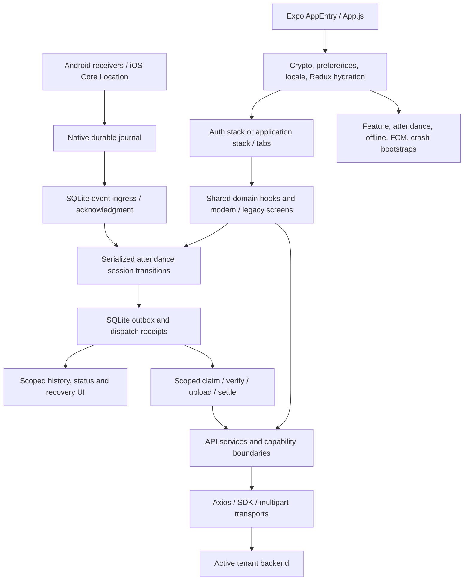

# Application architecture audit

Audit date: 4 November 2026 (Asia/Kolkata). Source baseline: `fa3ed0352d13fe3c26a24978f30453a899d11c7d`; initial working tree clean. This report supplements the maintained architecture references; it does not treat earlier audit reports as fresh validation.

## Installed baseline

| Area | Observed implementation |
| --- | --- |
| Runtime | Expo **57.0.27**, React Native **0.86.3**, React **19.2.3**, Hermes, New Architecture. Node **22.14.0**, npm **10.9.2**. |
| Dependencies | npm/package-lock; TypeScript **6.0.3** installed, but no application tsconfig or typecheck script. `npm ls --all --json` reports no dependency-tree problems. No dependencies changed. |
| Server state | TanStack Query **5.90.16**; shared client, authentication-generation invalidation clears cache. Default retry/cache policies unless overridden by a domain hook. |
| Local state | Redux Toolkit, redux-persist over AsyncStorage; entire root persisted. Protected-data/background read failures retry; no rehydrate timeout that silently replaces authentication. |
| Networking | Axios **1.13.2**, request-time tenant/token/employee context, one shared refresh, endpoint-specific result/error contracts. Mobile SDK uses lazy `expo/fetch`; multipart upload paths have separate global-fetch behavior. |
| Native builds | Committed iOS project/Pods installation; generated ignored Android project exists locally. Local Expo module owns Kotlin/Swift capture. iOS minimum 16.4; static RNFirebase frameworks. |
| Validation | Jest 29/jest-expo/RNTL, SQL.js-backed queue tests, native-source contract checks and Kotlin journal harness. ESLint correctness/hooks configuration; no checked-in CI workflow or coverage threshold. |
| Release | Local versions; EAS channels development/preview/production, clean-commit requirement. Version/runtime alignment verified by native configuration tests. No publication, distribution, signing, commit or push performed. |

Expo's [SDK 57 release notes](https://expo.dev/changelog/sdk-57) identify RN 0.86.3 as the memory-regression fix shipped in Expo 57.0.17. The installed versions already include that baseline; no framework upgrade was needed to obtain it.

## Ownership and data flow

`App.js` initializes crash reporting and guarded crypto, registers background push/headless handlers and cleanup, loads fonts/preferences/locale, then mounts providers and bootstraps. After remediation, OTA requests no longer gate this sequence, including a location wake. The update banner checks/downloads in the active foreground and offers explicit application.

The durable session authority is `utils/attendanceSessionState.js`. The transition lock spans execution; queued acceptance differs from server confirmation. Native capture cannot submit directly. SQLite owns durable ingress, FIFO claims, dispatch evidence and reconciliation. Unknown transport/server outcomes remain recoverable; a dispatched uncertain write is not blindly resent.

Authentication generations delimit async ownership. Mobile policy must be complete before sign-in, request credentials stay with the active tenant, transient refresh failure retains authentication, and logout retains attendance records. This audit fixes gaps in QR publication, push continuations and local queue reads without changing endpoint payloads.

## Reachable presentation map

| Surface | Routes / components inspected and validation boundary |
| --- | --- |
| Authentication | `welcome`, `Qrscan`, `login`, `mobile login`; modern/legacy welcome, QR and password; one themed mobile screen. Crypto/flow/provisioning/UI tests cover behavior. Live employee mapping/refresh compatibility remains unverified. |
| Main tabs | Home/HomeLegacy, Chat placeholder, Profile/settings; navigation direction, feature tiles, shortcuts, theme and localization contracts. Chat's retained header now updates on language changes. |
| Attendance | Action, camera, history, request and automatic-attendance variants; shared hooks, session authority, geofence/onboarding, queue/history/recovery UI. Camera and GPS require hardware checks beyond component mocks. |
| HR and records | Leave, complaints, expense claims, loans, resignation, three employee-record shortcuts, My QR, notifications and quick-access variants. Services/capability boundaries and shared forms/list primitives reviewed. |
| Placeholders / unused | ComingSoon and Chat intentionally provide no business workflow. SalaryAdvance source exists but is not registered in the app navigator; no deletion or new exposure introduced. `constants/appInfo.js` remains unused. |

Lists use virtualized lists in modern history/notification flows; attendance requests pages of 20, several HR endpoints return the full result set and reveal five records at a time. Client reveal pagination does not reduce backend payload size. No speculative memoization, library replacement or visual redesign was introduced.

Localization uses an offline i18next instance, four EN/AR resource namespaces, logical layout properties and a locale root. Static validation found 1,458 keys in each language and zero missing literal keys/resource conflicts. This does not validate translations semantically or establish layout/contrast/screen-reader quality on every device.

## Technical risks and boundaries

Full-root persistence and AsyncStorage credentials need an explicit secure-storage/backup migration, including locked-device attendance launches and old binaries. Native journals retain unacknowledged events indefinitely; dropping them would lose payroll evidence, so backlog work must be measured before redesign. Multiple assigned offices still select one physical geofence. No live backend exactly-once contract has been established.

The repository's source/test coverage is broad, but this audit is not an exhaustive physical-device certification. All navigated areas were mapped and critical services/native boundaries traced; the entire screen matrix was not manually exercised with authenticated staging accounts. See [readiness and validation](README.md) and subsystem reports for specific unresolved gates.
